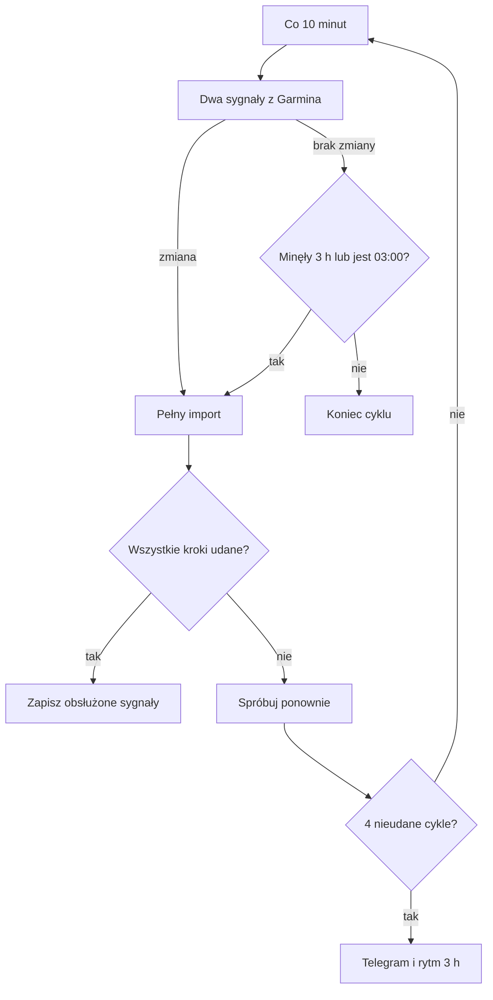

# Strażnik importu Garmina

## Co to jest

To automat, który pilnuje pobierania danych z Garmina do QBota. Oddziela lekkie sprawdzenie, czy coś się zmieniło, od pełnego importu. Gdy import się nie powiedzie, ponawia go i w końcu zwalnia tempo prób.

## Po co

Bez świeżego importu w QBotcie mogą brakować snu, wellness, energii, jazd lub danych serca. Strażnik ma wykryć przerwę i spróbować ją nadrobić.

## Skąd dane

Co 10 minut sprawdza dwie rzeczy w Garminie: czas ostatniego użycia urządzenia oraz najnowszą aktywność na koncie. Przy pełnym imporcie przechodzi kolejno przez masę, sen, energię, wellness, trening, aktywności i dane serca. HRV (zmienność rytmu serca; zobacz [słowniczek](../slowniczek.md)) może zostać dopisane z opóźnieniem. Sekwencja jest zapisana w kodzie; pełny zakres nie oznacza, że każdy import ma nowe rekordy.

## Jak liczone

1. **Sprawdź sygnały.** Zmiana czasu synchronizacji lub identyfikatora ostatniej aktywności oznacza, że dane mogły się zmienić.
2. **Uruchom pełny import.** Po zmianie wykonuje się import, a potem jeszcze przez 3 kolejne cykle, bo Garmin może dopisywać sen, HRV i Body Battery z opóźnieniem.
3. **Zastosuj siatkę bezpieczeństwa.** Pełny import rusza także co 3 h, nawet jeśli lekkie sprawdzenie nie zauważyło nowej aktywności. W godzinie 03:00 lokalnego czasu domyka dane za poprzedni dzień.
4. **Ponów błędy.** Nieudany import jest ponawiany w następnym cyklu. Po 4 nieudanych cyklach sygnał zostaje oznaczony, alarm jest wysyłany i kolejne pełne próby wracają do rytmu co 3 h.
5. **Zgłoś brak połączenia.** Brak łączności przez ponad godzinę daje Telegram. Powiadomienia są ograniczone do jednego na 6 h.
6. **Przykład sprawdzenia.** Kod Statusu z 18.10.2026 uznaje sprawdzenie starsze niż 45 min za błąd, a import starszy niż 4 h za ostrzeżenie. To progi prezentacji Statusu, odrębne od harmonogramu samego automatu.



## Gdzie to widać

Stan importu jest na stronie SETUP → Połączenia → Status. Błąd dłuższy niż godzinę lub seria nieudanych importów może trafić do Telegrama. Zrzut [Statusu](../img/ekrany/status.png) pokazuje wiersz „Garmin → QBot (import)” i czas ostatniej kontroli. Zrzut sam nie potwierdza działania importu w chwili czytania.

## Jak czytać

- „Kontrola działa” oznacza, że strażnik niedawno sprawdził Garmin. Nie gwarantuje, że wszystkie kategorie danych odświeżyły się w tym samym momencie.
- Ostrzeżenie o starym imporcie oznacza opóźnienie. Sprawdź także informację o błędnej części, jeśli jest podana.
- Telegram o braku połączenia oznacza, że nowe dane nie trafiają do QBota; do czasu naprawy nie zakładaj, że sen, gotowość lub jazdy są świeże.
- Cztery nieudane cykle ograniczają częstotliwość prób do 3 h, a nie wyłączają import na stałe.

## Gdy Garmin każe zalogować się ponownie

Czasem Garmin unieważnia zapisane logowanie QBota i przy nowym logowaniu żąda kodu weryfikacyjnego (MFA) z maila lub aplikacji. Automat nie może tego kodu wpisać sam. Wtedy:

1. Wszystkie importy Garmina przestają próbować się logować, żeby Garmin nie zablokował konta za zbyt wiele prób.
2. W dzwonku pojawia się „Garmin: zaloguj QBota ponownie”, a Status pokazuje „Garmin wymaga ponownego logowania z kodem”.
3. Zaloguj QBota jedną komendą w Terminalu na Macu (zapyta o kod):

```
ssh -t q 'runuser -u qbot -- /opt/qbot/app/.venv/bin/python3 /opt/qbot/app/scripts/garmin_login.py'
```

Po udanym logowaniu wstrzymanie znika samo, a import rusza przy najbliższym sprawdzeniu (do 10 min).

Gdy Garmin odpowiada „za dużo prób” (błąd 429), import robi 60 min przerwy i sam próbuje ponownie. Nic nie trzeba robić.

## Decyzje i historia

21.10.2026: awaria importu 11:19. Zadanie Garmina działające na koncie administratora (root) odświeżyło plik logowania i zostawiło go tylko dla siebie. Strażnik działa na koncie `qbot`, więc nie mógł go przeczytać i logował się od zera, a Garmin zażądał kodu MFA. Od tej pory każde logowanie oddaje plik kontu `qbot`, a żądanie kodu lub blokada 429 wstrzymuje próby i daje znać w dzwonku (`garmin_auth.py`).


8.10.2026 ujednolicono importy Garmina pod jednym strażnikiem. Zastąpił wiele okien godzinowych dla snu, wellness, kalorii, treningów, aktywności i masy. Import serca dodano do sekwencji 12.10.2026, po imporcie aktywności. Starsze wpisy dokumentacji opisujące rytm 15-minutowy są nieaktualne: obecny timer systemowy ma 10 min.

## Ograniczenia i pułapki

- Jeśli sprawdzenie lekkie nie może połączyć się z Garminem, sam strażnik może nie wiedzieć, czy pojawiły się nowe dane.
- Pełny import ma limit czasu 15 min dla każdego składowego zadania; nieudany krok może opóźnić świeżość danej kategorii.
- Powiadomienie nie naprawia logowania do Garmin Connect ani nie gwarantuje, że urządzenie zsynchronizowało się z usługą Garmin.
- `qbot_status_checks.garmin_import` ocenia ostatni stan, a nie uruchamia importu. W jego opisie znaleziono rozjazd z rzeczywistym timerem: kontrola spodziewa się 10 min, zgodnie z timerem, ale starsze komentarze i dziennik wiki wspominały 15 min.

## Wpływa na / Zależy od

- **Wpływa na:** świeżość danych snu, wellness, energii, treningów, aktywności i serca używanych w kolejnych obliczeniach.
- **Zależy od:** dostępności usługi Garmin, stanu autoryzacji i poprawnego zakończenia zadań importu.

## Powiązane hasła

- [Garmin](../polaczenia/garmin.md)
- [Status](../system/status.md)
- [Automaty](../system/automaty.md)
- [Strażnicy QBota](index.md)

## Zrodla

- `/opt/qbot/app/scripts/garmin_watch.py` — harmonogram, warunki importu, ponawianie i alarm.
- `/opt/qbot/app/qbot_status_checks.py` — check `garmin_import` i progi Statusu.
- `/etc/systemd/system/qbot-garmin-watch.timer` — interwał kontroli co 10 min.
- `/opt/qbot/app/qbot3/connectors/import_garmin_heart.py` — import serca.
- `/opt/qbot/app/docs/DECISIONS.md` — decyzja z 08.10.2026.
