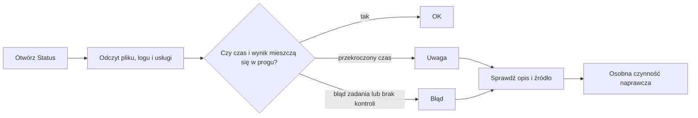

# Kontrola importu widoczna w Statusie

## Co to jest

Status zbiera wyniki kilku niezależnych sprawdzeń i pokazuje je w jednym miejscu. Sam odczyt Statusu nie uruchamia importu, nie ponawia zadania i nie poprawia danych. Dla Garmina pracę wykonuje osobny [strażnik](garmin.md).

## Po co

To szybki sposób, by rozróżnić: „ostatnio sprawdzono i działa”, „dane są stare” oraz „ostatnie uruchomienie zakończyło się błędem”. Przy diagnozie warto otworzyć szczegóły konkretnego połączenia.

## Skąd dane

Kontrola odczytuje pliki stanu, końcówki logów oraz stan jednostek systemowych. Sprawdza między innymi import Garmin, synchronizację Hammerhead, Withings, kopię bazy i cotygodniowy audyt. Status nie ma osobnego harmonogramu naprawczego; wynik jest składany, gdy pyta o niego strona lub narzędzie.

## Jak liczone

1. **Odczytaj ostatni czas.** Jeśli pliku stanu albo danych brakuje, check może zwrócić „błąd” lub „uwaga”.
2. **Porównaj z progiem właściwym dla źródła.** W kodzie Statusu Garmin: sprawdzenie starsze niż 45 min jest błędem, a brak pełnego importu przez ponad 4 h jest ostrzeżeniem. Synchronizacja Hammerhead starsza niż godzina jest błędem. Kopia starsza niż 60 h jest ostrzeżeniem.
3. **Sprawdź rezultat zadania.** Nieudane części importu lub nieudany wynik systemd zmieniają stan na ostrzeżenie albo błąd.
4. **Przykład dla czytelnika.** Jeśli strona Status pokazuje Garmin „ostatnie sprawdzenie 10 min temu”, to spełnia próg 45 min. Nie dowodzi jednak, że nowy sen został już pobrany — sprawdź osobno czas ostatniego importu.
5. **Rozróżnij sygnał i naprawę.** Status informuje o stanie. Naprawa może wymagać sprawdzenia logowania, urządzenia lub osobnego zadania importu.

## Gdzie to widać

SETUP → Połączenia → Status. Na zrzucie [status.png](../img/ekrany/status.png) szukaj wiersza „Garmin → QBot (import)”; opis pokazuje czas sprawdzenia i ostatniego importu. Zrzut obrazuje miejsce w interfejsie, nie aktualny stan.

## Jak czytać

- `OK` oznacza, że sprawdzone warunki są spełnione w chwili odczytu.
- `Uwaga` wskazuje przeterminowany lub niepełny stan, który warto sprawdzić.
- `Błąd` oznacza awarię sprawdzenia lub zadania, niekoniecznie uszkodzenie wszystkich danych.
- „Wyłączone” może oznaczać celowo nieużywane połączenie.

## Decyzje i historia

Status jest wspólnym odczytem dla strony SETUP i wybranych narzędzi. W dokumentacji z 18.10.2026 wspomniano, że kod opisuje interwał Garmina jako 10 min; timer systemowy potwierdza 10 min. Nie należy mylić czasu ostatniego lekkiego sprawdzenia z czasem ostatniego pełnego importu.

## Ograniczenia i pułapki

- Status jest migawką; po chwili może być już nieaktualny.
- Widok sprawdza tylko wymienione punkty. Zielony stan nie dowodzi, że każda kategoria danych jest kompletna.
- Część checków nie wysyła alertu do Telegrama i nie wykonuje naprawy.
- Widok Statusu nie ma własnego harmonogramu uruchamiania; niepotwierdzone jest automatyczne powiadomienie przy każdej zmianie stanu.

## Wpływa na / Zależy od

- **Wpływa na:** informację pokazywaną w Statusie i wskazówki do ręcznej diagnozy.
- **Zależy od:** aktualności plików stanu, logów i odpowiedzi systemd.

## Powiązane hasła

- [Status](../system/status.md)
- [Automaty](../system/automaty.md)
- [Strażnik Garmina](garmin.md)
- [Strażnicy QBota](index.md)

## Zrodla

- `/opt/qbot/app/qbot_status_checks.py` — `garmin_import`, `hammerhead`, `backup`, `_timer_service`.
- `/opt/qbot/app/qbot_status_api.py` — udostępnienie kontroli Statusu.
- `/opt/qbot/app/docs/STATUS.md` — opis pozycji Statusu.
- `/etc/systemd/system/qbot-garmin-watch.timer` — rytm sprawdzenia Garmina.
