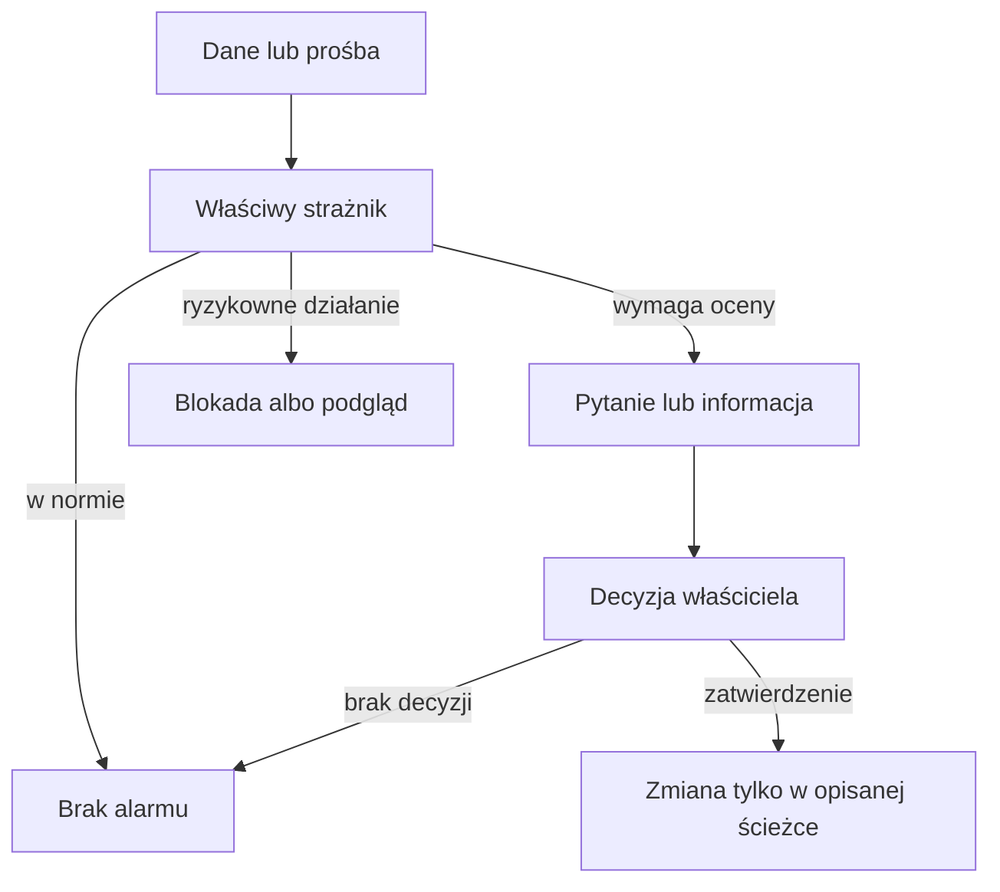

# Strażnicy QBota

## Co to jest

Strażnicy to automatyczne kontrole. Jedne tylko wysyłają pytanie, inne sprawdzają, czy import działa, a jeszcze inne blokują niebezpieczną prośbę. Nie ma jednego wspólnego alarmu ani jednej listy progów.

## Po co

Pomagają zauważyć problem, zanim błędne dane wpłyną na formę, plan lub raport. Wiadomość strażnika zwykle prosi o sprawdzenie. Nie oznacza sama z siebie, że dane zostały poprawione.

## Skąd dane

Zależnie od strażnika: z jazd i pomiarów, sygnałów zegarka, wpisów żywieniowych, historii ModelQ albo treści prośby. W tabeli niżej podano potwierdzone pory działania. „Codzienny przebieg” oznacza, że kontrola jest elementem nocnego przeliczenia, nie osobny timer.

## Jak liczone

1. **Moc i obciążenie:** nocny przebieg około 04:45 porównuje XSS (miarę obciążenia treningowego; [słowniczek](../slowniczek.md)) z mocy i tętna dla nowych jazd. 18.10.2026 jazda trwała 2 h 27 min, a stosunek wyniósł 0,82; wynik zapisano jako „OK”.
2. **Korekta ciała:** raz dziennie sprawdzane są różnice i świeżość danych. 16.10.2026 zapisano alert „SILA”: korekta ciała +55 przy formie 55.
3. **ModelQ:** w poniedziałki sprawdzane są granice i wiek kotwicy; w pierwszy poniedziałek miesiąca dochodzi porównanie z Xertem. 18.10.2026 próg ModelQ wynosił 240,7 W, Xert 230 W, różnica 4,7% względem Xerta.
4. **Import i żywienie:** Garmin sprawdza sygnały co 10 min, a pełne dane pobiera warunkowo; strażnik żywienia wysyła poranny przegląd. Szczegóły są na osobnych stronach niżej.
5. **Blokady:** prośba o usunięcie wszystkich tras zostaje zatrzymana przed uruchomieniem narzędzia. Pojedyncze kasowanie trasy wymaga osobnego podglądu i potwierdzenia.

| Strażnik | Co pilnuje | Kiedy | Skutek |
|---|---|---|---|
| [Obciążenie i kwarantanna](obciazenie.md) | Rozjazd obciążenia z mocy i tętna; podejrzane jazdy | Nocny przebieg, jazdy z ostatnich 10 dni | Telegram pyta; po wyborze można zachować moc albo przełączyć tę jazdę na tętno |
| [Korekta ciała](cialo.md) | Duża korekta, braki danych, dominacja sygnału, trwała różnica świeżości | Codziennie | Telegram do analizy; bez automatycznej zmiany |
| [ModelQ](modelq.md) | Granice progu i zapasu, stara kotwica, porównanie z Xertem, niski W′bal | Nocny przebieg; zależnie od kontroli poniedziałek lub po jeździe | Telegram; sygnatura nie zmienia się sama |
| [Garmin](garmin.md) | Czy urządzenie ma nowe dane i czy importy kończą się poprawnie | Timer co 10 min; import przy zmianie, co 3 h lub nocą | Ponawia import; po awariach wysyła alarm |
| [Żywienie](zywienie.md) | Puste dni i dni z nienaturalnie małą sumą energii | Timer skonfigurowany na codziennie 08:00 | Poranny status lub przypomnienie w Telegramie |
| [Import i Status](import.md) | Świeżość wybranych automatów i ich ostatni wynik | Status odczytuje stan przy wyświetleniu; osobny harmonogram kontroli statusu niepotwierdzony | Pokazuje OK, uwagę albo błąd; sam nie naprawia |
| [Ochrona przed kasowaniem](destrukcja.md) | Destrukcyjne polecenia w rozmowie | Przy każdej prośbie do Alberta | Blokuje masowe kasowanie; dla jednej trasy wymaga potwierdzenia |
| [Pozostałe kontrole](pozostale.md) | Limity map, kompletność tras, poprawność zapisów, kandydat przełomu progu | Przy żądaniu lub w nocnym przebiegu | Zatrzymuje wybrane zapisy albo pokazuje ostrzeżenie; przełom wymaga zgody |

W kodzie są też kontrole o węższym zakresie: [ponowny przegląd progu](modelq.md#ponowny-przeglad-progu-tp), [pytanie o zapas W′bal](modelq.md#pytanie-o-odczucie-przy-niskim-zapasie) oraz [plan żywienia](zywienie.md#ograniczenie-duzego-deficytu). Opisane są na stronach właściwych tematów, bo działają jako część przeliczenia lub po zdarzeniu.

## Gdzie to widać

Najczęstszy kanał to Telegram. Stan importów widać też w SETUP → Połączenia → Status. Strażnicy nie mają jednej wspólnej strony. Zrzut [Statusu](../img/ekrany/status.png) pokazuje wiersze stanu połączeń; nie pokazuje wszystkich strażników i nie jest rejestrem ich alertów.

## Jak czytać

Jeśli Telegram pyta „Moc OK?” albo o odczucie przy niskim zapasie, odpowiedz zgodnie z tym, co pamiętasz z jazdy. Jeśli wiadomość mówi o brakujących danych, najpierw sprawdź synchronizację. Jeśli operacja została zablokowana, zawęź prośbę albo przejdź przez wymagany podgląd. Progi i możliwe skutki opisują osobne hasła.

## Decyzje i historia

18.10.2026 wycofano dawny strażnik miernika oparty na mocy względem tętna. Dawał fałszywe alarmy po zmianie czujnika i przy różnej intensywności. P@HR pozostało wskaźnikiem formy, a pytanie o wiarygodność konkretnej jazdy zadaje teraz strażnik obciążenia. Szczegóły są na stronie [obciążenia](obciazenie.md).

## Ograniczenia i pułapki

- Brak wiadomości nie gwarantuje poprawności danych. Nie każdy mechanizm wysyła Telegram.
- Tabela wymienia mechanizmy odnalezione w zadanym zakresie kodu i dokumentacji, nie wszystkie progi walidacji każdego formularza.
- Nie potwierdzono dostarczenia każdej wiadomości Telegram do urządzenia.
- Aktualny timer Garmina działa co 10 min, choć stary wpis w dokumentacji Statusu wspomina co 10 min, a część starszych notatek mówi o 15 min. Stan sprawdzono z timera na hoście.

## Wpływa na / Zależy od

- **Wpływa na:** widoczne powiadomienia, status importów, decyzję o sposobie policzenia wybranej jazdy i bezpieczeństwo kasowania tras.
- **Zależy od:** zegara automatów, danych zapisanych przed uruchomieniem i reguł konkretnego mechanizmu.

## Powiązane hasła

- [Automaty](../system/automaty.md)
- [Status](../system/status.md)
- [Bezpieczniki ModelQ](../modelq/bezpieczniki.md)
- [Słowniczek](../slowniczek.md)

## Zrodla

- `/opt/qbot/app/fitmodel/daily_job.py` — kroki `load_guard`, `real_load_guard`, `modelq_guard`, `wbal_feel`, `tp_recheck`.
- `/opt/qbot/app/scripts/garmin_watch.py` — rytm i reguły importu.
- `/opt/qbot/app/scripts/nutrition_watchdog.py` — dzienny status żywienia.
- `/opt/qbot/app/qbot_status_checks.py` — odczyty stanu importów.
- `/opt/qbot/app/qbot3/agent_runtime.py` — blokada destrukcyjnych próśb.
- `qbot_v2.load_guard`, `real_load_guard_log`, `modelq2_anchor`, `modelq2_signature`, `modelq2_xert_bench`, `fitmodel_ride_quarantine` — odczyty tylko do trzech rekordów.
- `/opt/qbot/app/docs/DECISIONS.md` — decyzje 04.08–18.10.2026.
