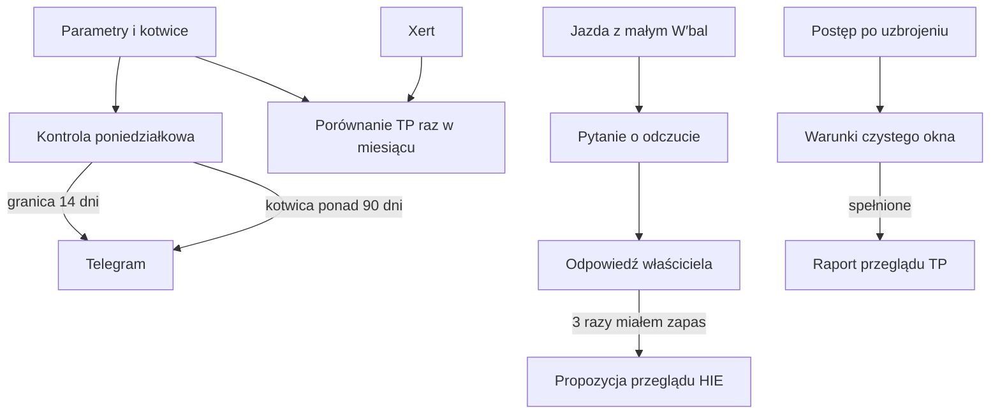

# Kontrole bezpieczeństwa ModelQ

## Co to jest

To kilka niezależnych przypomnień o stanie ModelQ. TP to próg mocy, HIE to zapas intensywności, a W′bal to szacowany pozostały zapas podczas jazdy ([słowniczek](../slowniczek.md)). Kontrole wysyłają informację lub pytanie; nie poprawiają samodzielnie sygnatury.

## Po co

Model może długo używać ograniczonego dryfu, opierać się na starej kotwicy albo odbiegać od niezależnego sprawdzianu. Podczas jazdy porównanie W′bal z odczuciem pomaga ocenić, czy zapas jest wiarygodny.

## Skąd dane

Kontrola jest elementem nocnego przebiegu około 04:45. Cotygodniowa część porównuje aktualne parametry z kotwicami. Comiesięczna część czyta najnowszy sprawdzian z Xertem. Inne kontrole korzystają z wyniku W′bal jazdy lub uruchamiają ponowny przegląd po osiągnięciu warunku czasu, jazd, godzin albo kilometrów.

## Jak liczone

1. **Granica ograniczenia.** W poniedziałki kod sprawdza, czy TP lub HIE pozostaje przy granicy dryfu przez co najmniej 14 dni. Tolerancja wynosi 2% od odpowiedniej granicy.
2. **Wiek kotwicy.** Powiadomienie powstaje, gdy ostatnia kotwica jest starsza niż 90 dni.
3. **Porównanie z Xertem.** W pierwszy poniedziałek miesiąca różnica TP większa niż 5% względem Xerta proponuje przegląd. HIE Xerta jest pokazane informacyjnie, nie jest podstawą zmiany.
4. **Przykład rzeczywisty.** 18.10.2026 ModelQ miało TP 240,7 W, a zapis Xerta 230 W. Różnica to (240,7−230) ÷ 230 × 100 = 4,7%, czyli mniej niż próg 5%. Ostatnia kotwica z 14.10 miała 4 dni.

### Pytanie o odczucie przy niskim zapasie

5. **Pytanie po jeździe.** Od 15.10 kontrola pyta o odczucie, gdy minimalne W′bal w jeździe wynosi najwyżej 5%. Odpowiedź „miałem zapas” w trzech kolejnych kwalifikujących się odpowiedziach w ciągu 90 dni daje propozycję przeglądu HIE. Odpowiedź nie zmienia ModelQ.

### Ponowny przegląd progu TP

6. **Ponowny przegląd TP.** Uruchamia się w nocnym przebiegu. Warunek może nadejść po 21 dniach, 8 jazdach, 15 godzinach albo 400 km od uzbrojenia. Musi też minąć wpływ choroby, a 28-dniowe okno EF musi zawierać co najmniej 8 czystych segmentów. Wynikiem jest raport, nie zmiana TP.
7. **Deduplikacja.** Alerty ModelQ tego samego rodzaju nie powtarzają się częściej niż co 7 dni.

Wzor

Różnica względem Xerta = (TP ModelQ − TP Xert) ÷ TP Xert × 100%. Dla 18.10.2026: (240,7 − 230) ÷ 230 × 100% = 4,7%. Alert porównawczy wymaga wartości większej niż 5% co do wartości bezwzględnej.

## Gdzie to widać

Wiadomości trafiają do Telegrama. Pytanie o W′bal pokazuje datę jazdy, minimalny zapas, TP i HIE oraz trzy przyciski: „Odcięło”, „Blisko”, „Miałem zapas”. ModelQ nie ma osobnego archiwum tych wiadomości na stronie.

## Jak czytać

- Alert o granicy znaczy, że ogranicznik wyznacza wynik przez dłuższy czas; warto rozważyć nową kotwicę.
- Alert starej kotwicy jest przypomnieniem o aktualności punktu odniesienia, a nie automatycznym unieważnieniem ModelQ.
- Różnica Xerta powyżej 5% to propozycja przeglądu. Odpowiedź zawsze należy do właściciela.
- Jeśli przy bardzo niskim W′bal miałeś zapas, zaznacz to. Jedna odpowiedź nie zmienia parametrów.
- Pytania o odczucie nie obejmują jazd liczonych z tętna i nie dotyczą jazd przed 15.10.2026.

## Decyzje i historia

Kontrole granic i Xerta dodano po przeglądzie ModelQ z 14.10.2026, gdy HIE długo pozostawało na ograniczeniu. Pytanie o odczucie wykorzystuje sytuacje, gdy model przewiduje prawie zerowy zapas, ale właściciel nie wykonuje specjalnych testów maksymalnych. Ponowny przegląd TP powstał po uznaniu TP za niepewne w zakresie około 239–256 W; okno EF ma czekać na ustąpienie wpływu choroby. Wcześniejsza strona [Bezpieczniki ModelQ](../modelq/bezpieczniki.md) zawiera skrócony opis.

## Ograniczenia i pułapki

- Nie znaleziono żadnego wpisu w `modelq_guard_log`; tabela nie istniała w chwili odczytu. Nie potwierdzam więc rzeczywistego alertu z tych bezpieczników ani dostarczenia Telegrama.
- Przykład z 18.10 potwierdza różnicę poniżej progu, nie pełną historię poniedziałkowych kontroli.
- Sam Xert nie jest źródłem, z którego ModelQ automatycznie przejmuje TP.
- Kontrola TP może czekać na czyste okno po chorobie. Brak raportu nie oznacza braku wyzwalacza.

## Wpływa na / Zależy od

- **Wpływa na:** przypomnienia i propozycje przeglądu; bezpośrednia zmiana ModelQ wymaga oddzielnej decyzji i działania.
- **Zależy od:** sygnatury, kotwic, rekordu Xerta, zapisów jazdy oraz kalendarza zdrowia.

## Powiązane hasła

- [Bezpieczniki ModelQ](../modelq/bezpieczniki.md)
- [TP](../modelq/tp.md)
- [HIE](../modelq/hie.md)
- [Kotwice](../modelq/kotwice.md)
- [Xert](../modelq/xert.md)
- [Strażnicy QBota](index.md)

## Zrodla

- `/opt/qbot/app/fitmodel/modelq_guard.py` — granice, wiek kotwicy, Xert i deduplikacja.
- `/opt/qbot/app/fitmodel/wbal_feel.py` — pytanie i próg W′bal.
- `/opt/qbot/app/fitmodel/tp_recheck.py` — warunki ponownego przeglądu TP.
- `/opt/qbot/app/fitmodel/daily_job.py` — harmonogram kroków.
- `qbot_v2.modelq2_anchor`, `modelq2_signature`, `modelq2_xert_bench` — wartości z 18.10.2026.
- `/opt/qbot/app/docs/DECISIONS.md` — decyzje 04.10, 14.10 i 18.10.2026.
