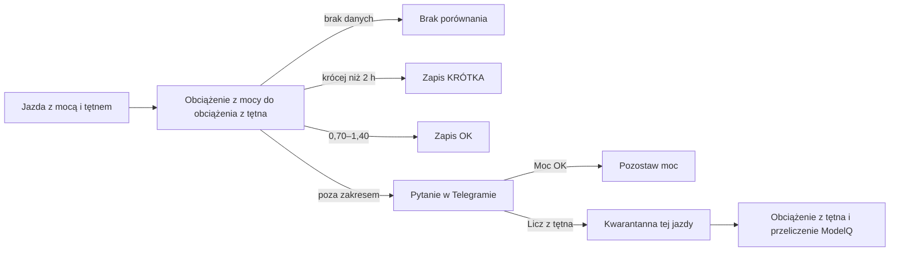
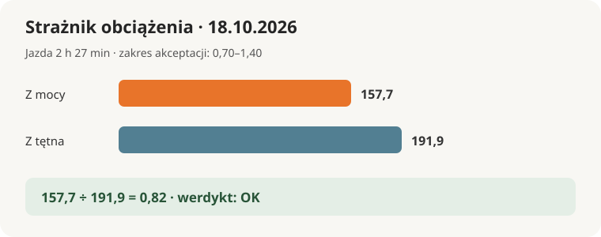

# Strażnik obciążenia i kwarantanna miernika

## Co to jest

Strażnik obciążenia porównuje dwa wyniki obciążenia tej samej jazdy: jeden z mocy, drugi z tętna. XSS (miara obciążenia treningowego; zobacz [słowniczek](../slowniczek.md)) pozwala tu porównać, czy oba sposoby dają zbliżony wynik. Strażnik nie rozpoznaje sam, który czujnik jest winny.

## Po co

Pomaga wyłapać jazdę, w której wskazanie miernika mocy mogło być błędne. Do wyboru są dwie odpowiedzi: zostawić moc albo przeliczyć tę jazdę z tętna. Druga opcja jest zmianą danych dla tej jazdy i wymaga Twojej odpowiedzi.

## Skąd dane

Podczas nocnego przebiegu o 04:45 strażnik sprawdza nowe jazdy z ostatnich 10 dni, które nie były już ocenione. Bierze całkowite obciążenie z mocy, obciążenie z tętna, czas jazdy i średnią temperaturę. Obciążenie z tętna pochodzi z próbek tętna oraz kalibracji wykonanej na czystych jazdach.

## Jak liczone

1. **Sprawdź jakość porównania.** Jeśli obciążenie z tętna jest mniejsze niż 5 punktów albo brak jednego z wyników, nie ma porównania.
2. **Podziel wynik z mocy przez wynik z tętna.** Dla jazdy 18.10.2026 było to 157,7 ÷ 191,9 = 0,82. Czas wynosił 8 815 sekund, czyli 2 h 27 min.
3. **Zastosuj progi.** Jazda krótsza niż 2 h dostaje „KRÓTKA”. Dla dłuższej jazdy stosunek od 0,70 do 1,40 oznacza „OK”; poza tym zakresem oznacza „SPRAWDŹ” i pytanie w Telegramie.
4. **Przyjmij Twoją decyzję.** „Moc OK” zachowuje obciążenie z mocy. „Licz z tętna” zapisuje jazdę do kwarantanny, zastępuje jej obciążenie wynikiem z tętna i ponownie przelicza ModelQ.
5. **Pamiętaj o odrębnych filtrach.** Kwarantanna nie oznacza, że trening się nie odbył. Jazda może nadal liczyć się jako obciążenie z tętna, lecz odpada z wybranych obliczeń opartych na mocy.

Wzor

Stosunek = obciążenie z mocy ÷ obciążenie z tętna. W dniu 18.10.2026: 157,7 ÷ 191,9 = 0,82. Ponieważ jazda trwała ponad 2 godziny, a 0,82 mieści się między 0,70 a 1,40, kod nadał „OK”.

## Gdzie to widać

Gdy wynik wypada poza zakresem dla długiej jazdy, Telegram pokazuje dzień, czas, oba wyniki, ich stosunek oraz przyciski „Moc OK” i „Licz z tętna”. Przy temperaturze poniżej 14°C i stosunku powyżej 1 wiadomość dodaje uwagę o chłodzie. Nie ma osobnej strony strażnika.

## Jak czytać

- „OK” oznacza, że porównanie mieści się w szerokim zakresie; nie jest certyfikatem dokładności miernika.
- „KRÓTKA” oznacza tylko brak pytania dla jazdy poniżej 2 godzin. Takie jazdy zapisują wynik, bo ich wpływ na obciążenie jest mniejszy.
- „SPRAWDŹ” oznacza sygnał do Twojej oceny, a nie automatyczny werdykt, że miernik jest zepsuty.
- W dniu 18.10.2026 dla jazd z wynikiem „SPRAWDŹ” nie było zapisanych rekordów. Potwierdzone rekordy tego dnia nie oznaczały alertu.
- Jeśli wybierzesz tętno, następne podsumowanie może się zmienić. Sprawdź potwierdzenie w Telegramie i nie traktuj go jako kalibracji sprzętu.

## Decyzje i historia

28.09.2026 wprowadzono ten strażnik zamiast alarmów starego P@HR (mocy przy tym samym tętnie; zobacz [słowniczek](../slowniczek.md)). 18.10.2026 dawny strażnik został wycofany: po zmianie czujnika mylił mierniki, a porównanie P@HR miało rozrzut około ±12% przy progu 8%. P@HR pozostało wskaźnikiem formy bez alarmu. Kwarantanna pozostaje ręcznym wyborem, a nie automatycznym skutkiem podejrzenia.

## Ograniczenia i pułapki

- Kalibracja z tętna sama ma niepewność. Temperatura jest podawana jako kontekst; przy zimnie tętno może być niższe.
- Krótka jazda może zostać zapisana jako „KRÓTKA” bez wiadomości.
- Decyzja „Licz z tętna” zmienia obciążenie tej jazdy i uruchamia przeliczenie. To nie zmienia fizycznego zapisu czujnika ani nie naprawia pliku jazdy.
- Zwolnienie z kwarantanny nie musi samo przeliczyć jazdy ponownie; sprawdź opis [XSS z tętna](../modelq/xss-z-tetna.md).

## Wpływa na / Zależy od

- **Wpływa na:** sposób policzenia obciążenia tej jazdy oraz obliczenia, które pomijają jazdy w kwarantannie.
- **Zależy od:** importu mocy i tętna, kalibracji tętna i nocnego kroku ModelQ.

## Powiązane hasła

- [XSS z tętna](../modelq/xss-z-tetna.md)
- [XSS](../modelq/xss.md)
- [Bezpieczniki ModelQ](../modelq/bezpieczniki.md)
- [Strażnicy QBota](index.md)

## Zrodla

- `/opt/qbot/app/fitmodel/load_guard.py` — progi, werdykt, pytanie Telegram i zastosowanie decyzji.
- `/opt/qbot/app/fitmodel/modelq2/hr_xss.py` — podział obciążenia z tętna.
- `/opt/qbot/app/fitmodel/daily_job.py` — nocne uruchomienie.
- `/opt/qbot/app/fitmodel/modelq2/publish.py` — ponowne przeliczenie po zmianie.
- `/opt/qbot/app/docs/DECISIONS.md` — decyzje 28.09 i 18.10.2026.
- `qbot_v2.load_guard`, `qbot_v2.fitmodel_ride_quarantine` — zapis wyników i decyzji.
