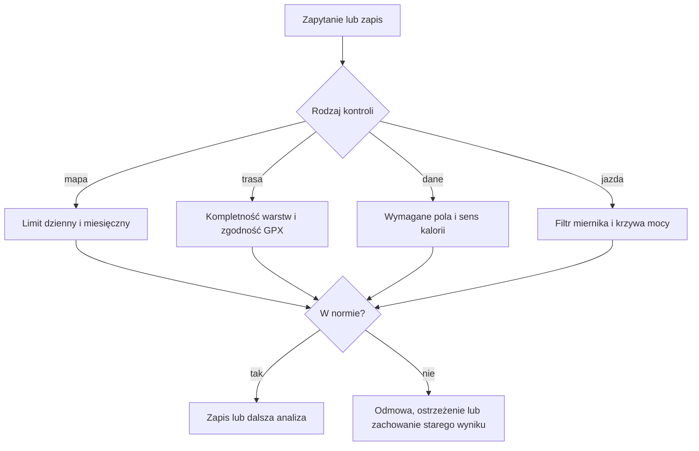

# Pozostałe bezpieczniki danych i kosztów

## Co to jest

Poza strażnikami wysyłającymi Telegram, w kodzie są kontrole uruchamiane tylko wtedy, gdy ktoś zapisuje dane albo prosi o przeliczenie. Chronią przed przekroczeniem limitu płatnej usługi, nadpisaniem dobrego wyniku gorszym, analizą niezgodnego pliku i zapisem niekompletnych danych.

## Po co

Zwykle zobaczysz skutek jako odmowę, ostrzeżenie albo brak publikacji części wyniku. Te kontrole nie są wspólnym monitoringiem i nie muszą wysyłać wiadomości.

## Skąd dane

Każda kontrola działa na swoim wejściu: liczniku map, pliku trasy, warstwach trasy, danych wpisu żywieniowego albo krzywej mocy jazdy.

## Jak liczone

1. **Limit Google Places.** Przed zapytaniem płatna usługa rezerwuje limit. Domyślnie dozwolone jest 300 wywołań dziennie i 1 000 w miesiącu kalendarzowym. Jeśli kolejne wywołanie przekroczyłoby któryś limit, zostaje odrzucone przed wysłaniem zapytania. Baza pokazała 17 wywołań 17.10.2026; to przykład zużycia, nie dowód dzisiejszego limitu.
2. **Podział trasy na dni.** Podział odrzuca nieprawidłowe odległości, cięcia poza trasą, powtarzające się granice, dzień krótszy niż 1 km albo podział na więcej niż 12 dni. Jeśli dzień ma oś trasy, ale nie ma odziedziczonej nawierzchni, zapis jest zatrzymany. Profil wysokości musi pokrywać co najmniej 90% elementów osi.
3. **Zachowanie kompletnego opisu punktów.** Jeśli istnieje już wynik oznaczony jako kompletny, a nowe pobranie jest częściowe albo błędne, nowy wynik nie zastępuje starego. Użytkownik dostaje status „zachowano istniejący pełny wynik”.
4. **Kontrola zgodności pliku trasy.** Przy analizie etapu dystans z pliku GPX (plik trasy; zobacz [słowniczek](../slowniczek.md)) jest porównany z planowanym dystansem etapu. Rozjazd powyżej 5% daje status częściowy i ostrzeżenie o możliwie nieaktualnym pliku.
5. **Ochrona zapisu kalorii.** Wpis z zerową lub ujemną energią jest blokowany, chyba że nazwa pasuje do jawnych wyjątków napojów/produktów bez kalorii albo dane pochodzą z zatwierdzonego wyszukania. Brak wymaganych pól lub niewłaściwy format daty także blokuje zapis.
6. **Bezpiecznik przełomu progu.** Nocny przebieg porównuje najlepszą moc z krzywą TP + W′/czas. CP (próg krytyczny; zobacz [słowniczek](../slowniczek.md)) jest kandydatem do podniesienia tylko wtedy, gdy jazda przekracza przewidywanie o ponad 1%. Wchodzą tylko jazdy poza kwarantanną, poza przedziałem oznaczonym jako wadliwy i z miernikiem poniżej współczynnika 1,15. Propozycja ogranicza wzrost TP do 3%, a HIE do 15% na zdarzenie. Zapis kotwicy wymaga odpowiedzi „TAK” w Telegramie; prośba wygasa po 48 h.

Wzor

Przykład kontroli pliku: różnica procentowa = |dystans GPX − dystans etapu| ÷ dystans etapu × 100%. Ostrzeżenie pojawia się powyżej 5%. Rzeczywistych danych konkretnego etapu z bieżącego odczytu nie pobierano.

## Gdzie to widać

Zależnie od kontroli: komunikat błędu przy zapisie, ostrzeżenie częściowej analizy etapu, status zachowania kompletnego wyniku punktów albo pytanie „TAK/NIE” dla kandydata na podniesienie progu. Dla limitu Google Places użytkownik może dostać odmowę wygenerowania części wzbogacenia trasy.

## Jak czytać

- Odmowa oznacza, że kontrola nie pozwoliła wykonać konkretnej operacji. Sprawdź, który limit lub warunek został wymieniony.
- „Częściowo” oznacza, że wynik istnieje, ale jego wejście nie przechodzi kontroli jakości.
- Zachowany kompletny wynik oznacza, że system wolał nie zastępować dobrych danych niepełnymi.
- Pytanie o przełom progu jest propozycją; bez Twojej odpowiedzi nowa kotwica nie zostaje przyjęta.

## Decyzje i historia

Limity Google Places podniesiono z 200 do 300 na dobę 05.10.2026; limit miesięczny wynosi domyślnie 1 000. Strażnik zachowania pełnych danych POI wprowadzono 02.07.2026. Przełom CP działa w trybie pytania o zgodę; wcześniejszą metodę opartą na samym W′bal odrzucono po fałszywych alarmach.

## Ograniczenia i pułapki

- Limity Google są konfigurowalne przez zmienne środowiskowe; wartości 300 i 1 000 to domyślne ustawienia kodu.
- Tabela licznika pokazuje rezerwacje, niekoniecznie udane odpowiedzi dostawcy map.
- Ograniczenia trasy chronią wybrane ścieżki podziału i analizy; nie gwarantują poprawności wszystkich innych warstw.
- Nie znaleziono rekordu kandydatury przełomu w tabeli podczas krótkiego odczytu. Progi są potwierdzone w kodzie, ale rzeczywistego alertu nie potwierdzono.
- Nie ma harmonogramu osobnego dla tych kontroli; są uruchamiane przez zdarzenie, zapis lub dzienny przebieg.

## Wpływa na / Zależy od

- **Wpływa na:** koszt zapytań, kompletność i wiarygodność wybranych analiz oraz dopuszczenie zapisów.
- **Zależy od:** danych wejściowych, zapisanych liczników, kompletności warstw i aktywnych reguł walidacji.

## Powiązane hasła

- [Analiza tras](../trasy/index.md)
- [Strażnik obciążenia](obciazenie.md)
- [Żywienie](zywienie.md)
- [Strażnicy QBota](index.md)

## Zrodla

- `/opt/qbot/app/qbot3/routes/google_places_budget.py` — limity i rezerwacja wywołań.
- `/opt/qbot/app/qbot3/routes/planer_stage_export.py` — ograniczenia podziału i kompletności.
- `/opt/qbot/app/qbot3/routes/route_poi_store.py` — zachowanie kompletnego wyniku.
- `/opt/qbot/app/qbot3/tool_registry.py` — kontrola różnicy dystansu GPX.
- `/opt/qbot/app/qbot3/safety.py` — walidacja i strażnik zerowych kalorii.
- `/opt/qbot/app/fitmodel/cp_breakthrough.py` — filtr miernika i kandydat przełomu.
- `qbot_v2.google_places_usage`, `qbot_v2.cp_breakthrough` — krótkie odczyty 17–18.10.2026.
