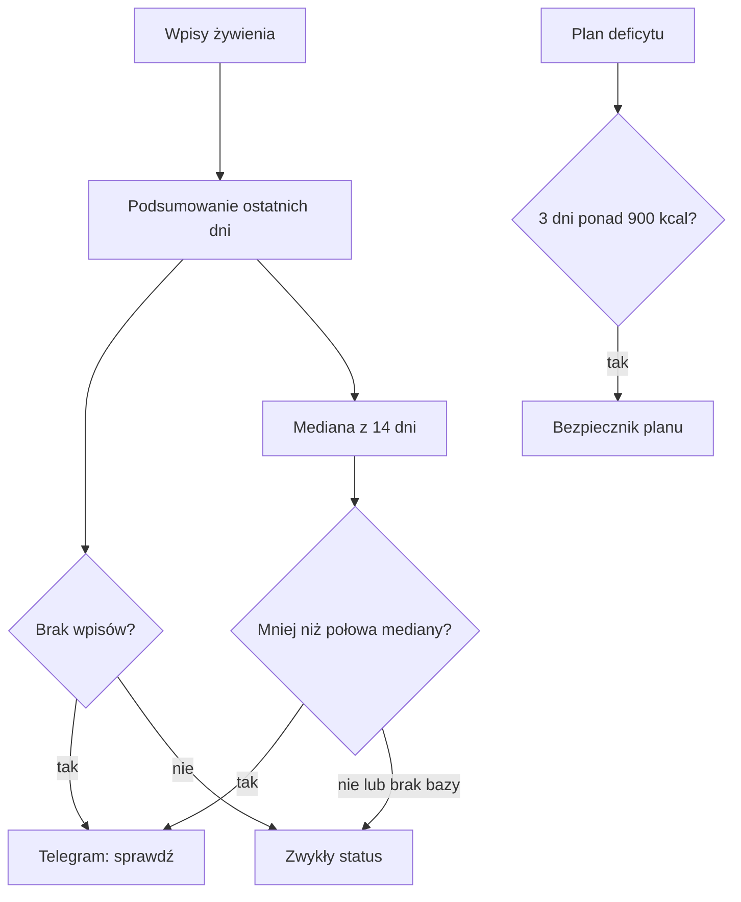

# Strażnik żywienia

## Co to jest

Poranny strażnik wysyła w Telegramie podsumowanie ostatnich dni i zwraca uwagę na dzień bez wpisów albo z bardzo małą sumą kalorii. Osobna reguła planu żywienia chroni przed zaleceniem dużego deficytu przez kilka dni z rzędu.

## Po co

Raport ma pomóc zauważyć, że wpis posiłku zaginął albo dzień nie został uzupełniony. Nie ocenia jakości jadłospisu i nie poprawia wpisów. Reguła planu ogranicza skrajny deficyt, a nie sprawdza, czy wszystkie posiłki zostały zapisane.

## Skąd dane

Raport czyta kanoniczne wpisy żywienia, które widzą raporty QBota, niezależnie od tego, z którego kanału zostały dodane. Dla niskiej sumy porównuje dzień z medianą dni z wpisami z poprzednich 14 dni. Wymaga co najmniej 5 dni bazowych. Domyślnie wysyła trzy ostatnie zamknięte dni o 08:00.

## Jak liczone

1. **Policz dzień.** Zlicz liczbę wpisów i ich energię. Dzień bez żadnego wpisu dostaje oznaczenie „BRAK wpisów”.
2. **Wyznacz punkt odniesienia.** Posortuj sumy kalorii z poprzednich 14 dni, w których były wpisy i suma była większa od zera. Potrzeba co najmniej 5 takich dni.
3. **Porównaj z połową mediany.** Domyślny próg to 50% mediany. Jeśli suma dnia jest poniżej progu, Telegram oznacza ją jako potencjalnie niepełną.
4. **Przykład z bazy.** Dla raportu sprawdzanego 18.10.2026 poprzednie 14 dni miały 8 dni z wpisami i dodatnią energią. Ich posortowane sumy to 1 998, 2 083, 2 249, 2 347, 2 533, 2 604, 2 700 i 2 736 kcal. Mediana = (2 347 + 2 533) ÷ 2 = 2 440 kcal; próg połowy mediany = 1 220 kcal. Dni 15–17.10 miały 2 249, 2 736 i 2 083 kcal, więc żaden nie przekroczył w dół tego progu.
5. **Odrębna blokada planu.** W planie jest bezpiecznik: co najmniej 3 zamknięte dni z rzędu z deficytem ponad 900 kcal. To dotyczy propozycji planu żywienia, nie codziennego Telegrama.

Wzor

Próg dnia = 0,5 × mediana kalorii z maksymalnie 14 poprzednich dni z wpisami. Dla raportu z 18.10.2026 mediana wyniosła 2 440 kcal, a próg 1 220 kcal. W kroku 4 pokazano wszystkie wartości użyte do ręcznego sprawdzenia mediany.

## Gdzie to widać

Timer jest skonfigurowany na 08:00 każdego dnia. Jeśli jest aktywny, raport trafia do Telegrama i może zawierać listę trzech dni, sumę energii, brak danych oraz wezwanie do sprawdzenia niskiej sumy. Reguła planu działa wewnątrz doboru celu żywieniowego i nie ma osobnego przycisku.

## Jak czytać

- „Brak wpisów” oznacza brak zapisu w bazie, nie dowód, że nic nie jadłeś.
- „Poniżej normy” oznacza wynik poniżej połowy własnej mediany, nie ocenę medyczną ani indywidualny cel.
- Jeśli masz mniej niż 5 dni historii, niska suma nie jest oceniana tym progiem.
- Jeśli plan ogranicza deficyt, potraktuj to jako sygnał do sprawdzenia kilku ostatnich dni. Nie wynika z tego automatycznie, że trzeba coś dopisać.

## Decyzje i historia

Strażnik czyta tę samą bazę wpisów co raporty, żeby nie pomijać błędów zależnych od konkretnego kanału zapisu. Próg niskiej sumy i zakres można zmienić parametrami programu; standard to połowa mediany z 14 dni i trzy dni raportu. Bezpiecznik planu jest oddzielną regułą i nie wysyła tego samego raportu.

## Ograniczenie dużego deficytu

Plan żywienia sprawdza trzy zamknięte dni przed planowanym dniem. Jeśli każdy z nich ma deficyt większy niż 900 kcal, kod uruchamia bezpiecznik. To ograniczenie planu, nie alarm o braku wpisu; raport poranny ma własny próg opisany wyżej.

## Ograniczenia i pułapki

- Jedzenie niewpisane do systemu wygląda jak brak danych.
- Dni z wpisami, ale bez dodatniej sumy kalorii, nie wchodzą do mediany.
- Raport domyślnie kończy się na wczoraj; dzień bieżący nie jest zamkniętym podsumowaniem.
- Nie udało się odczytać z systemd, czy timer jest obecnie włączony. Definicja na dysku wskazuje 08:00, ale nie dowodzi aktywnego działania. Przykład bazy nie jest logiem dostarczenia Telegrama.

## Wpływa na / Zależy od

- **Wpływa na:** Twoją kontrolę kompletności wpisów oraz ograniczenie planu żywienia przy serii dużych deficytów.
- **Zależy od:** zapisanych posiłków, wartości energetycznej i poprzednich dni.

## Powiązane hasła

- [Żywienie](../zdrowie/zywienie.md)
- [Energia](../zdrowie/energia.md)
- [Strażnicy QBota](index.md)

## Zrodla

- `/opt/qbot/app/scripts/nutrition_watchdog.py` — zakres dni, mediana, próg i treść Telegrama.
- `/etc/systemd/system/qbot-nutrition-watchdog.timer` — codzienna pora 08:00 Europe/Warsaw.
- `/etc/systemd/system/qbot-nutrition-watchdog.service` — uruchomienie skryptu.
- `/opt/qbot/app/qbot_food_plan.py` — trzy dni z deficytem ponad 900 kcal.
- `qbot_v2.intake_logs`, `qbot_v2.intake_items` — odczyty dni 14–18.10.2026.
