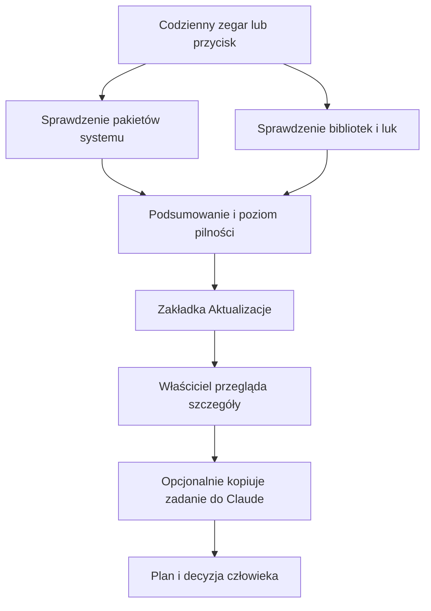

# Aktualizacje serwera

## Co to jest

To ekran w ustawieniach, który zbiera informacje o nowszych wersjach programów na serwerze i o znanych lukach bezpieczeństwa. Sam ekran niczego nie instaluje.

## Po co

Możesz sprawdzić, czy serwer ma oczekujące poprawki, i przekazać Albertowi lub Claude opisane zadanie do przygotowania planu aktualizacji. Klasy „pilne”, „zalecane” i „może poczekać” pomagają ustalić kolejność sprawdzenia.

## Skąd dane

Ekran łączy dwa rodzaje informacji:

- pakiety systemu Ubuntu (systemu operacyjnego serwera): dostępne aktualizacje, poprawki bezpieczeństwa, automatyczne poprawki i informację, czy serwer wymaga restartu;
- biblioteki Pythona: wersje z kilku środowisk programu oraz informacje o znanych lukach z publicznego rejestru OSV (bazy luk bezpieczeństwa; [słowniczek](../slowniczek.md#osv)).

Wynik jest przygotowywany raz dziennie około 05:15. Można też nacisnąć „Sprawdź teraz”. Ten przycisk zleca nowe sprawdzenie w tle. Serwer zapisuje wynik i ekran pokazuje go po odświeżeniu.

## Jak liczone

1. Program pobiera listę pakietów systemowych, które mają nowszą wersję, i sprawdza, czy czeka poprawka bezpieczeństwa.
2. Dla bibliotek Pythona porównuje wersję zainstalowaną z nowszą wersją i sprawdza znane luki.
3. Pozycje dotyczące luk i pilnych poprawek są dzielone na trzy grupy. Pilna oznacza znaną lukę w ważnej bibliotece albo określony czas oczekiwania na poprawkę/restart. Zalecana obejmuje luki w bibliotekach pomocniczych i zwykłe aktualizacje systemu. „Może poczekać” oznacza nowszą wersję bez rozpoznanej luki.
4. Ekran pokazuje liczbę pozycji, szczegóły pakietów i czas ostatniego sprawdzenia. Jeśli sprawdzenie się nie udało, pokazuje problem zamiast udawać, że wszystko jest aktualne.
5. Przycisk „Kopiuj prompt dla Claude” (prompt, czyli instrukcja tekstowa; [słowniczek](../slowniczek.md#prompt)) przygotowuje zadanie do skopiowania. To propozycja do dalszego rozpatrzenia, nie polecenie aktualizacji serwera.

## Gdzie to widać

SETUP → Połączenia → Aktualizacje. Strona pokazuje podsumowanie, pakiety systemu, grupy bibliotek oraz opis znanych luk. Przycisk „Sprawdź teraz” tylko zleca zebranie świeższych danych.

Na zrzucie zakładka Aktualizacje nie jest otwarta, więc nie widać na nim listy pakietów. Nie mam zrzutu aktualnego wyniku z tej zakładki.

## Jak czytać

- **Pilne**: najpierw sprawdź szczegóły i wpływ zmiany. Etykieta nie oznacza, że poprawkę można bezpiecznie zainstalować bez testu.
- **Zalecane**: pozycja wymaga oceny, ale kod nie nadał jej poziomu pilnego.
- **Może poczekać**: wykryto nowszą wersję bez znanej luki w danych z tego sprawdzenia. To nie jest gwarancja braku wszystkich problemów.
- **Wymagany restart**: system sygnalizuje, że część aktualizacji wymaga ponownego uruchomienia.
- **Jeszcze nie sprawdzono** albo widoczny błąd: nie wyciągaj wniosku, że system jest aktualny. Najpierw uruchom sprawdzenie i odczytaj nowy wynik.

Wynik zależy od tego, czy udało się połączyć z serwisem pakietów i rejestrem luk. Data sprawdzenia jest ważna: starszy wynik nie opisuje obecnego stanu.

## Decyzje i historia

19.10.2026: dodano ekran Aktualizacje w SETUP i wiersz tego sprawdzenia w Statusie. Sprawdzenie jest tylko informacyjne; nie instaluje pakietów ani nie restartuje serwera. Automatyczne poprawki bezpieczeństwa systemu Ubuntu są pokazywane osobno od ręcznej aktualizacji bibliotek Pythona.

## Ograniczenia i pułapki

- Wynik może być niepełny, gdy system albo rejestr luk nie odpowiada.
- Nowsza wersja nie oznacza automatycznie, że jest zgodna z QBOTem. Przed zmianą trzeba sprawdzić zależności i działanie programu.
- Etykieta pilności jest regułą porządkowania, a nie oceną ryzyka konkretnego wdrożenia.
- Samo skopiowanie zadania do Claude niczego nie zmienia na serwerze.
- Nie potwierdzałem w tej aktualizacji rzeczywistej zawartości wyniku na stronie ani tego, czy codzienny timer jest aktywny.

## Wpływa na / Zależy od

- Wpływa na: decyzję, które aktualizacje rozpatrzyć w pierwszej kolejności.
- Zależy od: dostępności źródeł pakietów i informacji o lukach oraz świeżości zebranego wyniku.

## Powiązane hasła

- [Status](status.md)
- [Automaty QBota](automaty.md)
- [Strony WWW](strony-www.md)
- [Bezpieczniki i bezpieczeństwo](bezpieczniki.md)

## Zrodla

- `/opt/qbot/app/scripts/updates_check.py` — zbieranie pakietów Ubuntu, wersji bibliotek i informacji OSV; ocena poziomu pilności.
- `/opt/qbot/app/qbot_status_api.py` — odczyt wyniku i zlecenie odświeżenia.
- `/opt/qbot/app/qbot_status_checks.py` — wiersz Aktualizacje na stronie Status.
- `/opt/qbot/web/public/aktualizacje.html` — ekran i sposób prezentacji wyników.
- `/etc/systemd/system/qbot-updates-check.timer`, `qbot-updates-check.service` — zaplanowane sprawdzenie.
