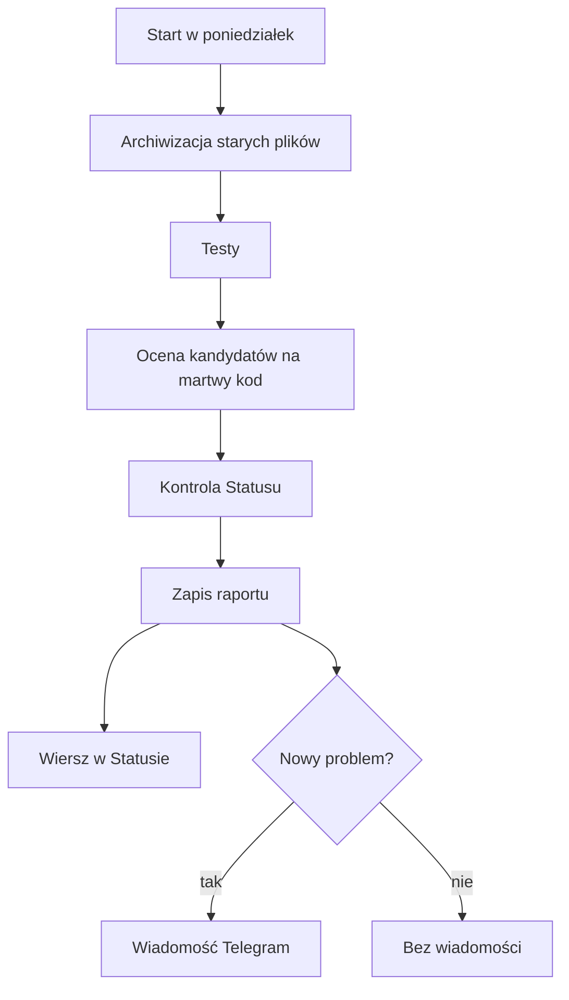

# Audyt tygodniowy

## Co to jest

Audyt tygodniowy to automatyczna kontrola QBota wykonywana raz na tydzień. Obejmuje porządkowanie plików roboczych, uruchomienie testów, ocenę kandydatów na nieużywany kod i sprawdzenie Statusu.

## Po co

Pomaga zauważyć nowe błędy i pokazać, czy ostatni audyt zakończył się poprawnie. Nie zastępuje codziennego sprawdzenia Statusu, bo między kolejnymi audytami może pojawić się nowa awaria.

## Skąd dane

Wynik składa się z daty, liczby testów zakończonych poprawnie, niepowodzeń, elementów do sprawdzenia oraz podsumowania kontroli Statusu. Status odczytuje zapisany wynik. Właściciel nie musi uruchamiać audytu, by obejrzeć ostatni raport.

## Jak liczone

1. W poniedziałek około 02:30 uruchamia się zadanie, z losowym opóźnieniem do 5 minut.
2. Pliki kopii i robocze starsze niż 7 dni są przenoszone do archiwum. Nie są po prostu kasowane.
3. Zadanie uruchamia zestaw testów, ocenia kandydatów na martwy kod, a następnie pobiera Status.
4. Wynik zapisuje się w pliku. Telegram dostaje jedną wiadomość tylko wtedy, gdy pojawił się nowy problem określonego rodzaju.
5. Przykład z zapisu pokazanego w Statusie 18.10.2026: audyt wykonany 15.10 o 17:19 wykazał 993 testy OK i 12 kandydatów na martwy kod. To przykład konkretnego historycznego wyniku; liczby zmienią się po kolejnym audycie.

## Gdzie to widać

SETUP → Połączenia → Status → „Audyt tygodniowy”. Na zrzucie status.png wiersz audytu jest prawie na dole, między bramką a licznikiem starego QBota. Widoczna liczba testów dotyczy ostatniego uruchomienia.

## Jak czytać

Status ostrzega, gdy wynik jest starszy niż 8 dni, gdy nie można go odczytać albo gdy w ostatnim uruchomieniu testy zgłosiły niepowodzenia. „Kandydaci na martwy kod” oznacza pozycje wymagające oceny — to nie lista, którą należy automatycznie usuwać.

Wynik Statusu i wynik testów to dwie różne części raportu. W przykładzie 993 testy zakończyły się dobrze, ale osobno raport zawierał 12 kandydatów do dalszej analizy. Ta liczba nie zmienia zielonego wyniku testów.

Na zrzucie z 18.10.2026 widać wynik z 15.10.2026, 17:19: testy 993 OK i 12 kandydatów. Trzy dni różnicy oznaczają, że wynik jest świeższy niż próg ostrzeżenia ośmiu dni.

## Decyzje i historia

Kontrola wykonuje także działania: archiwizuje stare pliki i uruchamia testy. Z tego powodu nie należy utożsamiać jej z bezpiecznym, czysto odczytowym ekranem Statusu. W tym etapie nie uruchamiałem audytu.

## Ograniczenia i pułapki

Testy mogą trwać długo. Lista kandydatów nie jest decyzją o usunięciu. Telegram ma wysyłać wiadomość o nowych problemach, nie pełny raport za każdym razem. Nie potwierdzałem pracy aktywnego timera systemowego; dokument i kod opisują jego oczekiwany harmonogram.

> DO SPRAWDZENIA: aktywność timera audytu w systemie oraz dokładny czas następnego uruchomienia.

## Wpływa na

- [Status](status.md) — pokazuje podsumowanie ostatniego raportu.
- [Bezpieczniki](bezpieczniki.md) — testy sprawdzają część zabezpieczeń.
- [Centrum powiadomień](centrum-powiadomien.md) — osobna wiadomość o problemie może przyjść Telegramem.

## Zależy od

- Zestawu testów, wyniku kontroli Statusu i miejsca na zapis raportu.
- Zaplanowanego uruchomienia zadania tygodniowego.

## Powiązane hasła

- [Status](status.md)
- [Kopie bazy](kopie-bazy.md)
- [Automaty](automaty.md)

## Zrodla

- `/opt/qbot/app/scripts/weekly_audit.py` — kroki audytu, limity czasu i zapis wyniku.
- `/opt/qbot/app/qbot_status_checks.py` — `weekly_audit` i próg wieku wyniku.
- `/opt/qbot/app/deploy/systemd/qbot-weekly-audit.timer` — oczekiwany harmonogram.
- `/opt/qbot/app/docs/STATUS.md` — opis wiersza audytu.
