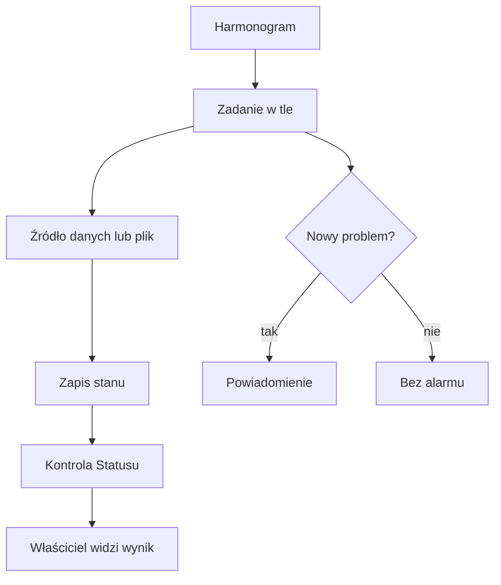

# Automaty QBota

## Co to jest

Automaty to zaplanowane zadania działające bez ręcznego otwierania strony. Przykładami są sprawdzanie nowych danych, cotygodniowy audyt i tworzenie kopii bazy.

## Po co

Automaty pozwalają QBOTowi regularnie sprawdzać źródła i przygotowywać dane. Gdy coś nie działa, warto zobaczyć odpowiedni wiersz w Statusie, a nie uruchamiać zadania ponownie bez rozpoznania przyczyny.

## Skąd dane

Zadania korzystają z harmonogramów systemowych, plików stanu, dzienników i zapisanych danych. Ta strona opisuje tylko automaty potwierdzone w kodzie i dokumentacji; nie jest pełną listą wszystkich timerów hosta.

## Jak liczone

1. Garmin jest sprawdzany co 10 minut. Import danych ma dodatkowo kontrolę bezpieczeństwa, która wykonuje import nie rzadziej niż co 3 godziny.
2. Hammerhead → Garmin jest sprawdzany co 10 minut.
3. Audyt tygodniowy jest planowany w poniedziałek około 02:30, z maksymalnym opóźnieniem 5 minut.
4. Kopia bazy jest oceniana w Statusie według ostatniego uruchomienia; ostrzeżenie pojawia się po 60 godzinach. Dokładnego aktywnego harmonogramu kopii nie potwierdzono.
5. Przykład z widoku Status z 18.10.2026, 14:23: Garmin pokazywał import o 14:00 i sprawdzenie o 14:18; Hammerhead pokazywał ostatnią jazdę 13:10 i kontrolę 14:20. To czasy na zrzucie, nie gwarantowany rozkład przyszłych uruchomień.

## Gdzie to widać

SETUP → Połączenia → Status podaje ostatnie sprawdzenia wybranych automatów. Na zrzucie status.png w górnych wierszach widać Garmin, Hammerhead, Withings i Komoot, a niżej kopię bazy oraz audyt.

## Jak czytać

„Ostatnia jazda” i „ostatnie sprawdzenie” to różne zdarzenia: automat może sprawdzić źródło bez znalezienia nowej jazdy. Gdy kontrola jest stara, sprawdź opis i czas, zanim wyciągniesz wniosek o awarii źródła.

Porównaj dwa zegary przy danym źródle: kiedy ostatnio wykonano kontrolę i kiedy ostatnio przyszły nowe dane. Na zrzucie Statusu z 18.10.2026 Garmin pokazywał import o 14:00 oraz kontrolę zmian o 14:18. Dla Hammerhead ekran podawał ostatnią przesłaną jazdę 13:10 i kontrolę o 14:20. Różnica jest normalna: brak nowej jazdy nie musi oznaczać, że automat przestał pracować.

## Decyzje i historia

Widok Statusu tylko odczytuje znaczniki. Audyt tygodniowy wykonuje działania: archiwizuje pliki, uruchamia testy i zapisuje raport. Kopia bazy to jeszcze inne zadanie. Nie należy traktować tych czynności jak jednego automatu.

## Ograniczenia i pułapki

Nie sprawdzono aktywności wszystkich timerów systemowych. Zrzut może przedstawiać dane sprzed bieżącego odczytu. Harmonogram widoczny w kodzie mówi, jak zadanie ma działać, ale sam nie dowodzi, że timer jest obecnie aktywny.

> DO SPRAWDZENIA: aktualny stan timerów Garmin, Hammerhead, audytu i kopii bazy. Odczyt systemd w bieżącym środowisku nie zwracał części stanów.

## Wpływa na

- [Status](status.md) — pokazuje część ostatnich wykonań.
- [Audyt tygodniowy](audyt-tygodniowy.md) — jest jednym z automatów.
- [Kopie bazy](kopie-bazy.md) — opisuje osobne zadanie archiwizacji danych.
- [Centrum powiadomień](centrum-powiadomien.md) — wybrane automaty i ich problemy mogą generować wpisy.

## Zależy od

- Harmonogramów i dostępności zewnętrznych usług.
- Uprawnień, miejsca na dysku i poprawnego zapisu plików stanu.

## Powiązane hasła

- [Status](status.md)
- [Audyt tygodniowy](audyt-tygodniowy.md)
- [Kopie bazy](kopie-bazy.md)
- [Połączenia](../polaczenia/index.md)

## Zrodla

- `/opt/qbot/app/qbot_status_checks.py` — `garmin_import`, `hammerhead`, `backup` i `weekly_audit`.
- `/opt/qbot/app/scripts/weekly_audit.py` — harmonogram oczekiwany i zakres audytu.
- `/opt/qbot/app/docs/STATUS.md` — źródła czasów i progi.
- `/opt/qbot/app/docs/CURRENT.md` — potwierdzone harmonogramy automatycznych integracji.
