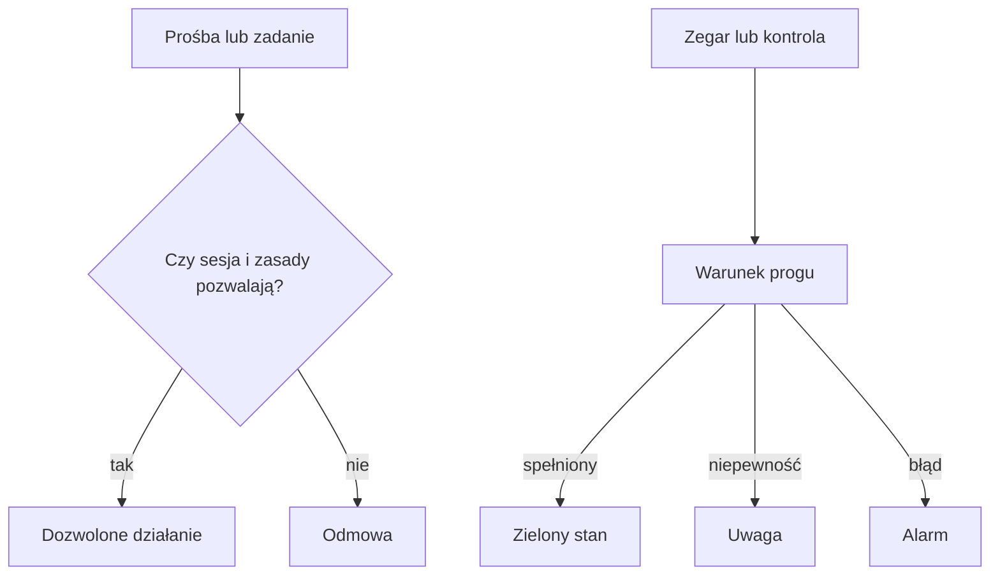

# Bezpieczniki

## Co to jest

Bezpieczniki to osobne reguły, które zatrzymują niedozwolone działanie albo zgłaszają sygnał wymagający uwagi. Nie ma jednego przełącznika, który włącza je wszystkie.

Kontrole treningu, importów i żywienia opisuje nowy [dział Strażnicy](../straznicy/index.md). Ta strona zachowuje zakres ochrony dostępu demo, Statusu i audytu.

## Po co

Pomagają chronić konto i dane oraz ograniczają skutki pomyłki. Jeśli coś jest zablokowane, sprawdź, czy widzisz regułę ochronną, czy prawdziwy błąd.

## Skąd dane

Przykłady obejmują ograniczenia dostępu demo, progi alarmowe Statusu oraz testy uruchamiane podczas audytu. Każdy mechanizm ma własne warunki i własny zakres.

## Jak liczone

1. Dostęp demo najpierw sprawdza, czy sesja jest ważna. Błąd odczytu sesji kończy się odmową.
2. Gość demo może przeglądać tylko dozwolone strony i odczyty. Nowy adres danych nie jest automatycznie dopuszczony.
3. Parametry wymuszające odświeżenie lub ponowne liczenie są odrzucane w trybie demo.
4. Status osobno ocenia wiek i wynik synchronizacji. Przykładowo w kodzie ostrzeżenie o kopii pojawia się po 60 godzinach, a brak sprawdzenia Garmin przez ponad 45 minut zmienia stan jego kontroli na błąd.
5. Audyt sprawdza testy, ale lista kandydatów na nieużywany kod nie daje automatycznej zgody na usunięcie.

## Gdzie to widać

Ograniczenie dostępu widać jako odmowę strony lub czynności demo. Kontrole działania widać w SETUP → Połączenia → Status. Nie wszystkie zabezpieczenia mają osobny przełącznik w interfejsie.

Na zrzucie setup.png zakładka „Dostępy” jest jedną z głównych zakładek. Obok widzisz osobne ustawienia powiadomień i połączeń; ich obecność nie oznacza, że wszystkie zabezpieczenia są ustawiane z tego ekranu.

## Jak czytać

Odmowa działania w demo jest oczekiwana, gdy próba coś zapisuje albo wymusza przeliczenie. Ostrzeżenie Statusu znaczy, że pomiar lub kontrola nie spełnia swojego progu; sprawdź opis wiersza. Stan „wyłączone” oznacza celowo odłączoną funkcję, nie awarię.

Przykład: gość demo może zobaczyć dozwoloną stronę, ale próba wysłania formularza zapisu zostanie odrzucona. Podobnie wywołanie strony z parametrem wymuszającym świeże przeliczenie jest zablokowane. Z kolei przekroczenie progu wieku kopii daje sygnał w Statusie, ale nie kasuje kopii ani nie uruchamia automatycznej naprawy. To trzy odrębne reguły, z osobnymi skutkami.

## Decyzje i historia

Zasada demo brzmi: domyślnie zakaz, a odczyty dopuszcza się jawnie. To ogranicza ryzyko, że nowa strona przypadkiem pozwoli gościowi zmienić dane. Testy sprawdzają tylko znane reguły, nie dowodzą braku wszystkich możliwych błędów.

## Ograniczenia i pułapki

To hasło podaje sprawdzone przykłady, nie kompletną listę każdego ograniczenia w QBocie. Różne części serwisu mają odrębne zasady. Nie należy interpretować braku alarmu jako gwarancji bezpieczeństwa.

To hasło podaje przykłady potwierdzone w dostępie demo, Statusie i audycie. Nie jest kompletną listą reguł każdej funkcji QBota; opis ograniczeń konkretnej funkcji znajduje się przy jej własnym haśle.

## Wpływa na

- [Dostęp demo](dostep-demo.md) — określa zakres dostępnych odczytów.
- [Status](status.md) — pokazuje wyniki niektórych kontroli.
- [Audyt tygodniowy](audyt-tygodniowy.md) — uruchamia część testów ochronnych.

## Zależy od

- Reguł dostępu i progów opisanych przy poszczególnych funkcjach.
- Poprawnej konfiguracji strony i danych sesji.

## Powiązane hasła

- [Dostęp demo](dostep-demo.md)
- [Status](status.md)
- [Audyt tygodniowy](audyt-tygodniowy.md)
- [Dane i prywatność](dane-i-prywatnosc.md)
- [Strażnicy QBota](../straznicy/index.md)

## Zrodla

- `/opt/qbot/app/qbot_web_auth.py` — `demo_allows` i odmowa przy niespełnieniu reguł.
- `/opt/qbot/app/qbot_status_checks.py` — progi kontroli.
- `/opt/qbot/app/scripts/weekly_audit.py` — uruchamianie testów i raportowanie problemów.
- `/opt/qbot/app/docs/WEB_DEMO_AUTH.md`, `/opt/qbot/app/docs/STATUS.md` — opis zasad.
