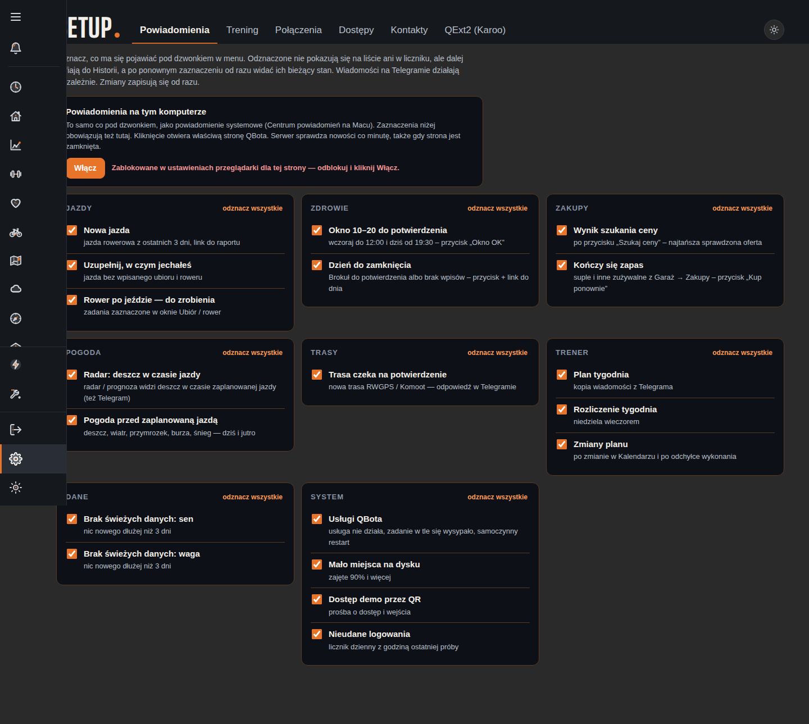
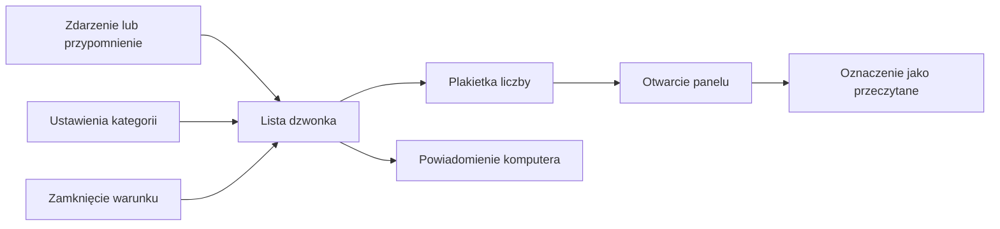

# Centrum powiadomień

## Co to jest

Centrum powiadomień to dzwonek przy menu QBota. Pokazuje zdarzenia i przypomnienia wymagające zauważenia. Wybrane pozycje mogą dodatkowo pojawić się jako powiadomienie systemowe komputera.

## Po co

Otwórz dzwonek, gdy chcesz sprawdzić, czy czeka potwierdzenie trasy, zmiana planu, przypomnienie o rowerze albo sygnał o braku świeżych danych. Kategorie można włączać i wyłączać w SETUP. Wiadomości Telegrama działają osobno.

## Skąd dane

Centrum łączy dwa rodzaje informacji. Zdarzenia zapisane przez inne części serwisu, na przykład wiadomość o nowej jeździe, oraz stany odnawiane przy sprawdzaniu, na przykład nadal oczekująca trasa. W ustawieniach można wybrać kategorie widoczne pod dzwonkiem. Zrzut setup.png pokazuje zakładkę „Powiadomienia”, grupy kategorii z polami zaznaczenia i osobny panel [Web Push](../slowniczek.md#web-push), czyli powiadomień wysyłanych przez przeglądarkę.

## Jak liczone

1. Zdarzenie lub aktualny warunek tworzy pozycję. W przypadku przypomnienia „na żywo” warunek może być sprawdzany ponownie.
2. Nowa treść pozycji ponownie oznacza ją jako nieprzeczytaną. Gdy warunek przestaje być prawdziwy, przypomnienie może się zamknąć.
3. Dzwonek pobiera listę. Liczba na plakietce odpowiada pozycjom nieprzeczytanym, niezamkniętym i niewyłączonym przez użytkownika.
4. Krótki odczyt bazy 18.10.2026 o 15:17 wykazał 3 takie nieprzeczytane pozycje. W ostatnich 14 dniach zapisano 30 wpisów, których nie ukryto krzyżykiem; zapytanie nie sprawdzało, czy były zamknięte ani czy ich kategoria była włączona. Najnowsza zmiana miała czas 13:45. To stan na moment zapytania, a nie stała liczba.
5. Powiadomienie komputera korzysta z tego samego wyboru kategorii. Serwer sprawdza nowe lub zmienione pozycje co 60 sekund. Przy pierwszym włączeniu nie wysyła hurtem wszystkich starych wpisów.

## Gdzie to widać

Dzwonek znajduje się przy menu. Ustawienia są pod SETUP → Powiadomienia. Na zrzucie setup.png wybierz widoczną u góry zakładkę „Powiadomienia”; jeśli ekran jest przesunięty, panel powiadomień komputerowych jest nad grupami pól.

## Jak czytać

Plakietka pokazuje nieprzeczytane pozycje. Otworzenie panelu oznacza widoczne wpisy jako przeczytane. Krzyżyk ukrywa pozycję z bieżącej listy, ale nie usuwa historii jej zapisu. Historia w panelu obejmuje 90 dni. Zdarzenia są widoczne przez 14 dni; przypomnienie aktywne może trwać dłużej, dopóki jego warunek nie zniknie.

Wyłączenie kategorii ukrywa jej wpisy z listy i licznika. Ponowne włączenie pokazuje bieżący stan. Nie wyłącza to niezależnej wiadomości Telegram.

## Decyzje i historia

Dzwonek został dodany do wspólnej nawigacji w październiku 2026. Później doszły kategorie jazd, pogody i systemu oraz historia wpisów. Powiadomienia systemowe przeglądarki są opcjonalne; użytkownik włącza je na danym komputerze.

## Ograniczenia i pułapki

Powiadomienie może zawierać skrót lub odnośnik, a nie pełny raport. Przy kilku nowych wpisach naraz system grupuje część z nich. Gdy strona jest zamknięta, wysyłka komputerowa zależy od wcześniejszego włączenia powiadomień przeglądarki i poprawnej subskrypcji urządzenia.

> DO SPRAWDZENIA: które konkretne 3 wpisy były nieprzeczytane o 15:17. Nie odczytywałem ich treści, tylko liczniki.

## Wpływa na

- [Dostęp demo](dostep-demo.md) — prośby i wejścia demo mogą tworzyć pozycje systemowe.
- [Status](status.md) — oba ekrany mogą sygnalizować problemy, ale robią to osobno.
- Powiadomienia komputera — wysyłają włączone pozycje z listy.

## Zależy od

- Zdarzeń i warunków z modułów QBota.
- Wyboru kategorii użytkownika i, dla powiadomień komputera, uprawnień przeglądarki.

## Powiązane hasła

- [Status](status.md)
- [Strony WWW](strony-www.md)
- [Dostęp demo](dostep-demo.md)
- [Automaty](automaty.md)

## Zrodla

- `/opt/qbot/app/qbot_notif.py` — `push`, `sync_live`, zakres zdarzeń i odświeżanie stanów.
- `/opt/qbot/app/qbot_webpush.py` — `tick` i cykl powiadomień komputera.
- `/opt/qbot/app/web_public/setup.html` — grupy kategorii i konfiguracja powiadomień.
- `/opt/qbot/app/web_public/nav.js` — dzwonek, lista, historia i licznik.
- `/opt/qbot/app/sql/notif_v1.sql` — zapis pozycji powiadomień.
