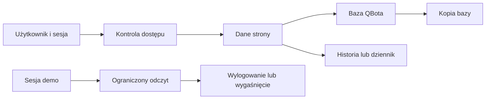

# Dane i prywatność

## Co to jest

To opis tego, gdzie QBOT przechowuje część informacji potrzebnych do działania oraz jakie granice dostępu sprawdzono. Nie jest to pełny audyt prywatności wszystkich modułów.

## Po co

Warto wiedzieć, że dane mogą znajdować się nie tylko na stronie, którą aktualnie oglądasz. QBOT zapisuje dane operacyjne, historię powiadomień, ustawienia i kopie bazy. Dostęp gościa demo jest ograniczony, ale nie cofa informacji już pobranych.

## Skąd dane

Źródła zależą od funkcji. Ustawienia i część wpisów są przechowywane w bazie QBota, kopie bazy w osobnych plikach, a liczniki diagnostyczne w dziennikach. Sesja demo ma osobny losowy token w przeglądarce; w bazie zapisywany jest jego skrót, a nie sam token. Ten opis pochodzi z przejrzanych reguł demo i kopii.

## Jak liczone

1. Użytkownik loguje się i otrzymuje dostęp wynikający z rodzaju sesji.
2. Właściciel ma pełną sesję; gość demo otrzymuje ograniczony dostęp do wybranych odczytów.
3. Dane potrzebne do późniejszej kontroli są zapisywane w odpowiedniej warstwie, na przykład wpis powiadomienia albo dziennik użycia.
4. Kopie bazy są kompresowane do plików i według skryptu przechowywane maksymalnie 14 dni.
5. Historia w dzwonku obejmuje 90 dni. Dziennik licznika legacy w przejrzanym opisie nie ma potwierdzonej reguły retencji.

## Gdzie to widać

Gość demo widzi plakietkę „tylko podgląd” i pozostały czas sesji. Właściciel zarządza dostępami w SETUP → Dostępy. Dzwonek prezentuje historię powiadomień, a Status wskazuje stan ostatniej kopii.

## Jak czytać

„Tylko podgląd” ogranicza działania wykonywane przez QBota. Nie jest obietnicą, że gość nie może zrobić zrzutu ekranu, przepisać wyświetlonych informacji ani zachować pobranego wcześniej pliku. Wylogowanie lub koniec sesji blokuje kolejne żądania.

W praktyce okres przechowywania zależy od rodzaju danych. Historia dzwonka ma swój limit, kopie bazy własny, a pomiary treningowe mogą być przechowywane według innych zasad. Nie wolno przenosić limitu z jednego mechanizmu na drugi. Przykładowo, że wpis powiadomienia znika po okresie historii, nie dowodzi usunięcia danych źródłowych z modułu, który go utworzył.

## Decyzje i historia

Właściciel zdecydował, że demo ma umożliwiać podgląd modułów, bez zapisów. Nowe odczyty API nie są automatycznie dopuszczane do demo. Kopie bazy są odrębnym zabezpieczeniem od historii w interfejsie.

## Ograniczenia i pułapki

Nie sprawdzono pełnej retencji wszystkich tabel, plików, dzienników i eksportów. Nie należy wnioskować, że każda kategoria danych podlega podanym okresom 14 lub 90 dni — te czasy dotyczą wyłącznie kopii i historii powiadomień opisanych tutaj.

> DO SPRAWDZENIA: kompletna lista miejsc przechowywania, retencji i usuwania danych dla wszystkich działów QBota.

## Wpływa na

- [Dostęp demo](dostep-demo.md) — określa, jaki podgląd otrzymuje gość.
- [Kopie bazy](kopie-bazy.md) — kopie zawierają dane bazy.
- [Centrum powiadomień](centrum-powiadomien.md) — przechowuje wpisy i historię.
- [Warstwa legacy](warstwa-legacy.md) — licznik zapisuje użycie wybranych starych funkcji.

## Zależy od

- Zasad logowania, ograniczeń dostępu i reguł przechowywania poszczególnych modułów.
- Konfiguracji serwera i dostępności kopii.

## Powiązane hasła

- [Dostęp demo](dostep-demo.md)
- [Kopie bazy](kopie-bazy.md)
- [Centrum powiadomień](centrum-powiadomien.md)
- [Bezpieczniki](bezpieczniki.md)

## Zrodla

- `/opt/qbot/app/docs/WEB_DEMO_AUTH.md` — sesja demo, token i ograniczony dostęp.
- `/opt/qbot/app/qbot_web_auth.py` — walidacja sesji i zasady demo.
- `/opt/qbot/app/scripts/qbot_backup.sh` — plik kopii i retencja 14 dni.
- `/opt/qbot/app/qbot_notif.py` — zakres czasu zdarzeń w dzwonku.
