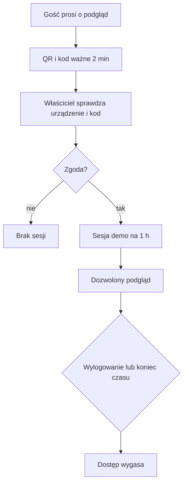

# Dostęp demo

## Co to jest

Dostęp demo to czasowy podgląd QBota, który właściciel zatwierdza na swoim koncie. Gość widzi wybrane strony, ale nie dostaje pełnych uprawnień właściciela.

## Po co

Użyj go, gdy chcesz komuś pokazać serwis bez przekazywania swojego hasła. Właściciel może sprawdzić urządzenie i krótki kod przed zgodą, a później zakończyć aktywną sesję.

## Skąd dane

Przeglądarka gościa tworzy prośbę i pokazuje [kod QR](../slowniczek.md#kod-qr), czyli obraz kodu do zeskanowania. Właściciel otwiera prośbę w swoim zalogowanym widoku, porównuje kod i zatwierdza albo odrzuca. Po zatwierdzeniu przeglądarka gościa odbiera odrębną sesję. Na zrzucie setup.png zakładka „Dostępy” należy do konfiguracji właściciela; główny zrzut strony startowej index.png pokazuje stronę główną, nie ekran zatwierdzania demo.

## Jak liczone

1. Prośba QR jest ważna 2 minuty. Po zatwierdzeniu komputer ma dodatkowe 60 sekund na jej odebranie.
2. Sesja demo trwa 1 godzinę i nie jest przedłużana. Na pasku nawigacji gość widzi plakietkę z pozostałym czasem.
3. Domyślnie dozwolone są tylko odczyty. Strona blokuje próby zapisu, wybrane adresy i odświeżenia wymuszające ponowne przeliczenie. Nowy adres danych jest niedostępny w demo, dopóki nie zostanie świadomie dopuszczony.
4. Po wylogowaniu lub upływie godziny następne żądania tracą dostęp. Odczyt może korzystać z krótkiej pamięci podręcznej sprawdzenia sesji; jej unieważnienie czyści tę pamięć.

## Gdzie to widać

Prośba o dostęp zaczyna się na ekranie logowania. Właściciel może zatwierdzać prośby i przeglądać aktywne sesje w widoku „Dostępy”. Gość widzi pomarańczową plakietkę „Tryb demo — tylko podgląd” oraz przycisk wylogowania.

## Jak czytać

Jeśli strona zwraca odmowę, może to być celowa granica demo, a nie awaria. Dostęp do strony nie oznacza dostępu do wszystkich jej czynności. W szczególności zapisy, zarządzanie kontami i operacje wymagające ponownego obliczenia pozostają zablokowane.

Przykład: jeśli prośba powstała o 10:00 i została od razu zatwierdzona, sesja jest ważna do 11:00. To przykład działania limitu z kodu, a nie konkretna aktywna sesja.

## Decyzje i historia

Decyzja właściciela z 07.10.2026 ustala godzinny, tylko do odczytu podgląd. Dodatkowe zabezpieczenia obejmują zgodność kodu, ograniczenie liczby błędnych prób oraz odmowę dostępu, gdy nie można sprawdzić sesji w bazie.

## Ograniczenia i pułapki

Unieważnienie blokuje kolejne żądania, lecz nie cofa plików, które gość wcześniej pobrał ani zdjęć ekranu. Część limitów prób jest przechowywana w pamięci działającego procesu; po jego ponownym uruchomieniu takie liczniki się zerują. Zrzut index.png jest ekranem startowym z treściami przygotowanymi dla właściciela; nie pokazuje listy udostępnianych endpointów.

## Wpływa na

- [Centrum powiadomień](centrum-powiadomien.md) — wejścia i prośby demo mogą tworzyć wpisy.
- [Strony WWW](strony-www.md) — bramka decyduje, które ekrany i dane są dostępne.
- [Bezpieczniki](bezpieczniki.md) — zasady demo są jednym z ograniczeń dostępu.

## Zależy od

- Aktywnej sesji właściciela przy zatwierdzaniu.
- Czasu ważności prośby i sesji oraz potwierdzenia jej stanu.

## Powiązane hasła

- [Centrum powiadomień](centrum-powiadomien.md)
- [Bezpieczniki](bezpieczniki.md)
- [Dane i prywatność](dane-i-prywatnosc.md)

## Zrodla

- `/opt/qbot/app/qbot_web_auth.py` — `demo_allows`, ważność prośby i sesji.
- `/opt/qbot/app/qbot_web.py` — `_webauth_guard` i ochrona stron/API.
- `/opt/qbot/app/docs/WEB_DEMO_AUTH.md` — zakres zatwierdzania i ograniczenia.
- `/opt/qbot/app/web_public/nav.js` — plakietka dostępu demo.
