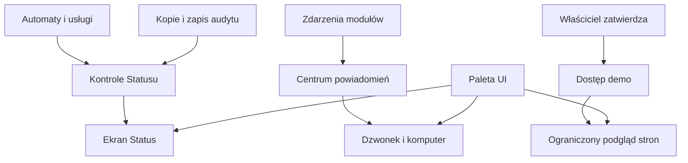

# System QBota

## O czym jest ten dział

Ten dział wyjaśnia, jak właściciel może sprawdzić stan QBota, zarządzać powiadomieniami i dostępem gościa oraz zrozumieć kopie danych, automaty i wygląd stron. To instrukcja do codziennego użycia, nie opis techniczny instalacji.

Jeśli coś nie działa, zacznij od [Statusu](status.md). Gdy czekasz na przypomnienie, sprawdź [Centrum powiadomień](centrum-powiadomien.md). Jeśli chcesz komuś pokazać serwis, użyj ograniczonego [dostępu demo](dostep-demo.md). Nie uruchamiaj ręcznie zadań z tego działu bez potrzeby: audyt i kopia bazy wykonują rzeczywiste działania.

## Jak elementy łączą się ze sobą

Status pokazuje wyniki kontroli; automaty i kopia bazy dostarczają części znaczników. Audyt zapisuje własny wynik, który później pojawia się w Statusie. Dzwonek pobiera zdarzenia z modułów, natomiast powiadomienia Telegrama działają osobnym torem. Zasady demo ograniczają to, co gość może otworzyć. Paleta UI wpływa na wygląd, a nie na obliczenia.

## Gdzie to widać

Zrzut `index.png` pokazuje stronę startową: główne zdjęcie i hasło w górnej części, karty wypraw pod nim, mapę miejsc po prawej i liczniki na dole mapy. Jest to przykład wyglądu serwisu, a nie ekran kontroli systemu.

Zrzut `status.png` pokazuje podsumowanie „Wszystko działa” oraz listę dziesięciu pozycji. Wiersze są mapowane poniżej.

Zrzut `setup.png` pokazuje zakładki SETUP u góry. Aktywna jest zakładka Powiadomienia; niżej widać grupy kategorii i panel powiadomień komputera. Część lewej strony jest zasłonięta menu, więc opisy kategorii, których nie da się odczytać, należy sprawdzić w pełnym widoku.

### Co widzisz na ekranie → hasło

| Co widzisz | Hasło |
|---|---|
| „Wszystko działa” i przycisk „Sprawdź ponownie” | [Status](status.md) |
| Usługi QBota | [Status](status.md) |
| Garmin → QBot (import) | [Garmin](../polaczenia/garmin.md) |
| Hammerhead → Garmin | [Hammerhead → Garmin](../polaczenia/hammerhead-garmin.md) |
| Withings → Garmin | [Withings](../polaczenia/withings.md) |
| Komoot (nowe trasy) | [Komoot](../polaczenia/komoot.md) |
| Kopia bazy danych | [Kopie bazy](kopie-bazy.md) |
| Model AI Alberta | [Albert](../albert/index.md) |
| Bramka (HikConnect), świadomie wyłączona | [Bezpieczniki](bezpieczniki.md) |
| Audyt tygodniowy | [Audyt tygodniowy](audyt-tygodniowy.md) |
| Stary QBot (licznik użycia) | [Warstwa legacy](warstwa-legacy.md) |
| Kropki zielona, żółta, czerwona i pusta | [Status](status.md) |
| Dzwonek i jego licznik | [Centrum powiadomień](centrum-powiadomien.md) |
| Zakładka Powiadomienia i dostarczanie na komputer | [Centrum powiadomień](centrum-powiadomien.md) |
| Kategoria „Zdrowie”: okno 10–20, zamknięcie dnia i brak świeżych danych | [Zdrowie](../zdrowie/index.md), [okno 10–20](../zdrowie/okno-10-20.md), [sen](../zdrowie/sen.md) |
| Nowa jazda, uzupełnienie roweru i zadania przy rowerze | [Raport jazdy](../raport-jazdy/index.md), [Garaż](../garaz/index.md) |
| Deszcz podczas jazdy i przed zaplanowaną jazdą | [Ostrzeżenia pogodowe](../pogoda/ostrzezenia.md), [Pogoda](../pogoda/index.md) |
| Kategoria „Zakupy”: wynik szukania ceny i kończący się zapas | [Zakupy](../garaz/zakupy.md), [przypomnienia zakupowe](../garaz/przypomnienia-zakupowe.md) |
| Kategoria „Trasy”: trasa czeka na potwierdzenie | [Potwierdzenia Telegram](../trasy/potwierdzenia-telegram.md) |
| Kategoria „Trener”: plan tygodnia, rozliczenie tygodnia, zmiany planu | [Powiadomienia Trenera](../trener/powiadomienia.md), [plan tygodnia](../trener/plan-tygodnia.md) |
| Kategoria „System”: usługi, mało miejsca na dysku, demo QR, nieudane logowania | [Status](status.md), [Dostęp demo](dostep-demo.md), [Bezpieczniki](bezpieczniki.md) |
| Powiadomienia pogodowe dla jazdy | [Ostrzeżenia pogodowe](../pogoda/ostrzezenia.md) |
| Zakładka Trening | [Trening](../trener/index.md) |
| Zakładka Połączenia | [Połączenia](../polaczenia/index.md) |
| Zakładka Dostępy | [Dostęp demo](dostep-demo.md) |
| Zakładka Kontakty | [Kontakty w SETUP](kontakty.md) |
| Zakładka QExt2 (Karoo) | [QExt2](../qext2/index.md) |
| Jasny/ciemny motyw i pomarańczowe zaznaczenie | [Paleta UI](paleta-ui.md) |
| Strona startowa i jej karty wypraw | [Strony WWW](strony-www.md) |

Indeks wszystkich zrzutów, także mobilnych, jest w [indeksie ekranów](../img/ekrany/indeks.md).

## Hasła w dziale

- [Status](status.md) — kontrola usług, importów i kopii.
- [Centrum powiadomień](centrum-powiadomien.md) — dzwonek, historia i powiadomienia komputera.
- [Dostęp demo](dostep-demo.md) — czasowy podgląd zatwierdzany przez właściciela.
- [Audyt tygodniowy](audyt-tygodniowy.md) — cotygodniowe testy i raport.
- [Kopie bazy](kopie-bazy.md) — pliki kopii i retencja.
- [Bezpieczniki](bezpieczniki.md) — kontrole i ograniczenia działań.
- [Paleta UI](paleta-ui.md) — kolory i motyw stron.
- [Warstwa legacy](warstwa-legacy.md) — zarejestrowane użycie starszych elementów.
- [Strony WWW](strony-www.md) — główne ekrany QBota.
- [Automaty](automaty.md) — harmonogramy potwierdzone w dokumentach i kodzie.
- [Dane i prywatność](dane-i-prywatnosc.md) — sprawdzone zasady dostępu i przechowywania.

## Jak czytać

Zrzut Statusu jest obrazem z 18.10.2026, 14:23. Zalogowany odczyt wieczorem tego dnia pokazał nowszy wynik „Wszystko działa”, import Garmin o 21:15 i ostatnią kontrolę o 21:23, a kopię z 03:23. Odczyt z 15:17 zwracał wcześniejszą uwagę; nie traktuj żadnego zrzutu jako bieżącego stanu po jego wykonaniu.

W Statusie zielona kropka oznacza działającą kontrolę; żółta — uwagę; czerwona — problem; pusta — świadome wyłączenie. Dzwonek jest odrębną listą zdarzeń. Kolor pomarańczowy w SETUP zaznacza wybraną zakładkę albo pole, nie alarm.

## Ograniczenia i pułapki

Nie wszystkie automaty ani wszystkie karty powiadomień są opisane osobno. Nie potwierdzono bieżącego widoku po zalogowaniu, aktywności wszystkich timerów ani pełnej retencji danych. Gdy opis w dokumentacji źródłowej różni się od kodu, przyjęto kod i oznaczono rozbieżność.

Zalogowany widok SETUP i odczyty jego danych potwierdziły grupy powiadomień oraz listę kontaktów 18.10.2026. Zrzut setup.png nadal pokazuje tylko widoczną część strony, więc szczegóły opisano na podstawie odczytów i kodu.

## Wpływa na / Zależy od

- [Status](status.md) zbiera wyniki [automatów](automaty.md), [audytu](audyt-tygodniowy.md) i [kopii bazy](kopie-bazy.md).
- [Centrum powiadomień](centrum-powiadomien.md) zależy od zdarzeń modułów i ustawień użytkownika.
- [Dostęp demo](dostep-demo.md) ogranicza widoki opisane w [stronach WWW](strony-www.md).
- [Paleta UI](paleta-ui.md) zmienia wygląd, nie dane ani wynik kontroli.

## Powiązane hasła

- [Mapa serwisu](../mapa-serwisu.md)
- [Zależności QBota](../zaleznosci.md)
- [Albert](../albert/index.md)

## Zrodla

- `/opt/qbot/app/qbot_status_checks.py` — wspólne kontrole Statusu.
- `/opt/qbot/app/qbot_notif.py` — źródła powiadomień.
- `/opt/qbot/app/web_public/status.html`, `/opt/qbot/app/web_public/setup.html` — ekrany ze zrzutów.
- `/opt/qbot/app/docs/STATUS.md`, `/opt/qbot/app/docs/NOTIF_CENTER.md`, `/opt/qbot/app/docs/SETUP.md` — opisy działania.
