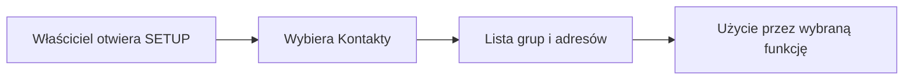

# Kontakty w SETUP

## Co to jest

Zakładka Kontakty w SETUP służy do zarządzania grupami adresów używanymi przez funkcje QBota. Zrzut setup.png potwierdza, że zakładka jest dostępna, ale nie pokazuje jej zawartości.

## Po co

Może pomóc właścicielowi zarządzać odbiorcami wiadomości, jeśli dana funkcja korzysta z grup kontaktów. Nie należy zakładać, że każdy wpis w książce kontaktów otrzymuje wiadomości automatycznie.

## Skąd dane

Nie udało się sprawdzić pełnej listy grup, pól ani działania zapisu. Dokument SETUP wskazuje, że ekran korzysta z listy grup adresów. Szczegóły oznaczam jako niepotwierdzone.

## Jak liczone

Zakładka opisuje dane kontaktowe, a nie obliczenie. Nie podaję kroków edycji ani liczby kontaktów, bo nie udało się odczytać zalogowanego widoku i bazy.

## Gdzie to widać

Na zrzucie setup.png zakładka „Kontakty” jest na górnym pasku między Dostępami i QExt2 (Karoo). Jej zawartości nie widać, ponieważ aktywna jest zakładka Powiadomienia.

## Jak czytać

Zakładka jest widoczna w nawigacji, ale nie potwierdza, że istnieje konkretny odbiorca, grupa ani zaplanowana wysyłka.

## Decyzje i historia

Nie potwierdzono osobnych decyzji dotyczących kontaktów.

> DO SPRAWDZENIA: jakie pola i akcje udostępnia zakładka Kontakty, gdzie zapisywane są adresy oraz które funkcje korzystają z grup.

## Ograniczenia i pułapki

Nie dodawaj adresów ani nie zmieniaj grup na podstawie tego opisu — nie opisuje on operacji edycji. Po uzyskaniu zalogowanego widoku hasło należy uzupełnić.

## Wpływa na

- Potencjalne funkcje wysyłające wiadomości do grup kontaktów; zakres niepotwierdzony.

## Zależy od

- Uprawnień właściciela i zapisanej konfiguracji kontaktów.

## Powiązane hasła

- [Strony WWW](strony-www.md)
- [Centrum powiadomień](centrum-powiadomien.md)
- [Dostęp demo](dostep-demo.md)

## Zrodla

- `/opt/qbot/app/web_public/setup.html` — zakładka Kontakty i odnośniki do API grup adresów.
- `/opt/qbot/app/docs/SETUP.md` — opis konfiguracji SETUP.
