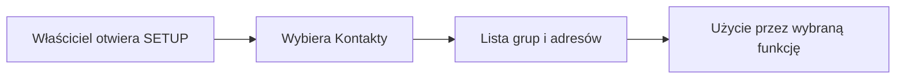

# Kontakty w SETUP

## Co to jest

Zakładka Kontakty w SETUP służy do zarządzania grupami adresów używanymi przez wybrane funkcje QBota. Dokument SETUP wymienia tworzenie i usuwanie grup, dodawanie oraz usuwanie adresów i odświeżanie grup powiązanych z odpowiedziami gości na zaproszenia do wypraw. Zrzut setup.png potwierdza położenie zakładki, ale nie pokazuje jej zawartości.

## Po co

Może pomóc właścicielowi zarządzać odbiorcami wiadomości, jeśli dana funkcja korzysta z grup kontaktów. Nie należy zakładać, że każdy wpis w książce kontaktów otrzymuje wiadomości automatycznie.

## Skąd dane

Zalogowany, tylko do odczytu wykaz z 18.10.2026 pokazał 2 grupy i 4 adresy łącznie. Nie wypisuję adresów, bo nie są potrzebne do wyjaśnienia działania. Dokumentacja i kod pokazują, że grupy są używane przy odbiorcach planu, a powiązaną z wyprawą grupę można synchronizować z odpowiedziami gości na zaproszenia.

## Jak liczone

Zakładka nie wykonuje obliczeń. Odczyt z 18.10.2026 wykazał 2 grupy i 4 adresy. Lista może się zmienić po edycji lub synchronizacji grupy wyprawowej. W automatycznej synchronizacji brane są pod uwagę tylko potwierdzone odpowiedzi „tak”. Najnowsza odpowiedź danego adresu zastępuje starszą. Adresy dodane ręcznie pozostają w grupie, nawet jeśli nie pochodzą z listy potwierdzonych gości.

## Gdzie to widać

Na zrzucie setup.png zakładka „Kontakty” jest na górnym pasku między Dostępami i QExt2 (Karoo). Jej zawartości nie widać, ponieważ aktywna jest zakładka Powiadomienia.

Zrzut pokazuje nazwę zakładki, a nie listę grup. Aby odczytać liczby kontaktów, właściciel otwiera samą zakładkę; dostępny w tym etapie odczyt API wykazał 2 grupy i 4 adresy łącznie.

## Jak czytać

Liczba grup i adresów opisuje bieżący odczyt, a nie zaplanowane wysyłki. Funkcja musi osobno wskazać grupę jako odbiorcę. Grupa wyprawowa jest powiązana z konkretną trasą i może pobierać potwierdzone odpowiedzi gości. Jeżeli ktoś później zmieni odpowiedź na „nie”, taka osoba przestaje należeć do automatycznie synchronizowanej części grupy. Ręcznie dopisany adres nie jest usuwany przez tę synchronizację.

Przykład z odczytu 18.10.2026: na liście były 2 grupy i 4 adresy łącznie. Nie odczytywałem nazw ani adresów i nie sprawdzałem, ile kontaktów było w każdej grupie. Z samych sum nie da się wywnioskować, kto otrzyma wiadomość. Odbiorców wskazuje się przy konkretnej wysyłce.

## Decyzje i historia

Nie potwierdzono osobnych decyzji dotyczących kontaktów.

Nie wykonywałem edycji. Dokumentacja ekranu wymienia akcje listy, tworzenia i usuwania grup, dodawania i usuwania adresów oraz odświeżania grupy wyprawowej.

## Ograniczenia i pułapki

Odczyt listy nie zmienia danych. Edycja może zmienić odbiorców wiadomości, dlatego przed dodaniem albo usunięciem adresu sprawdź, czy grupa jest używana przez plan lub zaproszenia.

## Wpływa na

- [Automaty](automaty.md) — wysyłka planu może korzystać z wybranej grupy.
- [Planer wypraw](../trasy/planer-wyprawy.md) — powiązaną grupę można synchronizować z potwierdzonymi odpowiedziami gości.

## Zależy od

- Uprawnień właściciela i zapisanej konfiguracji kontaktów.

## Powiązane hasła

- [Strony WWW](strony-www.md)
- [Centrum powiadomień](centrum-powiadomien.md)
- [Dostęp demo](dostep-demo.md)

## Zrodla

- `/opt/qbot/app/web_public/setup.html` — zakładka Kontakty i odnośniki do API grup adresów.
- `/opt/qbot/app/qbot_web.py` — `mail_groups_list`, `_group_emails`, `_sync_group_from_rsvp` i `_sync_groups_for_route`.
- `/opt/qbot/app/docs/SETUP.md` — opis konfiguracji SETUP.
