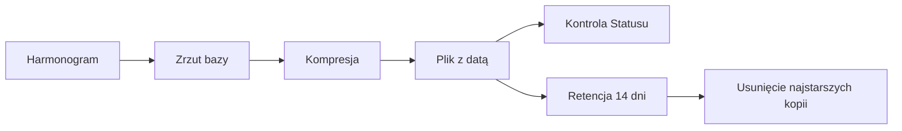
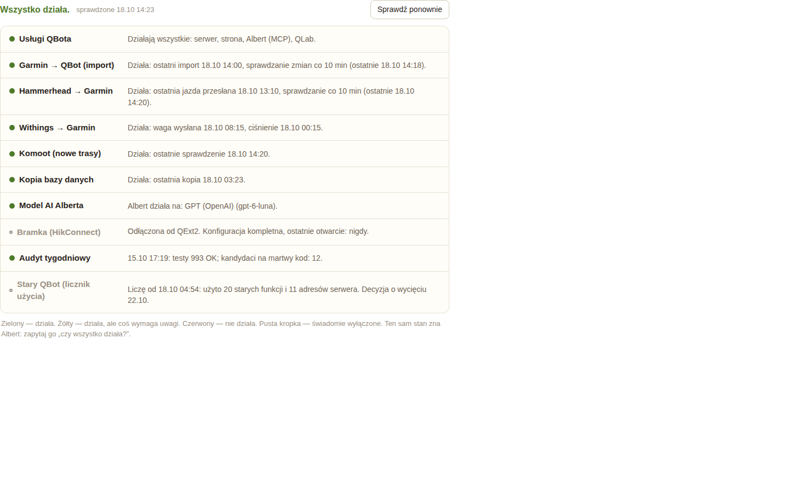

# Kopie bazy

## Co to jest

Kopia bazy to skompresowany zrzut danych z PostgreSQL. Jest osobnym plikiem archiwalnym, który można wykorzystać przy odtwarzaniu po awarii.

## Po co

Kopia zmniejsza ryzyko utraty danych po awarii sprzętu, pomyłce albo uszkodzeniu bazy. Samo pojawienie się pliku nie dowodzi jednak, że jego zawartość można odtworzyć.

## Skąd dane

Skrypt kopii wybiera ustawienia połączenia z pliku konfiguracji, uruchamia narzędzie zrzutu PostgreSQL, a wynik kompresuje. Domyślny katalog to `/opt/qbot/backups`; archiwum ma nazwę z datą i godziną. Skrypt usuwa pliki starsze niż 14 dni.

## Jak liczone

1. Zadanie uruchamia skrypt kopii.
2. Skrypt zapisuje zrzut jako plik `.sql.gz` i ogranicza dostęp do pliku.
3. Po udanym zapisie wypisuje nazwę i rozmiar pliku.
4. Następnie usuwa kopie starsze niż 14 dni.
5. Status osobno sprawdza wynik ostatniego uruchomienia zadania. Po przekroczeniu 60 godzin zgłasza uwagę.

## Gdzie to widać

SETUP → Połączenia → Status → „Kopia bazy danych”. Na zrzucie status.png ten wiersz jest w górnej połowie listy; tekst podaje czas ostatniej kopii.

## Jak czytać

Jeżeli Status pokazuje świeżą, udaną kopię, to znaczy, że ostatnie uruchomienie zakończyło się poprawnie według kontroli. Ostrzeżenie po 60 godzinach oznacza, że trzeba sprawdzić harmonogram lub wynik zadania. Nie oznacza automatycznie utraty danych.

Na zrzucie z 18.10.2026 14:23 Status podawał ostatnią kopię z 18.10 o 03:23. Różnica wynosi 11 godzin, więc była krótsza niż próg ostrzeżenia 60 godzin. Jest to przykład ze zrzutu, nie świeży pomiar stanu pliku.

Próg 60 godzin jest liczony przez kontrolę jako 2,5 doby od ostatniego poprawnego uruchomienia. Obejmuje więc zapas ponad jeden dzień, ale nie informuje o czasie retencji. Retencja 14 dni dotyczy sprzątania starych plików przez skrypt kopii. To dwie różne liczby: po przekroczeniu 60 godzin Status ostrzega, a skrypt zachowuje pliki do momentu przekroczenia 14 dni.

Jeśli Status pokazuje błąd albo brak świeżego wyniku, nie kasuj ręcznie pozostałych plików. Najpierw trzeba ustalić, czy istnieje świeży zrzut i czy zadanie zakończyło się poprawnie. Odtworzenia kopii nie wykonywałem, ponieważ zmieniłoby stan danych i wykracza poza dokumentację wyłącznie odczytową.

## Decyzje i historia

Skrypt ustawia prawa dostępu do pliku i retencję 14 dni. W ramach tego etapu nie otwierałem kopii ani nie próbowałem odtwarzać bazy.

## Ograniczenia i pułapki

Kopia może istnieć, ale być niekompletna, uszkodzona albo nieprzetestowana do odtworzenia. Próg Statusu sprawdza głównie ostatnie uruchomienie, nie pełną integralność danych. Nie udało się potwierdzić aktywnego timera ani bieżącej obecności pliku.

> DO SPRAWDZENIA: aktywny harmonogram, ostatni wynik zadania i obecność świeżego pliku kopii na dysku.

## Wpływa na

- [Status](status.md) — pokazuje wiek i wynik ostatniego uruchomienia.
- [Audyt tygodniowy](audyt-tygodniowy.md) — to odrębne zadanie; jego porządkowanie plików nie tworzy kopii bazy.
- [Dane i prywatność](dane-i-prywatnosc.md) — kopia jest dodatkowym miejscem przechowywania danych.

## Zależy od

- Dostępnego miejsca, danych połączenia i poprawnego działania narzędzia zrzutu oraz kompresji.
- Harmonogramu uruchomienia; jego bieżącej aktywności nie potwierdzono.

## Powiązane hasła

- [Status](status.md)
- [Audyt tygodniowy](audyt-tygodniowy.md)
- [Automaty](automaty.md)
- [Dane i prywatność](dane-i-prywatnosc.md)

## Zrodla

- `/opt/qbot/app/scripts/qbot_backup.sh` — format pliku, katalog, retencja i prawa dostępu.
- `/opt/qbot/app/qbot_status_checks.py` — `backup` i próg 60 godzin.
- `/opt/qbot/app/docs/STATUS.md` — opis kontroli kopii.
