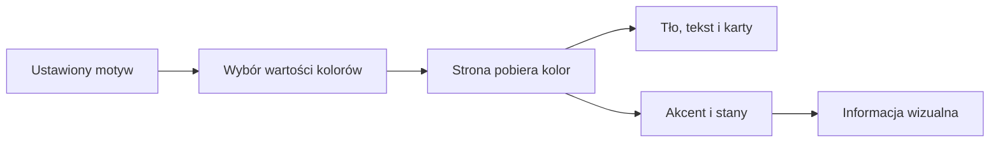

# Paleta wyglądu stron

## Co to jest

Paleta [UI2](../slowniczek.md#ui2) to wspólny zestaw kolorów i podstawowych elementów wyglądu stron QBota. Ma wariant jasny i ciemny. Kolor tła czy przycisku sam w sobie nie mówi, czy trening lub integracja działa.

## Po co

Wspólna paleta sprawia, że strony wyglądają podobnie, a informacja o dobrym lub złym stanie jest czytelna. Ułatwia też przełączanie trybu dziennego i nocnego.

## Skąd dane

Wspólne wartości kolorów są zapisane jako zmienne wyglądu. Strony mogą używać zestawu samych kolorów albo dodatkowych elementów, takich jak karty, przyciski i siatki. Reguła projektowa z 14.10.2026 mówi, że nowa lub przebudowywana strona korzysta z UI2.

## Jak liczone

Paleta niczego nie oblicza. Strona odczytuje wybrany kolor i rysuje nim tło, tekst, obramowanie albo akcent.

1. W trybie jasnym tło jest kremowe, a karty prawie białe.
2. Kolor akcentu jest pomarańczowy, a kolory dobrego, ostrzegawczego i złego stanu są osobnymi tokenami.
3. W trybie ciemnym wartości tła i tekstu zmieniają się, ale semantyczny podział stanów pozostaje.
4. Na zrzutach `status.png` oraz `setup.png` widać jasne tło, jasne karty i pomarańczowe podkreślenie aktywnej zakładki lub pola.

## Gdzie to widać

Na większości stron zmianę motywu wywołuje ikona księżyca/słońca. Zrzut setup.png pokazuje ikonę w prawym górnym rogu oraz aktywną zakładkę z pomarańczowym podkreśleniem. Zrzut status.png ma inną, prostszą prezentację, ale podobne jasne tło i ciepłe obramowanie.

## Jak czytać

Na ekranie Status kolor kropki ma znaczenie opisane pod listą: zielony oznacza działanie, żółty uwagę, czerwony problem, pusta kropka świadome wyłączenie. To reguła tego konkretnego widoku. Na innych stronach kolor może oznaczać serię wykresu, wybrany element albo dekorację.

Zestaw UI2 rozróżnia tło, kartę, tekst podstawowy, tekst pomocniczy, obramowanie, akcent oraz stany dobry, ostrzegawczy i zły. W jasnym motywie tło ma kolor `#f8f4ec`, karta `#fffdf8`, akcent `#e8742a`, a stan dobry `#4f7a2a`. Tryb ciemny zmienia tło, kartę i tekst, zachowując pomarańczowy akcent. Są to wartości palety, nie pomiary ani progi danych.

Zmiana na nocny wygląd odbywa się przez podmianę tych wartości. Nie musi zmieniać układu karty ani danych, które karta pokazuje. Wykresy i mapy mogą mieć własną legendę; w takim przypadku najpierw czytaj legendę, a potem interpretuj kolor.

Jeśli tekst jest niewyraźny po zmianie motywu, zgłoś problem strony. Nie wyciągaj wniosku o wyniku sportowym z samego koloru akcentu.

## Decyzje i historia

14.10.2026 ustalono UI2 dla nowych i przebudowywanych stron. Starszy zestaw zielono-złoty jest wycofywany, ale nie każda istniejąca strona została sprawdzona pod kątem zgodności.

## Ograniczenia i pułapki

Nie należy zakładać, że wszystkie strony mają już ten sam wygląd. Mapy i wykresy mogą używać specjalnych skal barw, bo ich znaczenie wynika z legendy. Zrzut głównej strony index.png pokazuje też fotografie; zdjęcia nie są elementem palety.

> DO SPRAWDZENIA: pełna lista aktualnych stron korzystających z UI2; sprawdzono tokeny i omawiane zrzuty, ale nie każdą stronę serwisu.

## Wpływa na

- Wygląd ekranów, które korzystają ze wspólnych wartości UI2.
- [Status](status.md) i [Centrum powiadomień](centrum-powiadomien.md) — określa ich wspólne elementy wyglądu.

## Zależy od

- Motywu zapisanego w przeglądarce.
- Plików wyglądu wczytanych przez daną stronę.

## Powiązane hasła

- [Strony WWW](strony-www.md)
- [Status](status.md)
- [Centrum powiadomień](centrum-powiadomien.md)

## Zrodla

- `/opt/qbot/app/web_public/ui2-tokens.css` — wartości jasnego i ciemnego motywu.
- `/opt/qbot/app/docs/UI_PALETA.md` — decyzja z 14.10.2026 i reguły użycia.
- `/opt/qbot/app/web_public/setup.html`, `/opt/qbot/app/web_public/status.html` — przykłady ekranów.
