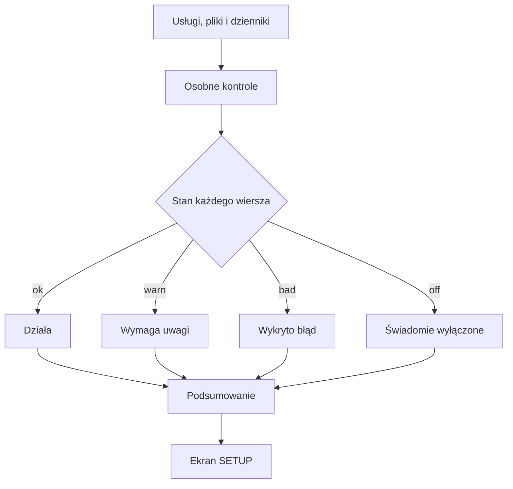

# Status QBota

## Co to jest

Status to ekran, który zbiera krótkie odpowiedzi na pytanie „czy sprawdzane części QBota działają?”. Pokazuje osobno usługi, importy danych, kopię bazy, model Alberta, audyt oraz funkcje świadomie odłączone.

## Po co

Warto zacząć od Statusu, gdy nie pojawia się jazda, pomiar albo wiadomość. Znajdź wiersz związany z tym źródłem i przeczytaj jego opis, zanim uznasz całą stronę za niedziałającą. Zielony wiersz mówi tylko o ostatniej kontroli; nie gwarantuje poprawności wszystkich danych ani każdej funkcji w serwisie.

## Skąd dane

Ekran pyta o stan usług i odczytuje pliki kontrolne oraz fragmenty dzienników. Nie uruchamia ponownie importów ani kopii. Wyniki są podawane wspólnym ekranem Statusu i mogą być odczytane też przez Alberta. Zrzut pokazuje widok „Połączenia → Status”; sekcja główna zawiera podsumowanie, przycisk ponownego sprawdzenia i listę wierszy.

Odczyt na żywo wymaga zalogowanej sesji właściciela. Odczyt strony wykonany wieczorem 18.10.2026 podał wynik „Wszystko działa”. Wiersz usług potwierdzał cztery usługi, Garmin pokazywał import o 21:15 i ostatnią kontrolę o 21:23, a kopia bazy — ostatnie uruchomienie o 03:23. To nowszy odczyt niż zrzut z 14:23.

## Jak liczone

1. Każda kontrola zwraca jeden z czterech stanów: działa, wymaga uwagi, wykryła błąd albo jest świadomie wyłączona. Ekran opisuje je krótkimi komunikatami.
2. Dla podsumowania pomija się pozycje wyłączone. Spośród reszty błąd ma pierwszeństwo przed uwagą, a uwaga przed działającym stanem.
3. Przykład ze zrzutu z 18.10.2026, 14:23: wiersze pokazały zielone usługi, import Garmin, Hammerhead, Withings, Komoot, kopię bazy, Alberta i audyt. Bramka i stary QBot miały pustą kropkę, czyli były świadomie wyłączone. To przykład ze zrzutu ekranu, nie bieżący odczyt bazy.
4. Odczyt kontrolny z 18.10.2026, 15:17 dał podsumowanie „Uwaga: 4 funkcje wymagają sprawdzenia”. Wieczorny odczyt zalogowany podał „Wszystko działa”, z usługami aktywnymi i ostatnim sprawdzeniem Garmina o 21:23. Starsza uwaga nie opisuje więc późniejszego wyniku; nie wiadomo, czy przyczyną różnicy był dostęp do odczytu stanu usług, czy zmiana stanu kontroli.
5. W odczycie z 18.10.2026 audyt miał wynik z 15.10, 993 testy OK i 12 kandydatów na martwy kod. Te liczby opisują tamten zapis audytu, nie liczbę funkcji na ekranie.

Wzór

Stan zbiorczy to najgorszy stan wśród pozycji, które nie są wyłączone. Kolejność od najpoważniejszego: błąd, uwaga, działa. Gdy wszystkie pozycje są wyłączone, kod traktuje wynik jako działający.

## Gdzie to widać

SETUP → Połączenia → Status. Przycisk „Sprawdź ponownie” pobiera świeży wynik. Ten sam ekran zawiera listę źródeł i ostatnie czasy. Na załączonym zrzucie szukaj wiersza „Audyt tygodniowy” mniej więcej w dolnej części listy, a na samej górze — podsumowania „Wszystko działa”.

## Jak czytać

- Zielona kropka: kontrola uznała swój warunek za spełniony.
- Żółta kropka: danych jest za mało, są zbyt stare albo kontrola nie może potwierdzić działania.
- Czerwona kropka: wykryto błąd.
- Pusta kropka: funkcja jest świadomie wyłączona. To nie jest alarm.
- Wiek ma znaczenie. Na przykład kontrola importu może działać poprawnie, ale stary znacznik ostatniego importu przesunie ją do ostrzeżenia.

Przykładowe progi z kodu: Garmin ostrzega, gdy od importu minęły ponad 4 godziny, a błąd strażnika lub brak jego sprawdzenia przez ponad 45 minut daje błąd. Hammerhead zgłasza problem po ponad godzinie bez sprawdzenia. Kopia bazy ostrzega, gdy ostatnie uruchomienie było ponad 60 godzin temu. Audyt ostrzega po ponad 8 dniach bez wyniku. Progi te dotyczą konkretnych wierszy i nie oznaczają, że każda integracja ma ten sam harmonogram.

## Decyzje i historia

19.10.2026: Status pokazuje nowe wiersze „Aktualizacje” i „Kopia R2”. Czas ostatniego audytu tygodniowego jest odczytywany jako czas lokalny, bez dodatkowego przesunięcia o dwie godziny. Osobna zakładka Aktualizacje tylko pobiera informacje i zleca sprawdzenie; nie instaluje pakietów.

Dokument projektu opisuje Status jako wspólne źródło dla strony i części odpowiedzi Alberta. Wiersz bramki HikConnect pozostaje wyłączony, bo jest odłączona od QExt2. Wiersz licznika legacy w kodzie również ma stan wyłączony; jego opis może mimo to pokazywać zliczone użycia.

## Ograniczenia i pułapki

Status opiera się na sygnałach, a nie na pełnym sprawdzeniu każdej strony i danych. Gdy środowisko nie ma dostępu do menedżera usług, kontrola może pokazać ostrzeżenie „nie mogę odczytać stanu” — nie należy zamieniać tego w twierdzenie, że usługa na pewno nie działa. Zrzut z 14:23 jest historycznym obrazem, a nie bieżącą gwarancją.

Ograniczenie odczytu: ręczna próba sprawdzenia stanu usług systemowych nie zadziałała w tym środowisku. Nie można więc niezależnie odtworzyć przyczyny wyniku z 15:17. Wieczorny wynik został odczytany przez zalogowaną stronę.

## Wpływa na

- [Audyt tygodniowy](audyt-tygodniowy.md) — Status pokazuje ostatni zapis jego wyniku.
- [Kopie bazy](kopie-bazy.md) — jeden z wierszy ocenia ostatnie uruchomienie kopii.
- [Centrum powiadomień](centrum-powiadomien.md) — problemy systemowe mogą pojawiać się też przy dzwonku.

## Zależy od

- Aktualnych plików stanu, fragmentów dzienników i odpowiedzi systemu usług.
- Działania osobnych kontroli. Błąd jednej kontroli nie powinien zatrzymać pozostałych.

## Powiązane hasła

- [Centrum powiadomień](centrum-powiadomien.md)
- [Kopie bazy](kopie-bazy.md)
- [Audyt tygodniowy](audyt-tygodniowy.md)
- [Bezpieczniki](bezpieczniki.md)

## Zrodla

- `/opt/qbot/app/qbot_status_checks.py` — `all_checks`, `garmin_import`, `hammerhead`, `backup`, `weekly_audit`, `legacy_usage`.
- `/opt/qbot/app/qbot_status_api.py` — API ekranu Status.
- `/opt/qbot/app/docs/STATUS.md` — lista i opis kontroli.
- `/opt/qbot/app/web_public/status.html` — ekran i znaczenie kropek.
