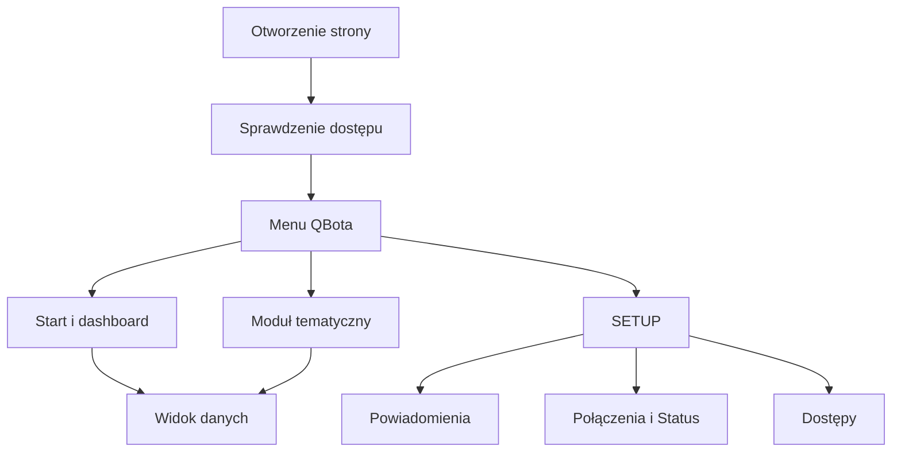
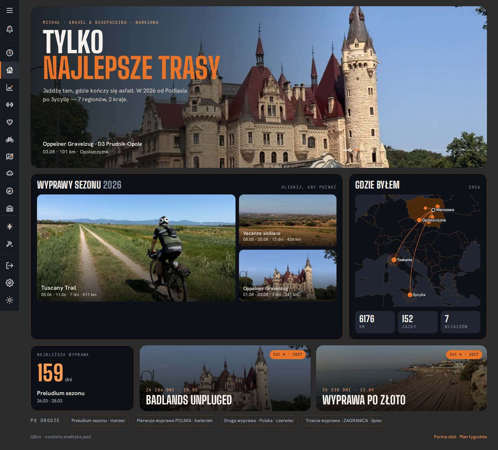

# Strony WWW

## Co to jest

Strony WWW to przeglądarkowa część QBota: strona startowa, dashboard i osobne ekrany Formy, Zdrowia, Treningu, Pogody, Raportu jazdy oraz ustawień. Menu po lewej pomaga przechodzić między nimi.

## Po co

Wybierz stronę odpowiadającą pytaniu. Status służy do kontroli pracy systemu, SETUP do ustawień, a strona startowa pokazuje najważniejsze informacje o wyprawach. Nie każda strona jest publiczna; dane właściciela wymagają zalogowania.

## Skąd dane

Widoki pobierają dane z serwera QBota i ze źródeł zewnętrznych przypisanych do danego modułu. Menu wspólne, motyw i dzwonek są używane przez wiele stron. Ekrany mogą mieć własne zakładki, filtry i elementy sterujące.

## Jak liczone

1. Użytkownik otwiera stronę i przechodzi przez kontrolę dostępu.
2. Strona pokazuje treści właściwe dla tego widoku; dane aktualizują się zgodnie z działaniem konkretnego modułu.
3. Na stronie głównej zrzut `index.png` pokazuje zdjęcie główne, karty wypraw sezonu, mapę odwiedzonych miejsc, licznik kilometrów i jazd oraz zapowiedzi kolejnych celów.
4. Zrzut setup.png pokazuje główne zakładki konfiguracji: Powiadomienia, Trening, Połączenia, Dostępy, Kontakty i QExt2 (Karoo). Wewnątrz zakładki mogą być dalsze podzakładki.

## Gdzie to widać

Na stronie głównej zdjęcie i tytuł są w górnej części, karty wypraw pod nimi, a mapa po prawej. Zrzut setup.png pokazuje zakładki na górnym pasku; zrzut status.png jest osobnym ekranem kontroli. Indeks wszystkich zrzutów znajduje się w [indeksie ekranów](../img/ekrany/indeks.md).

| Co widzisz na ekranie | Hasło |
|---|---|
| Strona startowa, kafle wypraw, mapa miejsc i liczniki | [Start i dashboard](../mapa-serwisu.md) |
| Dzwonek i liczba nieprzeczytanych wpisów | [Centrum powiadomień](centrum-powiadomien.md) |
| Podsumowanie „Wszystko działa” i lista kontroli | [Status](status.md) |
| Powiadomienia, Trening, Połączenia, Dostępy, Kontakty, QExt2 | [Centrum powiadomień](centrum-powiadomien.md), [Dostęp demo](dostep-demo.md), [Automaty](automaty.md) |
| Przełącznik jasnego i ciemnego motywu | [Paleta UI](paleta-ui.md) |
| Zalogowany właściciel lub czasowy podgląd gościa | [Dostęp demo](dostep-demo.md) |

## Jak czytać

Karta na stronie głównej jest skrótem. Kliknięcie prowadzi do właściwej strony z większą ilością danych. Liczniki na zrzucie opisują stan widoczny w czasie wykonania zrzutu; mogą się zmienić.

Na ekranie SETUP pomarańczowe zaznaczenie oznacza aktywną kartę lub włączoną pozycję, a nie ostrzeżenie. W Statusie kolory kropek mają osobne znaczenie opisane pod listą.

## Decyzje i historia

Strona SETUP zbiera ustawienia, które wcześniej były rozproszone po różnych ekranach. Zakładka Status jest częścią Połączeń. Główne menu jest wspólne, ale widoki na telefonie mogą mieć inny układ.

## Ograniczenia i pułapki

Zrzuty są obrazami z konkretnej chwili. Nie potwierdzają, że widok działa obecnie ani że dane są aktualne. Przeglądarka bez poprawnego logowania może zobaczyć stronę logowania zamiast treści właściciela.

W tej sesji zalogowana strona zwróciła bieżące dane Statusu, ustawień powiadomień i kontaktów. Nie sprawdzałem interaktywnie wszystkich stron ani kliknięć; opisy pozostałych ekranów opierają się na zrzutach i kodzie.

## Wpływa na

- [Status](status.md), [Centrum powiadomień](centrum-powiadomien.md) i [Dostęp demo](dostep-demo.md) są dostępne przez strony serwisu.
- [Paleta UI](paleta-ui.md) opisuje wspólny wygląd części widoków.

## Zależy od

- Przeglądarki, dostępu sieciowego i praw użytkownika.
- Danych udostępnianych przez konkretne moduły.

## Powiązane hasła

- [System](index.md)
- [Automaty](automaty.md)
- [Paleta UI](paleta-ui.md)
- [Mapa serwisu](../mapa-serwisu.md)
- [Dodawanie produktu ze sklepu](../garaz/dodaj-zakup-ze-sklepu.md)
- [Kalibracja zdjęć](../garaz/kalibracja-zdjec.md)
- [Planer wyposażenia](../garaz/planer-wyposazenia.md)
- [Zaproszenia dla gości](../trasy/zaproszenia-gosci.md)
- [Audyt kompletności wiki](../audyt-kompletnosci.md)

## Zrodla

- `/opt/qbot/app/web_public/index.html` — strona startowa.
- `/opt/qbot/app/web_public/setup.html` — zakładki ustawień.
- `/opt/qbot/app/web_public/nav.js` — wspólna nawigacja i dzwonek.
- `/opt/qbot/app/docs/SETUP.md` — zakres konfiguracji.
