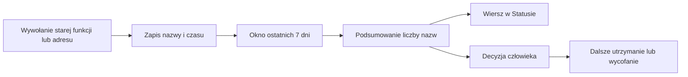

# Warstwa legacy

## Co to jest

„Legacy” oznacza starsze elementy QBota, które mogą nadal być potrzebne przez wybrane drogi działania. Licznik użycia zapisuje, z których oznaczonych elementów ktoś skorzystał.

## Po co

Przed wycofaniem starszej części systemu właściciel może sprawdzić, czy ktoś nadal korzysta z jej funkcji lub adresów. To wskazówka do analizy, a nie automatyczna decyzja o usunięciu.

## Skąd dane

Licznik zapisuje użycie oznaczonych funkcji oraz wybranych adresów serwera w dzienniku. Testy i narzędzia audytu są pomijane. To, co licznik potrafi zobaczyć, zależy od instrumentacji w konkretnych modułach.

## Jak liczone

1. Oznaczona funkcja lub adres zostaje wywołany.
2. Licznik dopisuje nazwę i czas do dziennika; ta sama nazwa jest zapisywana najwyżej raz na godzinę w procesie.
3. Podsumowanie wybiera wpisy z ostatnich 7 dni i rozdziela funkcje od adresów.
4. W Statusie 18.10.2026 o 15:17 widniał licznik „od 18.10 04:54”: użyto 20 starych funkcji i 11 adresów serwera. To liczba nazw z okna pomiarowego, nie liczba wszystkich wywołań.

## Gdzie to widać

SETUP → Połączenia → Status → „Stary QBot (licznik użycia)”. Na zrzucie status.png jest to ostatni wiersz listy. Szukaj informacji o dacie początku pomiaru oraz liczbie starych funkcji i adresów.

## Jak czytać

Liczba nazw pokazuje, że co najmniej raz zarejestrowano ich użycie w ostatnim tygodniu. Brak nazwy oznacza tylko, że licznik jej nie zauważył w tym oknie. Rzadkie użycie, brak instrumentacji albo inna ścieżka mogą nie pojawić się w raporcie.

Liczba „20 funkcji” nie znaczy, że uruchomiono je tylko 20 razy. Licznik ogranicza częstotliwość zapisu tej samej nazwy do jednego wpisu na godzinę w danym procesie. Podsumowanie liczy nazwy, które wystąpiły w oknie, a nie wszystkie wywołania ani wszystkich użytkowników. To ważne przy ocenie, czy element jest naprawdę nieużywany.

Licznik jest obserwatorem: zapisuje informację diagnostyczną, ale sam nie zmienia sposobu działania funkcji. Można go wyłączyć ustawieniem serwera wskazanym w dokumentacji, jednak bieżącego ustawienia produkcyjnego nie odczytywałem. Liczby z ekranu są więc liczbami raportu, nie potwierdzeniem, że pomiar obejmował wszystkie ścieżki.

Na zrzucie z 18.10.2026, 14:23 widnieje 20 funkcji i 11 adresów od 04:54. Bieżący odczyt kodu z 15:17 pokazał te same liczniki.

## Decyzje i historia

Opis licznika jest datowany 15.10.2026. Bieżący kod Statusu nadal pokazuje kontrolę jako „wyłączoną”, choć tekst zawiera wynik pomiaru. Dokument decyzji o wycięciu jest datowany 22.10.2026, czyli po dacie tego etapu. Nie można na tej podstawie stwierdzić, że wycięcie już nastąpiło.

> DO SPRAWDZENIA: dokument `LEGACY_USAGE.md` podaje decyzję z 22.10.2026, datę przyszłą względem 18.10.2026. Potwierdź, czy wpis jest omyłką daty, planem czy późniejszą zmianą dokumentu.

## Ograniczenia i pułapki

Zliczenia nie obejmują całego kodu i nie mówią, czy użycie było ważne. Nie usuwaj funkcji wyłącznie dlatego, że nie ma jej w raporcie. Przed wycofaniem potrzebne są analiza zależności oraz próba działania ważnych ścieżek.

## Wpływa na

- [Status](status.md) — wyświetla podsumowanie licznika.
- [Bezpieczniki](bezpieczniki.md) — licznik pomaga ostrożnie planować wycofanie, ale sam niczego nie blokuje.

## Zależy od

- Włączonej instrumentacji wybranych elementów i zapisywalnego dziennika.
- Okresu podsumowania wynoszącego 7 dni.

## Powiązane hasła

- [Status](status.md)
- [Automaty](automaty.md)
- [Bezpieczniki](bezpieczniki.md)

## Zrodla

- `/opt/qbot/app/qbot_legacy_usage.py` — `instrument`, `summary` i ograniczenie jednego zapisu na godzinę.
- `/opt/qbot/app/qbot_status_checks.py` — `legacy_usage` i stan wiersza.
- `/opt/qbot/app/docs/LEGACY_USAGE.md` — lista modułów oraz decyzja datowana na 22.10.2026.
