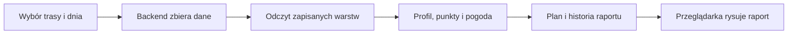

# Analiza trasy

## Co to jest

Analiza trasy to strona, która składa dostępne dane o zaplanowanej trasie w jeden raport. Nie należy jej mylić z oceną wykonanej jazdy z pliku FIT.

## Po co

Pomaga przed wyjazdem sprawdzić przebieg, teren, podjazdy, nawierzchnię, warunki i plan dnia.

## Skąd dane

Strona wybiera trasę z endpointu `/api/routes/ready`. Dane raportu przygotowuje backend z magazynu tras i osobnych silników. Rysowanie i wygląd obsługują oddzielne pliki strony.

## Jak liczone

Przykład z bazy: wersja trasy `komoot-3331694546` z 05.10.2026 miała 182,6 km i 209 zapisanych odcinków nawierzchni. To przykład zawartości magazynu, nie obietnica, że każda trasa ma tyle samo danych.

## Gdzie to widać

Strona `/raport-trasy.html`, tytuł „Analiza trasy”. Raport ma zakładki między innymi Nawierzchnia, Przewyższenia, Pogoda, Zaopatrzenie i Atrakcje.

## Jak czytać

Brak danych w zakładce oznacza, że jej warstwa nie jest dostępna dla wybranej trasy. Sprawdź też datę zapisanego planu; zmiana daty lub godziny może wymagać przeliczenia.

## Decyzje i historia

Raport składa się z backendu, renderera i arkusza stylów. Starszy opis jednego wypalanego pliku HTML jest nieaktualny. Aktualna strona korzysta z raportowych endpointów i oddzielnych plików renderujących.

## Ograniczenia i pułapki

Prognoza dotyczy wybranego dnia i godziny. Wynik historyczny w historii raportu nie jest automatycznie świeżą prognozą. Raport planowanej trasy nie jest raportem wykonanej jazdy.

## Wpływa na

Widok planu przed wyjazdem i eksport danych prezentowanych na stronie.

## Zależy od

Wybranej wersji trasy, jej obliczonych warstw, daty i dostępności prognozy.

## Powiązane hasła

- [Profil trasy](profil-trasy.md)
- [Nawierzchnia](nawierzchnia.md)
- [Czas przejazdu](czas-przejazdu.md)
- [Planer wyprawy](planer-wyprawy.md)

### Jak przejść raport krok po kroku

1. Wybierz trasę w górnym polu. Lista pokazuje trasy, dla których zapisano analizę nawierzchni.
2. Ustaw dzień i godzinę startu. Od tego zależy przypisanie prognozy do przejazdu.
3. Ustaw liczbę długich przerw oraz czas jednej takiej przerwy. To Twój plan, nie przewidywanie systemu.
4. Naciśnij „Przelicz”. Raport pobiera dane i zapisuje ich migawkę w historii.
5. Czytaj mapę i wykres razem: kilometr trasy łączy nawierzchnię, wysokość, pogodę i wiatr. Wiatr jest w m/s.

Na zrzucie poniżej wybrana jest trasa Rembertów z 17.10.2026, długość 53,7 km. Panel po lewej pokazuje start 09:30, 30 minut przerwy i czas 2 h 52 min. Mapa zajmuje środek ekranu, a wykres wysokości i nawierzchni jest na dole. Zrzut dokumentuje wygląd, nie potwierdza, że historyczna prognoza jest nadal aktualna.

Skąd biorą się liczby raportu

Raport łączy zapis śladu, obliczone warstwy trasy i prognozę dla wybranego dnia. Historia przechowuje dane raportu, nie gotowy obraz strony. Ponowne otwarcie starej migawki odtwarza zapisane dane; nie jest nową prognozą.

### Jak czytać konkretny dzień

Jeśli data raportu jest przeszła, potraktuj pogodę jako zapis dawnego wyliczenia. Jeśli mapa nie ma fragmentu w kolorze kategorii, sprawdź zakładkę nawierzchni i jej pokrycie. Puste miejsce nie oznacza automatycznie drogi asfaltowej. Jeżeli plan zmienia datę lub godzinę, przelicz go ponownie przed wyjazdem.

## Zrodla

- `/opt/qbot/app/docs/RAPORT_WEB.md` — architektura i historia raportu.
- `/opt/qbot/app/qbot_web.py` — `_build_report_data`, `/api/report/data`, `/api/routes/ready`.
- `/opt/qbot/web/public/raport-trasy.html` — wybór trasy, daty i przeliczenie.
- `/opt/qbot/web/public/raport-render.js` — zakładki i rysowanie.
- `qbot_v2.route_base` — aktywna wersja i geometria.
