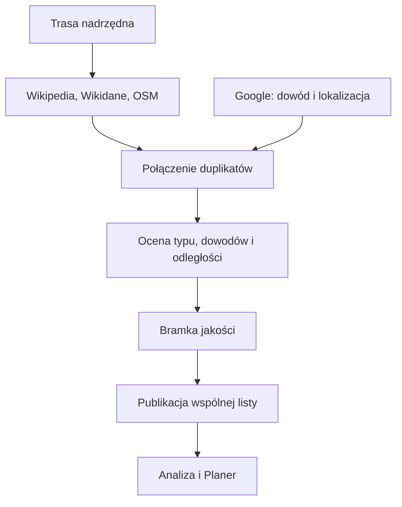

# Atrakcje przy trasie

## Co to jest

Atrakcje to osobna, oceniana lista miejsc wartych zobaczenia w pobliżu trasy. Silnik łączy dowody z kilku źródeł, a potem publikuje wspólny wynik dla Planera i Analizy trasy.

## Po co

Ułatwia wybór ciekawych miejsc na postój podczas jazdy lub wyprawy.

## Skąd dane

Kod wymienia Wikipedię, Wikidane, selektywny OSM i Google jako źródła uzupełniających się danych. Wynik publikuje `route_attraction_store` do tabel `route_attraction_run` i `route_attraction_layer`.

## Jak liczone

Przykład opisany w dokumencie źródłowym: trasa `komoot-3120318768`, 96 km, zebrała 26 wpisów Wikipedii i 58 obiektów OSM; po rankingu opublikowano 9 kandydatów. Dokument nazywa ten przebieg walidacją produkcyjną, ale jego daty nie potwierdzono w bieżącym kodzie ani bazie.

> DO SPRAWDZENIA: aktualna data i bieżący stan publikacji atrakcji trasy `komoot-3120318768`.

## Gdzie to widać

W zakładce Atrakcje w raporcie. Renderer umożliwia pobranie atrakcji i pokazuje informację, gdy żadna nie przejdzie progu.

## Jak czytać

Kandydat nie zawsze jest rekomendacją. Wynik rankingu i flaga rekomendacji są osobnymi polami. „Brak” może oznaczać brak wyników albo odrzucenie wszystkich przez bramkę jakości.

## Decyzje i historia

Dokument Planera z 18.07.2026 opisuje wersję rankingu 2.2 i wspólne źródło dla raportu oraz Planera. Starszy `Qbot_Route_Logistics.md` opisuje osobny, ręczny przepływ kandydatów POI do GPX i sam wskazuje, że poprawny import GPX do RWGPS nie został ustalony. Nie należy przedstawiać tego importu jako gotowej funkcji publikacji atrakcji.

## Ograniczenia i pułapki

Wyszukanie nie gwarantuje, że miejsce jest otwarte ani dostępne w dniu wyjazdu. Google jest dodatkowym sygnałem, nie samodzielnym werdyktem. Wynik może być częściowy, jeśli źródło OSM nie odpowie.

## Wpływa na

Zakładkę Atrakcje w raporcie i listę atrakcji przypisaną do dni wyprawy.

## Zależy od

Geometrii trasy, wyników źródeł, rankingu i opublikowanej warstwy dla wersji.

## Powiązane hasła

- [Planer wyprawy](planer-wyprawy.md)
- [Punkty na trasie](punkty-na-trasie.md)
- [Analiza trasy](analiza-trasy.md)

### Od kandydatów do rekomendacji

1. Źródła dostarczają kandydatów położonych przy trasie.
2. System łączy duplikaty i zbiera informacje o miejscu.
3. Kandydaci są oceniani według rodzaju miejsca, potwierdzeń i odległości od trasy.
4. Bramka jakości rozdziela rekomendacje od pozostałych kandydatów.
5. Jedna opublikowana lista jest używana przez raport trasy i Planer wyprawy.

To nie jest katalog wszystkich atrakcji przy drodze. Preferencje opisane w dokumencie projektu obejmują między innymi zamki, pałace i historyczne miasta; zwykłe obiekty sakralne nie są celem samym w sobie. Nie wpisuję tu punktowych progów rankingu, bo zależą od wersji algorytmu i wymagają potwierdzenia w jego aktualnej konfiguracji.

> DO SPRAWDZENIA: aktualna publikacja atrakcji i data jej obliczenia dla trasy `komoot-3120318768`.

Na stronie szukaj zakładki „Atrakcje”. To lista odrębna od zaopatrzenia: atrakcja służy zwiedzaniu, punkt logistyczny — obsłudze jazdy. Przy planowaniu etapu sprawdź czas zwiedzania i możliwość dojazdu.

## Zrodla

- `/opt/qbot/app/docs/PLANER_WYPRAW_ATRAKCJE.md` — wspólne źródło i ranking.
- `/opt/qbot/app/docs/Qbot_Route_Logistics.md` — odrębny eksperymentalny przepływ GPX i ograniczenia importu.
- `/opt/qbot/app/qbot3/routes/route_attraction_engine.py` — normalizacja i ranking.
- `/opt/qbot/app/qbot3/routes/route_attraction_sources.py` — źródła kandydatów.
- `/opt/qbot/app/qbot3/routes/route_attraction_store.py` — publikacja i odczyt.
- `/opt/qbot/app/sql/route_attraction_store_v1.sql` — warstwa danych.
- `/opt/qbot/web/public/raport-render.js` — zakładka i przycisk atrakcji.
