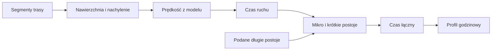
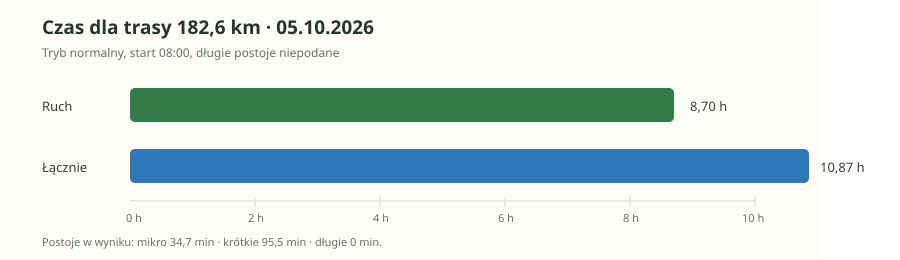

# Czas przejazdu

## Co to jest

`route_time_estimate` szacuje osobno czas jazdy i czas łączny z krótkimi postojami. Długich postojów nie zgaduje: dodaje je, gdy podasz ich liczbę i łączny czas.

## Po co

Pomaga ocenić długość dnia i przybliżoną godzinę dotarcia.

## Skąd dane

Segmenty nawierzchni i nachylenia pochodzą z kanonicznego odczytu osi trasy. Model prędkości v3 ładuje ustawienia z `config/speed_model.json`. Udokumentowana kalibracja używa zapisów jazd i próbek 1 Hz.

## Jak liczone

Sprawdzony przykład: dla aktywnej trasy `komoot-3331694546`, 182,6 km, wersja z 05.10.2026, wywołanie modelu normalnego z początkiem 08:00 zwróciło 8,70 godz. ruchu i 10,87 godz. łącznie. Model przewidział 34,7 min postoju mikro oraz 95,5 min krótkich postojów. Długie postoje wyniosły zero, bo nie zostały podane. To wynik bieżącego wywołania, bez deklarowanych długich przerw.

## Gdzie to widać

Narzędzie Alberta `route_time_estimate` oraz plan raportu trasy. Model wylicza też godzinowy profil przejazdu, jeśli podano start.

## Jak czytać

Tryb `normalny` korzysta z ustawień normalnych, `sport` i `wyscig` z szybszych ustawień. Wynik nie uwzględnia długiego obiadu ani zwiedzania, dopóki ich nie podasz. Wiatr i pogoda są osobnym obliczeniem.

## Decyzje i historia

Dokument o v2 z 30.06.2026 jest starszy. Jego końcowa sekcja opisuje v3: prędkości, postoje, bikepacking, współczynniki rowerów i rekalibrację jako kandydat wymagający zatwierdzenia. Aktualny `qbot_route_time_tools.py` czyta kanoniczne segmenty 50 m, więc starsze twierdzenie, że resolver czyta wyłącznie `route_frames`, jest nieaktualne. Opis raportu WWW z 18.10.2026 nadal streszcza część czasu jako v2 — to rozjazd dokumentacji z kodem.

## Ograniczenia i pułapki

Brak wymaganych danych kanonicznych może zwrócić `NEEDS_INPUT`; kod nie powinien wtedy podstawić wymyślonej średniej. Współczynnik bikepackingu wynosi 0,92 według opisu konfiguracji v3, ale użyte ustawienia mogą się zmienić.

## Wpływa na

Osobne wartości ruchu i całkowitego czasu w odpowiedzi oraz profil godzinowy raportu.

## Zależy od

Wersji trasy, kanonicznych segmentów, konfiguracji modelu i podanych długich postojów.

## Powiązane hasła

- [Profil trasy](profil-trasy.md)
- [Analiza trasy](analiza-trasy.md)
- [Planer wyprawy](planer-wyprawy.md)
- [Model czasu w słowniczku](../slowniczek.md#model-czasu-przejazdu)

### Przykład przeliczenia z zapisanej trasy

Dla `komoot-3331694546` z 05.10.2026 sprawdzone wywołanie trybu normalnego, start 08:00, zwróciło 8,70 godziny ruchu oraz 10,87 godziny łącznie. W wyniku było 34,7 min przerw mikro i 95,5 min krótkich. Długich przerw było 0, bo nie zostały podane. Różnica między czasem łącznym i ruchem obejmuje przerwy uwzględnione przez model.

1. Każdy fragment trasy dostarcza dystans, nachylenie i klasę nawierzchni.
2. Konfiguracja prędkości wskazuje tempo dla trybu normalnego, sportowego albo wyścigowego.
3. Czas fragmentu wynika z dystansu i przypisanej prędkości.
4. Model dodaje przerwy krótkie i mikro.
5. Użytkownik podaje długie przerwy; wynik pokazuje ruch oraz sumę osobno.

Wzór

Czas odcinka = dystans odcinka / prędkość przypisana temu odcinkowi. Czas ruchu to suma czasów odcinków. Czas łączny = czas ruchu + postoje modelowane + długie postoje zadane przez użytkownika. Wartości konfiguracji mogą się zmienić, dlatego przykład dotyczy zapisanego wywołania z 05.10.2026.

### Tryby i ostrożność

„Normalny” jest poziomem domyślnym. „Sport” i „wyścig” używają szybszych parametrów. Żaden tryb nie dodaje kary za wiatr do samej prędkości; pogoda jest osobnym wynikiem. Jeśli brak podstawowych danych o trasie, kod może zwrócić potrzebę uzupełnienia zamiast wymyślić średnią. Szacowanie czasu nie zastępuje zapasu na awarię, postoje turystyczne ani zmienną pogodę.

## Zrodla

- `/opt/qbot/app/docs/ROUTE_TIME_ESTIMATE_V2.md` — sekcje v2 i v3.
- `/opt/qbot/app/qbot_route_time_tools.py` — `estimate_route_time_v2`, `_load_route_segments`.
- `/opt/qbot/app/qbot3/routes/route_canonical_read.py` — kanoniczne segmenty trasy.
- `/opt/qbot/app/qbot3/tool_registry.py` — `route_time_estimate`.
- `/opt/qbot/app/qbot3/llm/albert.py` — zasady użycia narzędzia.
- `config/speed_model.json` — aktywna konfiguracja modelu.
- `img/trasy-czas-20261005.svg` — wykres z przykładu z 05.10.2026.
