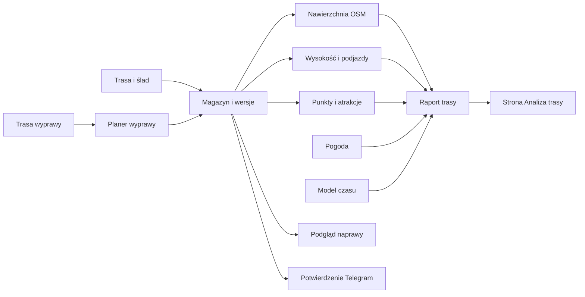
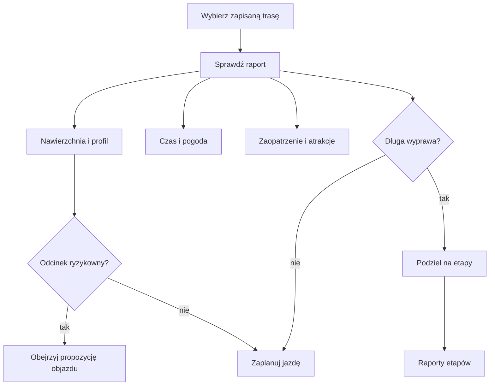

# Trasy

QBot analizuje trasy zapisane w swoim magazynie i pokazuje wynik na stronie Analiza trasy. Raport łączy przebieg trasy, nawierzchnię, wysokość, podjazdy, punkty i atrakcje; pogodę dołącza osobny silnik. Czas przejazdu jest liczony z danych o trasie i modelu prędkości, a długie przerwy trzeba podać samemu. Osobny planer dzieli długą trasę na dni. Propozycje naprawy są podglądem do oceny, a zapisane wersje mają własne dane.

## Jak korzystać z działu

Najpierw wybierz trasę zapisaną w magazynie. Raport pokazuje dostępne warstwy, ale ich obecność zależy od tego, co policzono dla konkretnego przebiegu. Przed jazdą sprawdź mapę, nawierzchnię, wysokość, pogodę oraz czas. Przy długiej trasie użyj Planera, a dla ryzykownego fragmentu otwórz Naprawę tras. Propozycja objazdu wymaga samodzielnego obejrzenia.

Na zrzucie widoczny jest raport dla trasy Rembertów z 17.10.2026, 53,7 km. Panel po lewej pokazuje plan startu, przerwę, czas jazdy, wschód i zachód słońca oraz podział nawierzchni i prędkości. Środkowa mapa pokazuje przebieg i kwadraty, dolny wykres — wysokość oraz pasma nawierzchni i wiatru. Dokładne znaczenie tych warstw opisują hasła poniżej.

| Co widzisz na ekranie | Hasło |
|---|---|
| Nazwa, data i dystans wybranej trasy | [Analiza trasy](analiza-trasy.md) |
| Mapa, kolor linii i wstążka nawierzchni | [Nawierzchnia](nawierzchnia.md) |
| Niebieskie pola, licznik nowych pól i kontrolki mapy | [Kwadraty na mapie](kwadraty-mapy.md) |
| Profil i lista podjazdów | [Profil trasy](profil-trasy.md) |
| Start, czas ruchu, postoje i godzina dotarcia | [Czas przejazdu](czas-przejazdu.md) |
| Sklepy, woda i usługi | [Punkty na trasie](punkty-na-trasie.md) |
| Miejsca do zwiedzania | [Atrakcje](atrakcje.md) |
| Ryzykowne fragmenty i podgląd objazdu | [Naprawa tras](naprawa-tras.md) |
| Identyfikator zapisanej wersji i archiwum | [Magazyn i wersje](store-i-wersje.md) |
| Zgoda oraz wiadomość po analizie w tle | [Potwierdzenia Telegram](potwierdzenia-telegram.md) |
| Podział długiej trasy na dni | [Planer wyprawy](planer-wyprawy.md) |
| Widok z brakującymi parametrami trasy i liczby dni | [Raport dnia](raport-dnia.md) |

W przykładzie z bazy dla `komoot-3331694546` z 05.10.2026 zapisano trasę 182,6 km, 209 fragmentów nawierzchni, 3654 próbki wysokości i 23 zdarzenia podjazdu. To konkret jednej trasy, nie minimalny zestaw danych dla każdej trasy.

## Hasła

- [Analiza trasy](analiza-trasy.md) — co łączy raport i gdzie go otworzyć.
- [Profil trasy](profil-trasy.md) — jak powstają wykres wysokości i lista podjazdów.
- [Nawierzchnia](nawierzchnia.md) — skąd pochodzą rozpoznane nawierzchnie i kiedy pozostają nieznane.
- [Punkty na trasie](punkty-na-trasie.md) — zaopatrzenie i inne punkty przy trasie.
- [Atrakcje](atrakcje.md) — osobna lista miejsc wartych zobaczenia.
- [Czas przejazdu](czas-przejazdu.md) — osobne oszacowanie jazdy i postojów.
- [Naprawa tras](naprawa-tras.md) — podgląd odcinków ryzykownych i możliwych objazdów.
- [Magazyn i wersje tras](store-i-wersje.md) — co QBot przechowuje i jak porządkuje zmiany.
- [Potwierdzenia Telegram](potwierdzenia-telegram.md) — co dzieje się po odpowiedzi „TAK”.
- [Planer wyprawy](planer-wyprawy.md) — podział trasy i przekazanie kolejnych dni do QBot.

## Wpływa na / Zależy od

Raport zależy od zapisanej wersji trasy i dostępnych warstw; wynik nawierzchni, profilu, punktów oraz atrakcji wpływa na odpowiednie zakładki raportu. Planer zależy od trasy nadrzędnej i przekazuje odcinki do magazynu. Powiadomienie Telegram informuje o wyniku pracy w tle, ale samo nie zmienia geometrii trasy.

## Powiązane hasła

- [Pogoda](../pogoda/index.md)
- [Trasy w Kalendarzu Trenera](../trener/trasy.md)
- [Mapa zależności](../zaleznosci.md)
- [Słowniczek](../slowniczek.md)

## Zrodla

- `/opt/qbot/app/docs/RAPORT_WEB.md` — architektura raportu i endpointy.
- `/opt/qbot/app/docs/architecture/QBOT_ARCHITEKTURA_QBOT3.md` — warstwy tras, OSM i wysokość.
- `/opt/qbot/app/qbot_web.py` — `_build_report_data`, endpointy raportu.
- `/opt/qbot/web/public/raport-trasy.html` — formularz i wybór trasy.
- `/opt/qbot/web/public/raport-render.js` — zakładki raportu.
- `/opt/qbot/web/public/naprawa-trasy.html` — ekran podglądu odcinków i objazdów.
- `/opt/qbot/web/public/raport-dzien.html` — parametry widoku analizy dnia.
- `/opt/qbot/web/public/raport-render.js` — nakładki i kontrolki mapy.
