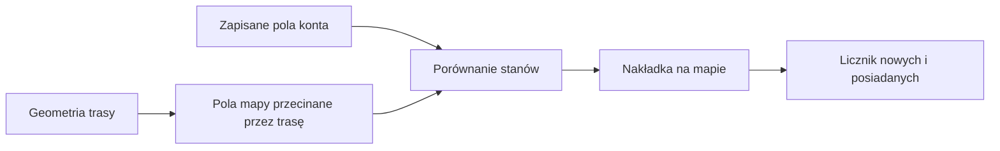

# Kwadraty na mapie trasy

## Co to jest

Kwadraty to dodatkowa siatka na mapie, która pokazuje pola przecinane przez trasę oraz pola już zapisane w koncie udostępniania. Nie są oznaczeniem nawierzchni ani wskazówką nawigacyjną.

## Po co

Pomagają zobaczyć, które pola trasa może dodać do kolekcji i jaki obszar wokół niej jest już znany.

## Skąd dane

Położenie pól wynika z geometrii trasy. Stan posiadania jest pobierany z połączenia StatsHunters, gdy jest skonfigurowane. Zrzut raportu z 17.10.2026 pokazuje niebieską siatkę i licznik „+0 nowych / 35 masz”; to opis widoczny na zrzucie, a nie nowy odczyt z usługi.

## Jak liczone

1. Mapa bierze geometrię wybranej trasy.
2. Wyznacza pola siatki, przez które przebiega ślad.
3. Porównuje je z listą pól konta, jeśli źródło jest dostępne.
4. Rysuje nakładkę oraz podsumowanie.

Kwadraty mają cztery stany: nowe pola na trasie, pola trasy już posiadane, posiadane pola w otoczeniu oraz wolne pola w otoczeniu. Na mapie nowe są zielone, posiadane pola trasy niebieskie, a posiadane pola otoczenia szare; wolne pola otoczenia mają sam obrys. Otoczka ma domyślnie trzy pola szerokości od przebiegu. Jest to ustawienie kontekstu mapy, nie wyznacznik dystansu dojazdu.

Trasa jest próbkowana co około 90 m, aby nie pominąć pól siatki. Warstwa korzysta z siatki mapowej z14, zgodnej z danymi StatsHunters. Inna część systemu używa siatki 0,01 stopnia do historii GPX; tych dwóch podziałów nie należy utożsamiać.

Na ekranie znajdują się osobne przyciski „Wyśrodkuj trasę”, „Mapa: B/W” i „Kwadraty: wł.”. Pierwszy dopasowuje mapę do całej trasy, drugi zmienia wygląd podkładu, a trzeci pokazuje lub ukrywa kwadraty. Linia kolorowa na drodze nadal oznacza nawierzchnię.

Jeśli mapa jest przybliżona do jednego miejsca, użyj wyśrodkowania; nie oznacza to ponownego przeliczenia kwadratów. Przycisk kwadratów steruje tylko nakładką, a ustawienie B/W tylko wyglądem podkładu.

## Jak czytać

Jeśli licznik nowych pól wynosi zero, trasa według aktualnego porównania nie dodaje nowych kwadratów. Licznik posiadanych pól może być większy od liczby pól przeciętych trasą, bo nakładka obejmuje również otoczenie. Nie planuj przejazdu na podstawie samej siatki — najpierw oceniaj przebieg i drogi.

## Ograniczenia i pułapki

Wynik zależy od geometrii trasy i dostępności połączenia z usługą. Brak nakładki nie dowodzi, że trasa nie przechodzi przez żadne pole. Zrzut nie potwierdza aktualnego stanu konta.

Lista posiadanych pól pochodzi z udostępnienia StatsHunters i może korzystać z pamięci podręcznej. Gdy lista jest niedostępna lub stara, licznik nie jest niezależnym pomiarem mapy. Zmiana wyglądu strony także nie odświeża sama w sobie źródłowej listy pól.

## Wpływa na

Wyłącznie dodatkową nakładkę i licznik pól na mapie raportu. Nie zmienia geometrii, nawierzchni ani czasu przejazdu.

## Zależy od

Wybranej geometrii oraz dostępnego stanu pól konta.

## Powiązane hasła

- [Analiza trasy](analiza-trasy.md)
- [Nawierzchnia](nawierzchnia.md)
- [Magazyn i wersje](store-i-wersje.md)

## Zrodla

- `/opt/qbot/app/docs/RAPORT_WEB.md` — sekcja „Kwadraty (StatsHunters)”.
- `/opt/qbot/app/qbot_web.py` — endpoint `GET /api/routes/{route_id}/tiles`.
- `/opt/qbot/web/public/raport-render.js` — kontrolka i nakładka mapy.
- `img/ekrany/raport-trasy.png` — zrzut z licznikiem i widoczną siatką.
