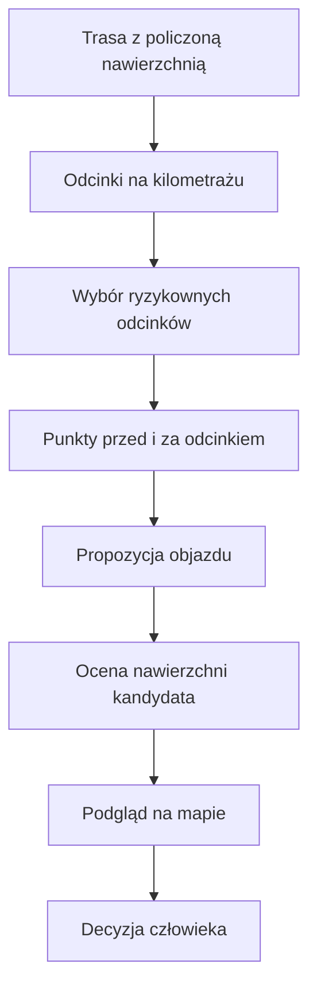
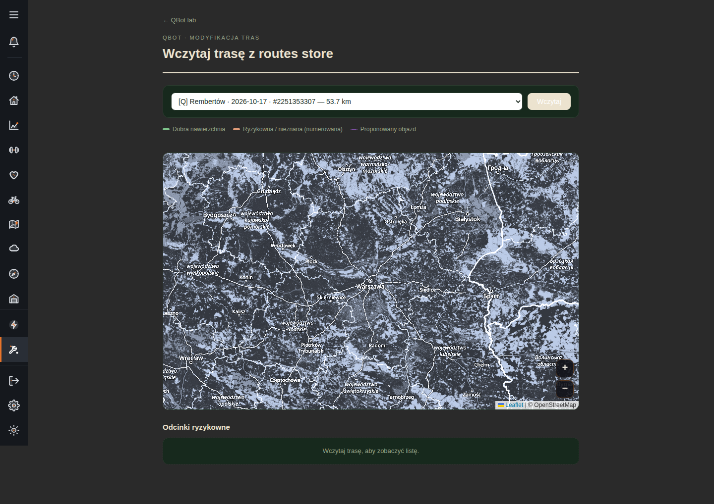

# Naprawa tras

## Co to jest

Naprawa tras to strona pokazująca ryzykowne fragmenty i może obliczyć propozycję objazdu. Propozycja jest podglądem do oceny człowieka; moduł nie zapisuje sam zmienionej trasy.

## Po co

Pomaga znaleźć fragmenty o niepewnej lub trudnej nawierzchni i obejrzeć możliwą alternatywę.

## Skąd dane

Lista tras pochodzi z magazynu z policzoną nawierzchnią. Strona pobiera geometrię i segmenty z endpointów qbot-web. Kandydat objazdu używa publicznego Valhalla.

## Jak liczone

## Gdzie to widać

Strona WWW `naprawa-trasy.html`, z mapą i tabelą odcinków.

## Jak czytać

Odcinek ryzykowny pochodzi z warstwy QBot; jakość kandydata ocenia Valhalla. Są to dwa różne systemy oceny. Zwróć uwagę na długość objazdu i sam obejrzyj go na mapie.

## Decyzje i historia

Dokument projektu z 01.07.2026 mówi, że funkcjonalność działała, lecz wymagała ponownej weryfikacji jednego odcinka po awarii publicznego serwera. Dokument nie potwierdza bieżącej dostępności serwera. Kod strony i endpointów potwierdza mechanizm podglądu, a nie zapis zmienionej trasy.

## Ograniczenia i pułapki

Valhalla jest usługą zewnętrzną i może być niedostępna. W dokumencie nierozstrzygnięta jest różnica między klasyfikacją OSM QBot i klasyfikacją Valhalli. Nie traktuj wygenerowanego objazdu jako automatycznie bezpiecznego.

## Wpływa na

Podgląd decyzji o ewentualnym ręcznym poprawieniu trasy.

## Zależy od

Wersji z warstwą nawierzchni, geometrii, endpointów strony i publicznej usługi Valhalla.

## Powiązane hasła

- [Nawierzchnia](nawierzchnia.md)
- [Magazyn i wersje tras](store-i-wersje.md)
- [Analiza trasy](analiza-trasy.md)

### Co dzieje się po kliknięciu

1. Wybierz trasę z listy tras, które mają policzoną nawierzchnię.
2. Mapa i tabela pokazują ciągłe odcinki oznaczone jako ryzykowne wraz z kilometrażem i uzasadnieniem.
3. Wybierz odcinek lub przycisk „Nowy kandydat”, aby poprosić o objazd.
4. Serwis trasowania zwraca możliwy przebieg, a jego własna ocena nawierzchni sprawdza, czy kandydat nadal wygląda na ryzykowny.
5. Obejrzyj cały objazd. Strona nie zapisuje automatycznie poprawionej trasy.

Kod ukrywa osobny alert krótszy niż 200 m i scala bliskie odcinki ryzykowne oddalone od siebie o mniej niż 200 m. Są to reguły grupowania alarmu, nie dowód, że krótki fragment jest bezpieczny.

Na załączonym zrzucie wybrano trasę Rembertów 53,7 km, ale mapa nadal pokazuje szeroki obszar Polski, a lista mówi „Wczytaj trasę, aby zobaczyć listę”. To ekran przed wczytaniem. Po kliknięciu „Wczytaj” powinny pojawić się dane odcinków; samego wyniku interakcji nie potwierdziłem w przeglądarce.

### Dwie różne oceny

Oznaczenie ryzyka oryginalnej drogi pochodzi z warstwy QBota. Ocena proponowanego objazdu korzysta z danych zwracanych przez zewnętrzny serwis. Gdy te oceny się różnią, nie traktuj zielonego kandydata jako gwarancji. Dokumentacja projektu opisuje znaną rozbieżność między klasyfikacją mapową a oceną serwisu trasowania.

### Kiedy kandydat nie jest dostępny

Propozycja zależy od tego, czy silnik zewnętrzny odpowie i czy znajdzie połączenie między punktami przed i za problemem. Brak kandydata nie znaczy, że droga jest zamknięta; mówi tylko, że w danym wywołaniu nie uzyskano trasy, którą można pokazać. Odwrotnie, sama obecność linii na mapie nie sprawdza nawierzchni na miejscu, ruchu, zakazu wjazdu ani bezpieczeństwa skrętu.

Jeśli odcinek leży przy ruchliwej drodze lub w lesie, obejrzyj punkty początku i końca objazdu. Wybór lepszej nawierzchni może oznaczać dodatkowy dystans. Kod nie stosuje limitu wydłużenia jako kryterium akceptacji; dlatego porównanie długości należy do Ciebie.

## Zrodla

- `/opt/qbot/app/docs/PROJEKT_NAPRAWA_TRAS.md` — zakres, decyzje i znane ograniczenia.
- `/opt/qbot/app/qbot_web.py` — endpointy geometrii, segmentów i kandydata.
- `/opt/qbot/web/public/naprawa-trasy.html` — interfejs podglądu.
- `/opt/qbot/app/tools/rwgps/route_surface_engine.py` — klasyfikacja nawierzchni śladu.
