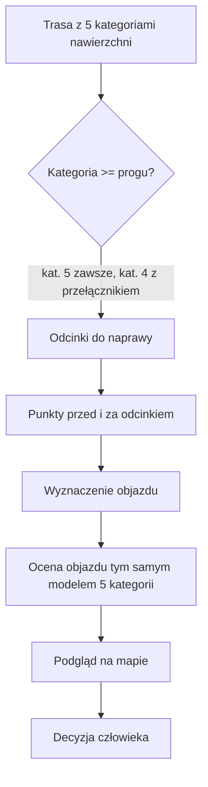

# Naprawa tras

## Co to jest

Strona, która pokazuje na trasie odcinki o złej nawierzchni i na żądanie proponuje objazd. Objazd to propozycja do Twojej oceny — moduł sam nie zmienia trasy.

## Po co

Żeby przed wyjazdem znaleźć fragmenty, które mogą być nieprzejezdne albo bardzo wolne, i zobaczyć, czy da się je ominąć lepszą drogą.

## Skąd dane

Lista tras pochodzi z magazynu tras z policzoną nawierzchnią. Ocena nawierzchni to te same 5 kategorii co w Analizie trasy (od „twarda szybka" do „ryzyko/niepewne"). Drogę objazdu wyznacza własny mini-router QBota na lokalnej bazie dróg Polski — według tych samych 5 kategorii. Poza Polską (albo gdy router nic nie znajdzie) zapasem jest publiczny silnik Valhalla. Każdy wariant ocenia na końcu ten sam model co Analiza trasy.

## Jak liczone

## Gdzie to widać

Analiza trasy → przycisk „Napraw trasę” (tylko na komputerze; na telefonie funkcja jest niedostępna). Trasa NAPRAWA ma w Analizie trasy zielony pasek z informacją, z jakiej trasy powstała.

## Jak czytać

Odcinek do naprawy to fragment o kategorii 5 (ryzyko/niepewne), a po włączeniu przełącznika także 4 (trudna/wolna). Przy każdym odcinku widać rozkład kategorii i powód. Objazd ma własny rozkład kategorii liczony tak samo jak w Analizie trasy, więc oba wyniki można wprost porównać. Zwróć uwagę na długość objazdu — wybór lepszej nawierzchni często oznacza dodatkowe kilometry.

## Decyzje i historia

- 01.07.2026: pierwsza wersja; objazdy oceniała Valhalla własną skalą nawierzchni, inną niż reszta QBota — znana rozbieżność „dwóch systemów oceny".
- 19.10.2026: moduł wznowiony. Jedna ocena nawierzchni: odcinki i objazdy liczone 5 kategoriami z Analizy trasy (z kontekstem terenu WorldCover dla dróg bez opisu). Kat. 5 zawsze, kat. 4 przełącznikiem. Odcinek na samym starcie lub mecie trasy też dostaje objazd. Trasa liczona starym modelem pokazuje komunikat „przelicz trasę".
- 19.10.2026: kwadraty (przełącznik przy odcinku, warstwa na mapie, bilans), czytelne kolory nowego przebiegu, zakładki promieni z powrotem do wcześniejszych propozycji.
- 19.10.2026: ekran nadzoru (warianty, akceptacja, bilans) i zapis jako osobna trasa NAPRAWA z pełnym przeliczeniem; tylko komputer.
- 19.10.2026: mini-router na lokalnej bazie dróg — sam omija złą nawierzchnię, zakazy (autostrady, ekspresówki, drogi prywatne, schody) i jazdę pod prąd; daje do 3 różnych wariantów. Valhalla tylko zapasem.

## Ograniczenia i pułapki

Liczenie objazdu trwa od 1 do kilkunastu sekund (najdłużej w mieście). Mapa OSM może nie znać nowych zakazów albo remontów. Poza Polską objazd zależy od zewnętrznego serwera Valhalla. Objazd z linii na mapie nie sprawdza ruchu, zakazów wjazdu ani bezpieczeństwa skrętów. Brak kandydata nie znaczy, że droga jest zamknięta — tylko że w tym wywołaniu nie znaleziono lepszego połączenia.

## Wpływa na

Decyzję o ręcznej poprawie trasy przed wyjazdem.

## Zależy od

Magazynu tras z 5 kategoriami nawierzchni, lokalnej bazy dróg OSM, warstwy WorldCover i (na razie) serwera Valhalla.

## Powiązane hasła

- [Nawierzchnia](nawierzchnia.md)
- [Magazyn i wersje tras](store-i-wersje.md)
- [Analiza trasy](analiza-trasy.md)

### Co dzieje się po kliknięciu

1. Wybierz trasę z listy tras z policzoną nawierzchnią i kliknij „Wczytaj".
2. Mapa i tabela pokazują odcinki do naprawy z kilometrażem, rozkładem kategorii i powodem.
3. Kliknij odcinek albo „Nowy kandydat", aby poprosić o objazd.
3a. Gdy kawałek zbiera nowe kwadraty, możesz zaznaczyć „Uwzględnij kwadraty” — wtedy objazd musi przez nie przejechać. Skutek dla kwadratów (zachowane / zgubione) widać przy każdym wariancie zawsze.
4. QBot szuka objazdu w coraz większym promieniu (0,3 / 1 / 2 / 3 km); zatrzymuje się, gdy zła nawierzchnia spadnie poniżej 200 m albo gdy większy promień nic nie poprawia. Zwraca do 3 różnych wariantów, każdy oceniony modelem 5 kategorii, z wydłużeniem względem zastępowanego kawałka.
5. Przyjmij wariant albo zostaw oryginał — bilans na górze pokazuje długość i złą nawierzchnię całej trasy.
6. „Gotowe” wraca do Analizy trasy: na mapie widać stary (szary przerywany) i naprawiony (fioletowy) przebieg, a obok „Napraw trasę” jest „Zapisz naprawioną trasę”, który tworzy NOWĄ trasę „<nazwa> · NAPRAWA n” (oryginał bez zmian) i liczy dla niej wszystko jak dla nowej trasy (kilka minut, wiadomość na Telegramie). Potem w Analizie trasy → „Udostępnij” → Wyślij na Karoo.

Odcinki złej nawierzchni krótsze niż 200 m nie są zgłaszane osobno, a bliskie (przerwa < 200 m) są scalane. To reguły grupowania, nie dowód, że krótki fragment jest dobry.

## Zrodla

- `/opt/qbot/app/docs/PROJEKT_NAPRAWA_TRAS.md` — zakres, decyzje, wyniki testów, plan.
- `/opt/qbot/app/qbot_web.py` — endpointy odcinków i kandydata, ocena objazdu `_detour_surface_categories`.
- `/opt/qbot/app/qbot3/routes/route_detour_router.py` — mini-router objazdów.
- `/opt/qbot/web/public/naprawa-trasy.html` — interfejs podglądu.
- `/opt/qbot/app/qbot3/routes/route_surface_category_store.py` — model 5 kategorii.
- `/opt/qbot/app/qbot3/routes/route_surface_context_store.py` — kontekst terenu (WorldCover).
- `/opt/qbot/app/tools/rwgps/route_surface_engine.py` — silnik nawierzchni śladu.
