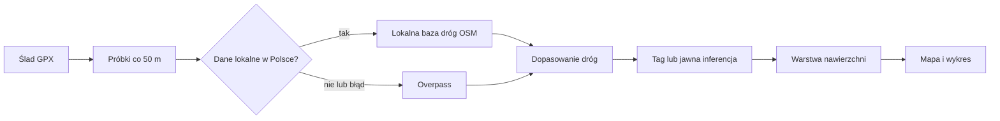

# Nawierzchnia trasy

## Co to jest

QBot przypisuje fragmentom śladu kategorię nawierzchni na podstawie danych mapowych i reguł silnika. Wynik jest zapisany osobno dla wersji trasy.

## Po co

Pomaga rozpoznać asfalt, drogi nieutwardzone i odcinki wymagające ostrożności przed jazdą.

## Skąd dane

Głównym źródłem jest silnik `route_surface_engine_v1`, analizujący rzeczywisty ślad. W Polsce może korzystać z lokalnej bazy dróg OSM z Geofabrik; poza jej zakresem lub przy problemie lokalnym używany jest Overpass. Dane lokalne opisują mapę OpenStreetMap, nie są pomiarem nawierzchni na miejscu.

## Jak liczone

Przykład z bazy: wersja trasy `komoot-3331694546` z 05.10.2026 ma zapisanych 209 segmentów nawierzchni. Liczba segmentów nie jest udziałem procentowym żadnej kategorii.

## Gdzie to widać

W Analizie trasy: zakładka Nawierzchnia, mapa kolorująca przebieg oraz wykres.

## Jak czytać

Nieznane oznacza brak pewnego dopasowania, a nie potwierdzony asfalt. Silnik rozróżnia jawne tagi OSM i inferencję oraz raportuje jakość. Wartość w mapie może być nieaktualna, jeżeli została wyliczona przed nowszą poprawką silnika.

## Decyzje i historia

Kod jest ważniejszy niż starszy audyt. Audyt z 02.07.2026 opisywał wadliwą proweniencję części dawnych zapisów; architektura z 28.06 opisuje późniejszy kontrakt jakości. Przy starym wyniku stan konkretnych segmentów trzeba sprawdzić przed wyciąganiem wniosków.

## Ograniczenia i pułapki

Lokalna baza opisana w dokumencie obejmuje Polskę. Za granicą system korzysta z Overpass i może ostrzegać o niepełnych danych. Tagi OSM mogą być błędne lub nieobecne. Klasyfikacja nie zastępuje sprawdzenia drogi przed przejazdem.

## Wpływa na

Kolor mapy i wykresu, podsumowanie odcinków oraz oszacowanie czasu jazdy.

## Zależy od

Geometrii wersji, danych OSM, dostępności źródła i jakości dopasowania.

## Powiązane hasła

- [Analiza trasy](analiza-trasy.md)
- [Czas przejazdu](czas-przejazdu.md)
- [Naprawa tras](naprawa-tras.md)

### Co oznacza kolor

Raport sprowadza surowe opisy mapy do pięciu kategorii czytelnych na mapie i wstążce wykresu: asfalt, dobry szuter, zwykły szuter, trudna lub wolna nawierzchnia oraz ryzyko. Kolory nie są oceną bezpieczeństwa całej trasy. Ostatnia kategoria pozostaje widoczna jako ostrzeżenie i nie jest usuwana przez łączenie krótkich fragmentów.

1. Ślad jest próbkowany wzdłuż trasy i dopasowywany do dróg z OpenStreetMap.
2. Dla Polski kod sprawdza lokalny zestaw dróg; w pozostałych przypadkach lub przy problemie źródła może użyć Overpass.
3. Tagi mapy i stan dopasowania służą do przypisania kategorii i pewności.
4. Raport scala część krótkich sąsiadujących odcinków, aby mapa i wykres były czytelne.

Dla trasy `komoot-3331694546` z 05.10.2026 zapisano 209 fragmentów surowej warstwy nawierzchni. To liczba zapisanych fragmentów, nie 209 km ani 209 dróg.

Na zrzucie przebieg jest kolorowy, a niebieskie kwadraty są osobną nakładką zdobytych pól mapy. Koloru samej drogi szukaj w linii trasy i wstążce na dolnym wykresie; nie utożsamiaj go z niebieską siatką.

### Jak czytać brak danych

„Nieznana” oznacza brak pewnego rozpoznania, nie potwierdzony asfalt. Jeśli udział danych jest mały lub źródło zewnętrzne nie odpowiedziało, wniosek o całej trasie powinien być ostrożny. OSM jest mapą tworzoną przez użytkowników i może być nieaktualna.

## Zrodla

- `/opt/qbot/app/docs/architecture/QBOT_ARCHITEKTURA_QBOT3.md` — parametry silnika i jakość.
- `/opt/qbot/app/docs/OSM_LOCAL_SURFACE.md` — źródło lokalne i zakres Polski.
- `/opt/qbot/app/docs/AUDYT_NAWIERZCHNIA.md` — ustalenia audytu i historyczna proweniencja.
- `/opt/qbot/app/tools/rwgps/route_surface_engine.py` — `analyze_route_surface`.
- `/opt/qbot/app/tools/rwgps/osm_local.py` — lokalne zapytania OSM.
- `/opt/qbot/app/qbot3/routes/route_surface_store.py` — zapis wyników.
