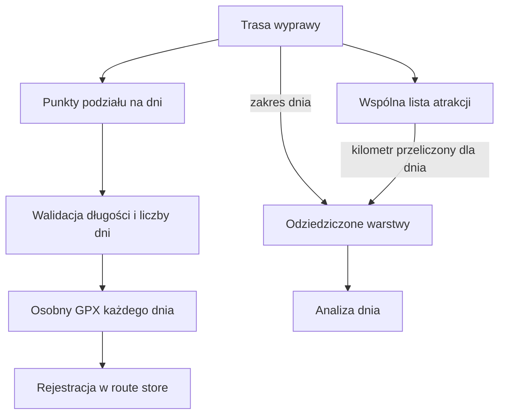

# Planer wyprawy

## Co to jest

Planer przygotowuje długą trasę jako wyprawę, wyszukuje wspólną listę atrakcji i pozwala podzielić ślad na dzienne trasy. Dni są zapisywane w magazynie, aby można było otworzyć je w Analizie trasy.

## Po co

Pomaga rozłożyć przebieg na dni i obejrzeć atrakcje bez ponawiania ich wyszukiwania dla każdego odcinka.

## Skąd dane

Planer korzysta z trasy nadrzędnej oraz wspólnej opublikowanej warstwy atrakcji. Po podziale dziedziczy odpowiednie zakresy nawierzchni i logistycznych POI.

## Jak liczone

## Gdzie to widać

Osobna strona Planera wyprawy. Przygotowane odcinki trafiają do magazynu tras i są dostępne w Analizie trasy.

## Jak czytać

Atrakcje wyszukiwane są dla wyprawy nadrzędnej. W raporcie dnia widoczne są tylko te z jego zakresu, z kilometrami liczonymi od początku dnia. Logistyczne punkty pozostają odrębną warstwą.

## Decyzje i historia

Dokument z 18.07.2026 opisuje eksport etapów przez `POST /api/planer/dodaj-do-qbot`, maksymalnie 12 dni i co najmniej 1 km na dzień. Identyczny podział jest idempotentny. Przy innym podziale poprzedni zestaw jest sprzątany dopiero po poprawnym zapisaniu nowego.

## Ograniczenia i pułapki

Opisany limit i kontrakt pochodzą z dokumentu projektu, a bieżącej walidacji endpointu w tej pracy nie wykonywałem. Niepotwierdzony jest tu aktualny dostęp do usług zewnętrznych w czasie wyszukiwania atrakcji.

## Wpływa na

Zapis dziennych tras, ich warstwy, dostępność w raporcie i retencję tras dzieci.

## Zależy od

Geometrii trasy rodzica, punktów podziału, route store oraz warstwy atrakcji i POI.

## Powiązane hasła

- [Atrakcje](atrakcje.md)
- [Punkty na trasie](punkty-na-trasie.md)
- [Magazyn i wersje tras](store-i-wersje.md)
- [Czas przejazdu](czas-przejazdu.md)

### Od wyprawy do raportu dnia

1. Wskaż trasę główną i przebieg podziału na dni.
2. Planer sprawdza punkty podziału i tworzy osobny plik śladu dla każdego etapu.
3. Etapy są zapisywane jako trasy dostępne później w raporcie.
4. Warstwy z trasy głównej są ograniczane do zasięgu danego dnia. Kilometraż atrakcji jest przeliczany względem początku etapu.
5. Każdy etap można analizować osobno, z własną datą i godziną przejazdu.

Dokument projektu opisuje limit 12 dni i minimalny etap 1 km. Ponieważ w tej pracy nie sprawdziłem bieżącego endpointu po zalogowaniu, traktuj limity jako opis udokumentowanej reguły, nie jako zweryfikowaną próbę interfejsu.

Zrzut `raport-dzien.png` nie jest potwierdzeniem poprawnie otwartego etapu: pokazuje komunikat „Brak parametrów (route_id, days)”. Oznacza to, że ta konkretna próba strony nie otrzymała wymaganych parametrów. Nie wyciągaj z niej wniosków o zawartości raportu dnia.

### Planowanie przerw

Podział trasy na etapy nie określa automatycznie czasu zwiedzania ani długich przerw. Czas przejazdu dla dnia licz osobno i uzupełnij plan o realny czas postoju. Atrakcje, punkty zaopatrzenia i podział geometryczny to trzy różne elementy.

## Zrodla

- `/opt/qbot/app/docs/PLANER_WYPRAW_ATRAKCJE.md` — podział, dziedziczenie i ograniczenia.
- `/opt/qbot/app/qbot3/routes/planer_stage_export.py` — walidacja, eksport i sprzątanie.
- `/opt/qbot/app/qbot3/routes/route_attraction_store.py` — publikacja rodzica dla dni.
- `/opt/qbot/app/qbot3/routes/route_poi_store.py` — odziedziczone POI logistyczne.
- `/opt/qbot/app/sql/route_stage_lineage_v1.sql` — `route_stage_lineage`.
- `/opt/qbot/web/public/planer-wyprawy.html` — strona Planera.
