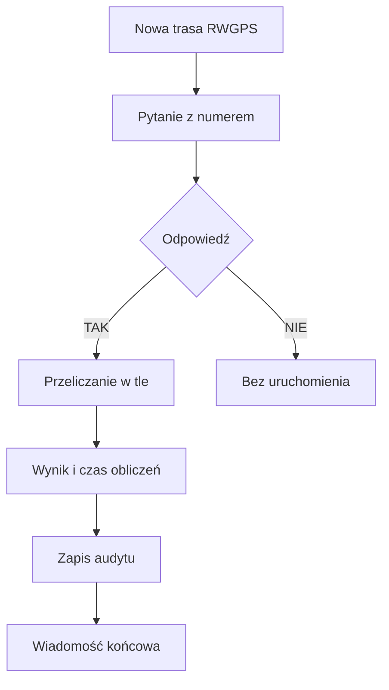

# Potwierdzenia tras w Telegramie

## Co to jest

To przepływ, w którym QBot pyta o zgodę na analizę nowej trasy, wykonuje obliczenia w tle po odpowiedzi i wysyła wiadomość o wyniku.

## Po co

Oddziela zgodę właściciela od długiego przeliczania i pozwala sprawdzić, czy wysłano końcowe powiadomienie.

## Skąd dane

Telegram zapisuje tury rozmowy i oczekujące akcje. Worker uruchamia `route_precompute_trigger.py`, a audyt końcowego powiadomienia zapisuje się w `telegram_conversation_turns`.

## Jak liczone

## Gdzie to widać

W rozmowie z botem Telegram. Kod przewiduje osobne wpisy audytu dla wysłanego i nieudanego końcowego powiadomienia.

## Jak czytać

Samo przyjęcie odpowiedzi „TAK” oznacza uruchomienie pracy, nie dowodzi zakończenia. Wynik i audyt wiadomości końcowej to oddzielne etapy.

## Decyzje i historia

Dokument z 01.07.2026 opisuje numerowane potwierdzenia, worker w osobnym procesie i idempotencję powiadomień. Późniejsza obsługa ręcznego „przelicz trasę” może również wymagać potwierdzenia, gdy ID pochodzi tylko z kontekstu rozmowy.

## Ograniczenia i pułapki

Nieudana wysyłka powiadomienia nie oznacza automatycznie, że samo przeliczanie się nie udało. Do ustalenia bieżącego wyniku należy sprawdzić audyt i joby.

## Wpływa na

Uruchomienie obliczeń trasowych po zgodzie oraz informację zwrotną w Telegramie.

## Zależy od

Oczekującej akcji, poprawnej odpowiedzi, workerów, konfiguracji Telegram i tabel audytu.

## Powiązane hasła

- [Magazyn i wersje tras](store-i-wersje.md)
- [Analiza trasy](analiza-trasy.md)
- [Albert](../albert/index.md)

### Jak odróżnić zgodę od ukończenia

1. Nowa trasa może wywołać pytanie z numerem odpowiedzi.
2. Odpowiedź „TAK” dopuszcza uruchomienie obliczeń; „NIE” zatrzymuje tę ścieżkę.
3. Praca odbywa się w tle. Samo przyjęcie odpowiedzi nie znaczy, że warstwy są gotowe.
4. Po zakończeniu system osobno próbuje wysłać wiadomość z wynikiem i czasem pracy.
5. Audyt końcowego powiadomienia rozróżnia wysyłkę udaną i nieudaną.

Zrzut raportu trasy nie przedstawia rozmowy Telegram. Potwierdzenie odbywa się w Telegramie; nie należy odczytywać dzwonka w lewym pasku WWW jako odpowiedzi na konkretną trasę. Szczegóły tury i końcowej wiadomości są śladem audytowym, a nie widokiem tego zrzutu.

Jeśli nie przyszła wiadomość końcowa, możliwe są dwa osobne stany: analiza nie została zakończona albo analiza się zakończyła, lecz powiadomienie nie dotarło. Rozstrzyga to zapis audytu, nie ponowne wysyłanie „TAK” na ślepo.

### Co przygotować przy diagnozie

Zanotuj identyfikator trasy, przybliżony czas odpowiedzi i treść wiadomości. Potem sprawdź osobno: czy odpowiedź została przyjęta, czy powstał wynik przeliczenia oraz czy zapisano próbę wysłania końcowego powiadomienia. Każdy z tych punktów dotyczy innego etapu. Ten opis wyjaśnia ślady techniczne; użytkownik nie musi sam przeglądać tabel, aby korzystać z funkcji.

Jeśli bot pyta o zgodę, wybierz odpowiedź dla właściwego numeru. Stare lub powtórzone potwierdzenie może dotyczyć innej oczekującej akcji, dlatego zawsze sprawdź kontekst rozmowy.

## Zrodla

- `/opt/qbot/app/docs/TELEGRAM_ROUTE_CONFIRM.md` — reguły i audyt potwierdzenia.
- `/opt/qbot/app/scripts/route_precompute_trigger.py` — worker i końcowe powiadomienie.
- `/opt/qbot/app/qbot3/routes/route_precompute_orchestrator.py` — joby analizy.
- `telegram_conversation_turns` — intencje i audyt wiadomości.
- `telegram_pending_actions` — oczekujące potwierdzenia.
