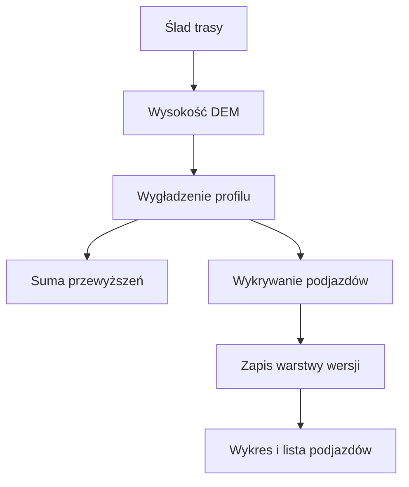
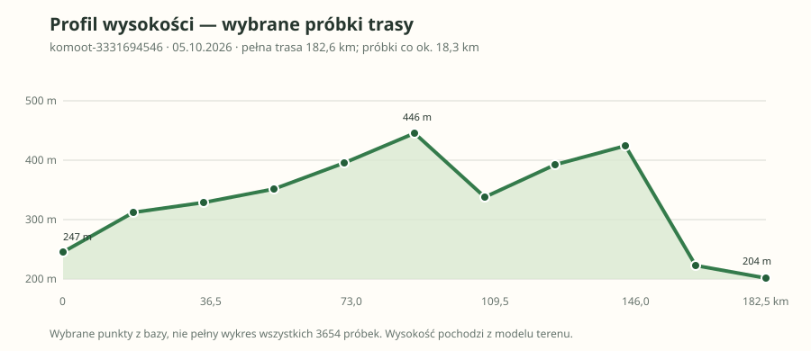

# Profil trasy i podjazdy

## Co to jest

Profil pokazuje zmianę wysokości wzdłuż zaplanowanej trasy. Lista podjazdów jest osobnym wynikiem wykrywania, zapisanym dla wersji trasy.

## Po co

Pomaga zobaczyć, gdzie trasa się wznosi i które podjazdy mogą wymagać uwagi.

## Skąd dane

Warstwa wysokości korzysta z próbek SRTM30m zapisanych w `route_elevation_samples`. Zdarzenia podjazdów są przechowywane w `route_climb_events`. Kod używa lokalnego wygładzania wysokości; oś 50 m służy do raportowania i łączenia warstw.

## Jak liczone

Na wersji `komoot-3331694546` z 05.10.2026 baza zawierała 3654 próbki wysokości i 23 wykryte podjazdy; trasa miała 182,6 km. To odczyt bazy, nie ręcznie dobrany przykład.

Poniższy schemat pokazuje wybrane próbki tej trasy, co około 18,3 km. Nie jest to komplet danych ani nowo obliczona suma przewyższeń.

## Gdzie to widać

W Analizie trasy, w zakładce „Przewyższenia”, na profilu oraz liście podjazdów.

## Jak czytać

Liczba wykrytych podjazdów zależy od reguł silnika i dostępnych próbek. Brak wpisów o podjazdach nie dowodzi, że trasa jest idealnie płaska.

## Decyzje i historia

Architektura wskazuje SRTM30m jako źródło wysokości. Podjazd odpowiada progom opisanym w kodzie; nie należy opisywać osi 50 m jako jedynego źródła wysokości ani podjazdów.

## Ograniczenia i pułapki

Wysokość DEM jest pomiarem modelowym terenu, a nie odczytem barometru rowerzysty. Jakość i kompletność zależą od zapisanego wyniku dla danej wersji.

## Wpływa na

Wykres przewyższeń, podsumowanie podjazdów i wejście modelu czasu trasy.

## Zależy od

Geometrii i zapisanej warstwy próbek wysokości dla konkretnej wersji.

## Powiązane hasła

- [Analiza trasy](analiza-trasy.md)
- [Nawierzchnia](nawierzchnia.md)
- [Czas przejazdu](czas-przejazdu.md)

### Od śladu do wykresu

1. System bierze zapisany przebieg trasy i próbki wysokości z modelu terenu.
2. Wysokość jest wygładzana, by ograniczyć drobne skoki modelu.
3. Z przebiegu wysokości powstaje profil, a osobne reguły oznaczają podjazdy.
4. Raport pokazuje wynik dla wybranej zapisanej wersji. Zmiana trasy może więc oznaczać inny profil.

Przykład z bazy dla `komoot-3331694546`, wersja z 05.10.2026: długość 182,6 km, zapisano 3654 próbki wysokości oraz 23 zdarzenia podjazdu. Liczba 23 opisuje wynik reguł wykrywania, a nie niezależną ocenę trudności przez człowieka.

Wzór

Przyrost wysokości na fragmencie to różnica wysokości końca i początku. Średnie nachylenie w procentach to przyrost wysokości podzielony przez długość poziomą, pomnożony przez 100. Wykres raportu korzysta z zapisanych próbek; nie odtwarza ich ręcznie z sumy podjazdów.

### Jak czytać wykres

Pojedynczy krótki ząb nie musi oznaczać podjazdu. Patrz na długość i ciągłość wzniesienia oraz na listę wykrytych zdarzeń. Wysokość pochodzi z modelu terenu, dlatego może różnić się od wskazań urządzenia barometrycznego.

### Co sprawdzić przed oceną trudności

Nie oceniaj całej trasy wyłącznie po najwyższym punkcie. Zwróć uwagę, czy wzniosy są rozłożone równomiernie, czy kilka dłuższych podjazdów skupia się w jednym etapie oraz gdzie wypadają na kilometrze. Podjazd może mieć umiarkowane średnie nachylenie i długie trwanie; krótki, stromy fragment może być trudny mimo małej sumy wysokości.

Suma podejść zależy od wygładzania profilu i sposobu sumowania zmian. Dlatego nie da się jej odtworzyć przez dodanie liczby zdarzeń podjazdu. Dla konkretnej trasy sprawdzaj wynik w raporcie dla wybranej wersji, a przy zmianie przebiegu upewnij się, że warstwa została przeliczona.

## Zrodla

- `/opt/qbot/app/docs/architecture/QBOT_ARCHITEKTURA_QBOT3.md` — sekcja „Wysokość i podjazdy”.
- `/opt/qbot/app/qbot3/routes/route_elevation_store.py` — `ensure_route_elevation`.
- `/opt/qbot/app/qbot3/routes/route_elevation_engine.py` — obliczenia wysokości.
- `/opt/qbot/app/sql/route_elevation_store_v1.sql` — `route_elevation_samples`, `route_climb_events`.
- `/opt/qbot/web/public/raport-render.js` — widok przewyższeń.
