# Raport dnia wyprawy

## Co to jest

Raport dnia pokazuje wybrany fragment dłuższej trasy. Planer przekazuje jego początek i koniec w kilometrach. Strona pokazuje trasę na mapie oraz dostępne dane o nawierzchni, wysokości, podjazdach i punktach.

## Po co

Przy wyprawie wielodniowej łatwiej wtedy ocenić jeden etap naraz: ile ma kilometrów, gdzie są trudniejsze fragmenty i jakie punkty leżą po drodze. Sam raport nie decyduje, czy dzienny dystans jest dla Ciebie odpowiedni. Długość etapu i miejsca podziału ustawia się w [Planerze wyprawy](planer-wyprawy.md).

## Skąd dane

Planer tworzy odnośnik z identyfikatorem trasy oraz zakresami kilometrów. Raport pobiera dane przygotowane z zapisanej trasy. To nie jest osobny, niezależny zapis całej wyprawy ani ponowne wyszukiwanie atrakcji.

Przykład sprawdzono na żywo żądaniem odczytu 18.10.2026 dla trasy Rembertów z 17.10.2026. Trasa ma zapisany dystans 53,659 km; raport pokazuje 53,7 km po zaokrągleniu do jednego miejsca.

## Jak liczone

Przykład z 18.10.2026: trasa Rembertów, 17.10.2026, zakres od 0 do 53,7 km.

1. Planer bierze granice etapów: w tym przykładzie początek to 0 km, a koniec 53,7 km.
2. Długość etapu wynosi 53,7 km. Dane zapisanej trasy podają dokładniej 53,659 km; ekran zaokrągla tę wartość do 53,7 km.
3. Dla tego zakresu raport podaje 259 m podejść. W tej wersji odpowiedzi lista odrębnych podjazdów jest pusta, więc nie należy z liczby 259 m wyciągać wniosku o liczbie podjazdów.
4. Podział nawierzchni wynosi: 30,5 km kategorii szybkiej (57%), 17,4 km kategorii 2 (32%), 1,9 km kategorii 3 (4%) i 3,8 km kategorii 4 (7%). Udziały są zaokrąglone, dlatego suma procentów może nie wynieść dokładnie 100%.
5. W kategorii 4 raport wskazuje między innymi odcinki 25,20–26,75 km (1,55 km), 33,70–34,50 km (0,80 km) i 41,75–43,20 km (1,45 km). Opis mówi, że brakowało bezpośredniego oznaczenia mapy, a nawierzchnię oszacowano z dodatkowego źródła. To sygnał do obejrzenia miejsca, nie pewna informacja o jego stanie w dniu jazdy.
6. Wykres profilu ma 270 punktów wysokości i obejmuje zakres 81–119 m. Mapa, wykres oraz szczegóły korzystają z wybranego fragmentu trasy.

```mermaid
flowchart LR
  Planer[Podział trasy na kilometry] --> Link[Odnośnik z trasą i zakresami]
  Link --> Strona[Strona Analiza dnia]
  Strona --> Dane[Pobranie danych fragmentu]
  Dane --> Mapa[Mapa odcinka]
  Dane --> Profil[Profil i nawierzchnia]
  Dane --> Szczegóły[Podjazdy i punkty]
```

## Gdzie to widać

W Planerze wyprawy wybierz podział trasy i otwórz analizę. Nad raportem pojawiają się przyciski kolejnych dni z zakresem kilometrów. Wybór innego przycisku ładuje kolejny fragment.

Poniższy zrzut z 18.10.2026 pokazuje stronę otwartą bez danych etapu. U góry po lewej jest powrót do Planera, a pod nim komunikat „Brak parametrów (route_id, days)”. Pusta strona oznacza, że zrzut wykonano bez odnośnika z Planera; nie przedstawia poprawnie wczytanego raportu.

W tym samym etapie sprawdzono poprawny odczyt danych dla trasy Rembertów przez żądanie strony z sesją. Odpowiedź zawierała zakres, podział nawierzchni i profil opisane wyżej. Zrzut poprawnego dnia nie znajduje się w indeksie zrzutów.

## Jak czytać

- Zakres „0–53,7 km” oznacza kilometry na trasie nadrzędnej, a nie kolejny odcinek o długości 53,7 km zaczynający się gdzie indziej.
- Kolory i liczby nawierzchni pokazują zapisane rozpoznanie dla fragmentu. Odcinki oszacowane pośrednio warto sprawdzić na mapie przed wyjazdem.
- Wysokość na wykresie pomaga zobaczyć ukształtowanie terenu. Suma podejść nie oznacza, że tyle metrów ma najwyższy podjazd.
- Jeśli widzisz komunikat o brakujących parametrach, otwórz analizę przyciskiem w Planerze. Nie wpisuj parametrów na chybił trafił.

## Ograniczenia i pułapki

- Zrzut w wiki przedstawia wyłącznie stan bez parametrów; nie potwierdza wyglądu wszystkich zakładek po otwarciu poprawnego etapu.
- Przykład z 18.10.2026 potwierdza pojedynczą trasę i odpowiedź dla całego jej zakresu. Nie dowodzi, że każda trasa ma komplet danych.
- W przykładzie suma podejść wynosi 259 m, ale lista podjazdów jest pusta. To dwa różne elementy odpowiedzi; sam ekran nie uzasadnia dopisywania brakujących podjazdów.
- Dane punktów mogą zawierać propozycje miejsc. Godziny otwarcia w przykładzie były nieznane, więc nie traktuj ich jako potwierdzenia, że sklep lub lokal będzie czynny.
- Raport opisuje trasę i zapisane warstwy. Nie jest prognozą pogody ani gwarancją aktualnego stanu drogi.

## Decyzje i historia

Starszy opis tej strony w wiki mówił, że nie wiadomo, jak otworzyć poprawny raport. Sprawdzenie plików strony oraz działającego odczytu pokazało, że Planer przekazuje identyfikator trasy i zakresy kilometrów, a strona pobiera dane i korzysta ze wspólnego rysowania raportu. Nazwa parametru `days` jest historyczna: w kodzie zawiera listę zakresów kilometrowych, a nie samą liczbę dni.

Dokument Planera opisuje zapis etapów jako osobnych tras w magazynie. Widok Analizy dnia jest inną drogą prezentacji zakresu kilometrów wybranej trasy; nie należy utożsamiać tych dwóch działań.

## Wpływa na / Zależy od

Raport dnia zależy od geometrii i zapisanych warstw trasy nadrzędnej oraz od zakresu wybranego w Planerze. Wynik przedstawia pojedynczy odcinek i może pomóc ocenić podział wyprawy. Nie zapisuje samodzielnie nowego podziału ani nie zmienia głównego śladu.

## Powiązane hasła

- [Planer wyprawy](planer-wyprawy.md)
- [Analiza trasy](analiza-trasy.md)
- [Magazyn i wersje tras](store-i-wersje.md)
- [Nawierzchnia](nawierzchnia.md)
- [Profil trasy](profil-trasy.md)
- [Indeks zrzutów ekranu](../img/ekrany/indeks.md)
- [Słowniczek](../slowniczek.md)

## Zrodla

- `/opt/qbot/web/public/planer-wyprawy3-render.js` — budowa odnośnika do analizy zakresów.
- `/opt/qbot/web/public/raport-dzien.html` — odczyt parametrów i żądanie danych dnia.
- `/opt/qbot/web/public/raport-render.js` — `renderDayHead`, `renderDayChart` i rysowanie wspólnego raportu.
- `/opt/qbot/app/qbot_web.py` — `api_planer_dzien`, `_build_day_data`.
- `qbot_v2.route_base`, `qbot_v2.route_elevation_samples` — aktywny zapis trasy i profil wysokości; odczyt trasy `komoot-2251353307` z 18.10.2026.
- `/api/planer/dzien` — odczyt dla trasy `komoot-2251353307`, zakres 0–53,7 km, 18.10.2026.
- `img/ekrany/raport-dzien.png` — zrzut stanu z brakującymi parametrami.
