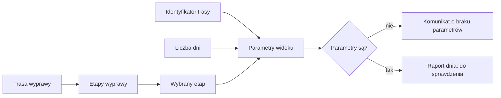
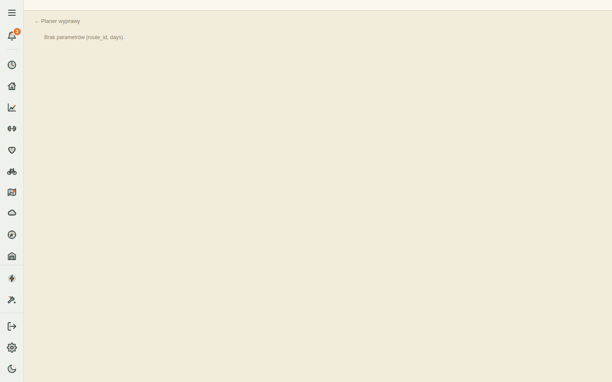

# Raport dnia wyprawy

## Co to jest

Raport dnia to widok szczegółów jednego etapu wyprawy. Powinien otrzymać identyfikator trasy oraz liczbę dni, aby ustalić, który etap otworzyć.

## Po co

Pomaga obejrzeć pojedynczy dzień długiej wyprawy oddzielnie od całego przebiegu. Geometrię podziału i wspólne atrakcje opisuje [Planer wyprawy](planer-wyprawy.md).

## Skąd dane

Zrzut dostarczony do wiki pokazuje stronę `raport-dzien.html` z komunikatem „Brak parametrów (route_id, days).” Widok nie wyświetla w tym stanie trasy, profilu ani danych dnia. Nie potwierdziłem poprawnego otwarcia strony z kompletem parametrów ani tego, jakie dokładnie pola raportuje działający widok.

> DO SPRAWDZENIA: poprawne wywołanie raportu dnia z prawidłowymi parametrami oraz lista danych wyświetlanych po jego otwarciu.

## Jak liczone

Poniższy diagram pokazuje jedynie minimalny przepływ wynikający z komunikatu i kontraktu Planera: trasa wyprawy jest dzielona na etapy, a raport dnia wymaga wskazania etapu. Renderowanie pełnej analizy nie zostało zweryfikowane.

1. Widok potrzebuje identyfikatora trasy i liczby dni — tak mówi komunikat na dostarczonym zrzucie.
2. Bez tych wartości pokazuje komunikat błędu i nie przedstawia raportu etapu.
3. Po przekazaniu wartości spodziewany wynik nie został w tej pracy potwierdzony, więc nie opisuję jego szczegółów.

## Gdzie to widać

Strona `/raport-dzien.html`. Dostarczony zrzut pokazuje boczny pasek nawigacji, link „Planer wyprawy” i komunikat o brakujących parametrach. Reszta strony jest pusta.

## Jak czytać

Komunikat oznacza, że ten widok nie dostał wymaganych danych wejściowych. Nie oznacza, że etap ma zerową długość albo że wyprawa nie ma raportu. Wróć do Planera lub do linku etapu i sprawdź, czy otwierasz stronę z prawidłowym kontekstem.

## Ograniczenia i pułapki

- Zrzut dokumentuje tylko stan z brakującymi parametrami.
- Nie potwierdzono wyświetlania mapy, czasu, pogody ani punktów w poprawnie otwartym raporcie dnia.
- Nie należy mylić tego widoku z raportem całej trasy.

Jeśli pojawia się komunikat o parametrach, wróć do strony, z której otwierasz etap, i wybierz konkretny dzień. Nie poprawiaj adresu na podstawie domysłów: nazwy parametrów są widoczne w komunikacie, ale dokładny format wartości nie został sprawdzony. Brak raportu na zrzucie nie dowodzi, że zapisane etapy są uszkodzone.

Widok raportu trasy ma osobny wybór trasy oraz daty i godziny startu. Liczba dni w komunikacie strony etapu pełni inną rolę niż liczba długich postojów w raporcie trasy. Nie myl tych pól.

## Decyzje i historia

Zrzut z indeksem zrzutów ekranu pokazuje stan strony z 18.10.2026. Jest to przykład niekompletnego otwarcia, nie opis docelowego działania. Dokument Planera opisuje zapis etapów do magazynu, lecz nie wystarcza do potwierdzenia interfejsu raportu dnia.

## Wpływa na / Zależy od

Widok zależy od parametrów wskazujących trasę i liczbę dni oraz od poprawnie utworzonych etapów. To, co robi z tymi danymi po stronie strony WWW, wymaga sprawdzenia.

## Powiązane hasła

- [Planer wyprawy](planer-wyprawy.md)
- [Analiza trasy](analiza-trasy.md)
- [Magazyn i wersje tras](store-i-wersje.md)

## Zrodla

- `/opt/qbot/web/public/raport-dzien.html` — ekran i komunikat o wymaganych parametrach.
- `/opt/qbot/web/public/planer-wyprawy.html` — linki do etapów; poprawny przebieg niezweryfikowany.
- `/opt/qbot/app/docs/PLANER_WYPRAW_ATRAKCJE.md` — opis etapów i danych przekazywanych do Analizy trasy.
- `img/ekrany/raport-dzien.png` — dostarczony zrzut ekranu.
