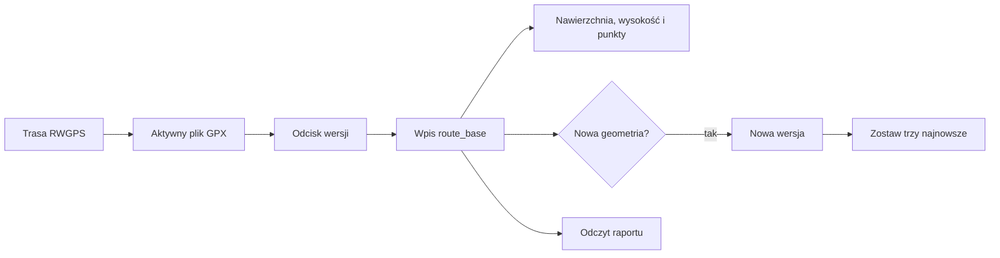
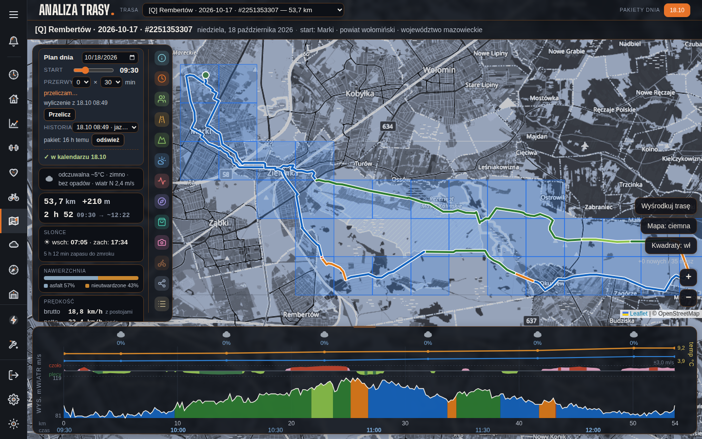

# Magazyn i wersje tras

## Co to jest

Magazyn przechowuje trasę, jej wersje i obliczone warstwy. Zmiana geometrii tworzy osobną wersję, tak by wyniki były związane z konkretnym przebiegiem.

## Po co

Pozwala raportom korzystać ze spójnych danych i ogranicza gromadzenie starych wersji.

## Skąd dane

Plik GPX i dane z RWGPS trafiają do route store. `route_version_key` opiera się na odcisku danych trasy. Tabele `route_base` i tabele warstw wiążą obliczenia z wersją.

## Jak liczone

## Gdzie to widać

Wersja może pojawić się w metadanych raportu. Narzędzie `route_list` odczytuje trasy i wersje. Przeliczanie i kasowanie są odrębnymi działaniami zapisującymi.

## Jak czytać

`active` oznacza status wpisu, ale dokument store zastrzega, że wybór do odczytu opiera się też na dacie modyfikacji. Automatyczna retencja zachowuje trzy najnowsze wersje według opisu kodu orchestratora.

## Decyzje i historia

Dokument Route Store opisuje stałą nazwę aktywnego GPX i archiwizację poprzedniego pliku. Usuwanie całej trasy ma dwa kroki: podgląd, a potem jawne potwierdzenie. Masowe usuwanie pozostaje blokowane.

## Ograniczenia i pułapki

Nie utożsamiaj każdej tabeli `route_base` z aktywnym przebiegiem. Stara wersja może mieć inne warstwy. Operacje przeliczenia i usuwania zmieniają dane i mogą uruchamiać pracę w tle.

## Wpływa na

Wybór danych w raporcie, podgląd naprawy, profil, nawierzchnię i etapy Planera.

## Zależy od

Źródłowego identyfikatora trasy, GPX i wyliczonego klucza wersji.

## Powiązane hasła

- [Analiza trasy](analiza-trasy.md)
- [Naprawa tras](naprawa-tras.md)
- [Planer wyprawy](planer-wyprawy.md)
- [Potwierdzenia Telegram](potwierdzenia-telegram.md)

### Jak wersja wiąże trasę z analizą

1. Import dostarcza ślad i jego identyfikator.
2. Magazyn zapisuje przebieg oraz odcisk geometrii.
3. Obliczenia nawierzchni, wysokości i punktów są przypisane do tej wersji.
4. Przy zmianie przebiegu powstaje kolejny zapis; stary wynik nie powinien być bezrefleksyjnie używany do nowego śladu.
5. Po obliczeniach automatyczna retencja ogranicza liczbę zachowywanych wersji.

W bazie 18.10.2026 dla `komoot-2251353307` były widoczne trzy wpisy wersji z 17.10.2026, wszystkie o dystansie 53,7 km. To potwierdza kilka zapisów dla jednego identyfikatora, ale sam widok nie wyjaśnia przyczyny ich powstania ani nie dowodzi, że każda ma komplet warstw.

W górnym pasku raportu widać trasę i datę; pełna informacja o wersji może być w szczegółach danych. Nie myl historycznej migawki raportu z nową wersją geometrii. Lista wersji i przeliczenie są różnymi czynnościami.

### Operacje zmieniające dane

Lista tras jest odczytem. Przeliczanie tworzy lub aktualizuje warstwy. Usuwanie trasy jest rozdzielone na podgląd i potwierdzenie. Zmiana wybranego raportu sama w sobie nie jest kasowaniem. Przed usunięciem sprawdź identyfikator i wersję.

### Gdy raport wygląda na nieaktualny

Najpierw porównaj identyfikator trasy i datę modyfikacji z tym, co wybrałeś. Następnie sprawdź, czy otwierasz bieżący raport, czy starszy zapis historii. Zapisane dane raportu mogą pochodzić z wcześniejszego przeliczenia nawet wtedy, gdy strona wyświetla je w aktualnym układzie graficznym.

Jeżeli przebieg został poprawiony w źródle, ale raport pokazuje poprzednią geometrię, trzeba sprawdzić, czy nowa wersja trafiła do magazynu. Samo odświeżenie strony nie gwarantuje ponownego pobrania ani obliczenia danych. Właściciel może użyć narzędzia listy do odczytu; przeliczanie i kasowanie są osobnymi działaniami.

## Zrodla

- `/opt/qbot/app/docs/ROUTE_STORE.md` — wersjonowanie, retencja i narzędzia.
- `/opt/qbot/app/qbot3/routes/route_base_store.py` — zapis bazowy.
- `/opt/qbot/app/qbot3/routes/route_versions.py` — `list_route_versions`, `prune_route_versions`.
- `/opt/qbot/app/qbot3/routes/route_precompute_orchestrator.py` — przeliczanie i retencja.
- `/opt/qbot/app/sql/route_base_store_v1.sql` — `route_base`, warstwy i joby.
