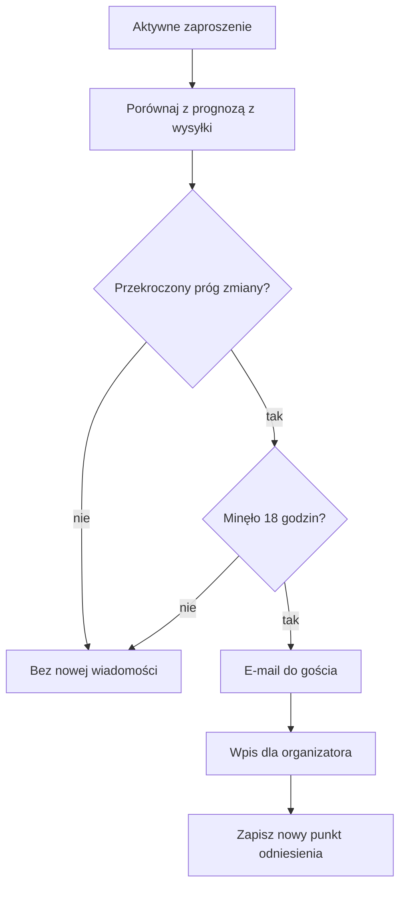
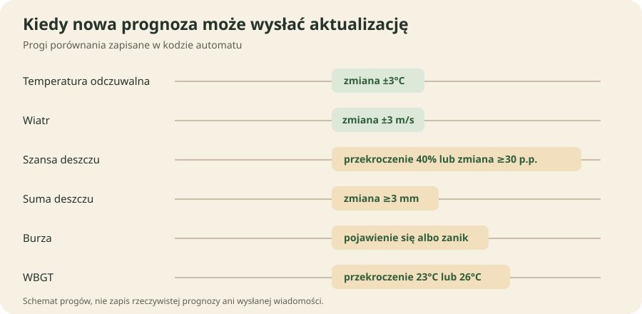
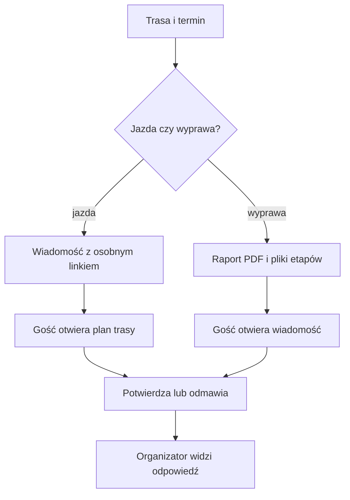

# Zaproszenia dla gości na jazdę i wyprawę

## Co to jest

QBot może wysłać osobie zaproszonej stronę z planem jazdy albo wiadomość e-mail z raportem całej wyprawy. Gość może obejrzeć dostępne dane i potwierdzić udział. Link dla gościa działa bez logowania, ale jest ograniczony do konkretnego zaproszenia.

## Po co

Wyślij zaproszenie, gdy chcesz przekazać trasę i plan osobie jadącej z Tobą. Przy krótszej jeździe gość otwiera stronę z mapą, szczegółami i plikami do pobrania. Przy wyprawie wielodniowej dostaje raport w formacie PDF (dokumencie do odczytu; [słowniczek](../slowniczek.md#pdf)) i osobne pliki [GPX](../slowniczek.md#gpx) dla etapów.

## Skąd dane

Zaproszenie korzysta z wybranej trasy, daty, godziny startu i zapisanych danych raportu. Dla pojedynczej jazdy można wybrać adresy albo grupę kontaktów. Raport wyprawy powstaje z trasy i ustalonych granic dni. Gość nie dostaje dostępu do całego konta ani do pozostałych stron QBota.

## Jak liczone

### Zaproszenie na pojedynczą jazdę

1. W raporcie trasy wybierz plan jazdy, adresy lub grupę kontaktów i — jeśli chcesz — dopisz wiadomość.
2. Otwórz podgląd wiadomości, aby sprawdzić jej treść. Podgląd nie wysyła zaproszenia.
3. Wyślij zaproszenie. QBot tworzy osobny link i wysyła e-mail. Na pojedynczą wysyłkę można podać najwyżej 40 adresów.
4. Gość otwiera link. Strona pobiera plan, mapę oraz dostępne informacje o trasie. Gość może potwierdzić jazdę, odmówić lub pobrać plik trasy.
5. Wróć do sekcji zaproszonych, aby zobaczyć stan odpowiedzi. Link można wyłączyć.

### Zmiana pogody po wysłaniu zaproszenia

Jeśli prognoza dla zaproszonej jazdy istotnie się zmieni, osobny automat może wysłać gościowi aktualizację e-mailem i dodać zbiorczy wpis do dzwonka organizatora. Sprawdza zaproszenia bez odmowy, z ważnym linkiem i jazdą od dziś do trzech dni naprzód. Nie wyśle wiadomości, jeśli nie ma zapisanego punktu odniesienia prognozy.

1. Automat porównuje bieżącą prognozę jazdy z prognozą zapisaną w chwili wysłania zaproszenia.
2. Zmiana jest uznana za istotną, gdy temperatura odczuwalna zmieni się o co najmniej 3°C, wiatr o co najmniej 3 m/s, szansa deszczu przekroczy 40% albo zmieni się o co najmniej 30 punktów procentowych, suma deszczu zmieni się o co najmniej 3 mm, pojawi się lub zniknie burza albo WBGT (wskaźnik obciążenia cieplnego; [słowniczek](../slowniczek.md#wbgt)) przekroczy 23°C lub 26°C.
3. E-mail o zmianie może przyjść najwyżej raz na 18 godzin dla danego zaproszenia. Po powiadomieniu nowa prognoza staje się punktem odniesienia dla następnego porównania.

Schemat pokazuje warunki z kodu; nie jest wykresem historycznej pogody. W krótkim odczycie nie znaleziono przykładu wysłanej zmiany prognozy, więc nie łączę tych progów z fikcyjnym przebiegiem danych.

### Zaproszenie na wyprawę wielodniową

1. W Planerze wyprawy wybierz trasę i granice dni, a następnie otwórz tworzenie raportu PDF.
2. Ekran oczekiwania pokazuje, że raport jest składany. Jeśli dla tych samych danych istnieje aktualny plik, może zostać podany od razu. W przeciwnym razie ekran sprawdza wynik i informuje o błędzie albo otwiera gotowy PDF.
3. W panelu wyprawy można wysłać e-mail z raportem PDF i plikami tras dla poszczególnych dni. Zaproszenie zawiera przyciski potwierdzenia lub odmowy.
4. Gość klika odpowiedź. QBot zapisuje ją dla tego zaproszenia, a organizator widzi listę odpowiedzi w Planerze.

Odczyt bazy z 11.10.2026 wykazał trzy zaproszenia na jazdę: dwa miały odpowiedź „tak”, jedno czekało. To przykład zapisanych odpowiedzi, nie dowód doręczenia wiadomości ani otwarcia linku. W oddzielnym rejestrze zaproszeń wyprawy odczytano z 22.07.2026 trzy oczekujące odpowiedzi; nie wnioskuję z nich o wysłaniu lub przeczytaniu maila.

## Gdzie to widać

Zaproszenie na jazdę przygotowuje się w raporcie trasy, w panelu planu dnia i zaproszonych. Gość otwiera osobną stronę internetową z tytułem „Zaproszenie na jazdę”. Raport wyprawy uruchamia się z Planera. Ekran „Raport wyprawy — generowanie” pokazuje postęp i po przygotowaniu otwiera PDF.

Zrzut przedstawia ekran organizatora, nie stronę gościa. Zrzutu strony gościa ani gotowego ekranu potwierdzenia wyprawy nie ma w indeksie zrzutów.

## Jak czytać

- „Czeka” oznacza, że w zapisanych danych nie ma odpowiedzi. Nie musi oznaczać, że e-mail nie dotarł.
- „Tak” lub „Nie” oznacza odpowiedź zapisaną po kliknięciu gościa. Nie potwierdza, że osoba rzeczywiście przyjedzie.
- Jeśli ekran generowania długo czeka, pozostaw go otwartym. Kod strony przewiduje limit oczekiwania około pięciu minut; tekst na ekranie podaje, że zwykle trwa to około minuty.
- Jeżeli link wygasł lub został wyłączony, gość nie otworzy danych. Organizator może sprawdzić listę i utworzyć nowe zaproszenie.

## Decyzje i historia

Wiadomość i strona gościa pokazują tylko dane potrzebne do wspólnej jazdy. Link nie otwiera konta właściciela. Raport wyprawy ma osobny ekran oczekiwania, ponieważ składanie pełnego dokumentu może trwać dłużej niż zwykłe wczytanie strony.

## Ograniczenia i pułapki

- Stan zaproszenia i doręczenie e-maila to różne informacje. Nie interpretuj samego statusu jako potwierdzenia odczytu.
- Zrzut raportu trasy nie pokazuje wszystkich elementów strony gościa.
- Wyprawowy PDF może być z pamięci podręcznej, jeśli dane źródłowe się nie zmieniły.
- Adres zaproszenia jest osobisty. Nie wklejaj publicznie linku, który pozwala obejrzeć plan.
- > DO SPRAWDZENIA: odczytać ekran gościa oraz ekran odpowiedzi wyprawy na żywo; w wiki nie ma ich zrzutów.

## Wpływa na / Zależy od

- **Wpływa na:** informacje i pliki przekazane zaproszonym osobom oraz listę odpowiedzi organizatora.
- **Zależy od:** trasy, planu dnia lub granic etapów, poczty oraz ważności linku.

## Powiązane hasła

- [Analiza trasy](analiza-trasy.md)
- [Planer wyprawy](planer-wyprawy.md)
- [Kontakty w SETUP](../system/kontakty.md)
- [Potwierdzenia tras w Telegramie](potwierdzenia-telegram.md)

## Zrodla

- `/opt/qbot/web/public/raport-gosc.html` — ekran gościa dla pojedynczej jazdy.
- `/opt/qbot/web/public/raport-trasy2-plan.js` — panel organizatora, podgląd, wysyłka i lista odpowiedzi.
- `/opt/qbot/web/public/wyprawa-oczekiwanie.html` — oczekiwanie na raport PDF.
- `/opt/qbot/app/qbot_web.py` — `invites_send`, `guest_data`, `guest_rsvp`, `api_wyprawa_pdf_start`, `wyprawa_rsvp_page`.
- `/opt/qbot/app/scripts/guest_forecast_watch.py` — harmonogram i progi wiadomości o zmianie pogody.
- `qbot_v2.ride_invite`, `qbot_v2.wyprawa_rsvp` — statusy zaproszeń.
