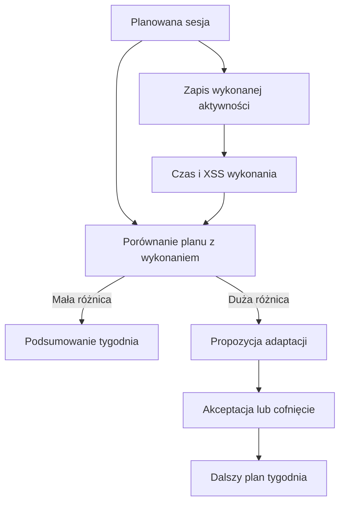

# Dopasowanie planu do wykonania

Po imporcie aktywności Trener może porównać ją z zaplanowaną sesją. [XSS](../slowniczek.md#xss) (punkty opisujące obciążenie treningu) pokazuje, jak porównywać jego planowaną i wykonaną wartość. Dzięki temu tydzień pokazuje zarówno zamierzony trening, jak i to, co zostało zapisane jako wykonanie. Różnica może uruchomić propozycję przeliczenia pozostałych treningów.

## Po co

Sprawdź to, gdy jazda trwała dłużej, krócej lub była cięższa niż plan. Sama różnica nie jest oceną treningu. Jeśli pojawi się oczekująca zmiana, przejrzyj ją i zaakceptuj albo cofnij.

## Jak liczone

1. System dopasowuje zapisaną aktywność do sesji planu i uzupełnia rzeczywisty czas oraz [XSS](../slowniczek.md#xss) (punkty opisujące obciążenie treningu).
2. Przykład z 14.10.2026: planowana jazda trwała 60 minut i miała 57 XSS. Wykonanie trwało 60 minut i miało 64,5 XSS. Różnica obciążenia to 7,5 XSS.
3. Przykład z 16.10.2026: plan wynosił 60 minut i 57 XSS; zapis wykonania to 67 minut i około 69,7 XSS. Różnica czasu wyniosła 7 minut, a obciążenia około 12,7 XSS.
4. Granica widocznej etykiety „więcej/mniej” to 10% czasu lub XSS. Reguła adaptacyjna ma osobny próg 15 punktów XSS w domyślnych ustawieniach.
5. Adaptacja dotyczy nierozpatrzonych treningów z ostatnich trzech dni. Nie oznacza, że każdy trening w historii będzie automatycznie przebudowany.

## Jak czytać

Na kafelku zielony trening opisuje wykonanie, a przerywana ramka pokazuje plan. Jeżeli widzisz różne czasy lub XSS, plan i wykonanie nie są tym samym pomiarem. W tygodniu 12.10–18.10 zrzut pokazuje 6,7 godziny planu wobec 6,6 godziny wykonania. Nie oznacza to, że każdy dzień miał identyczny przebieg.

## Ograniczenia i pułapki

Jakość dopasowania zależy od tego, czy aktywność i sesja zostały prawidłowo rozpoznane. Zrzut i przykłady z dwóch jazd nie potwierdzają, że każda aktywność została dopasowana. XSS wykonania pochodzi z zapisu aktywności; nie obliczaj go przez samo pomnożenie czasu.

Przed decyzją sprawdź szczegóły tygodnia. Jeżeli różni się tylko liczba minut, obciążenie może nadal być zbliżone; jeżeli różni się obciążenie, czas może pozostać bez zmian. Na zrzucie suma wykonania wynosi 6,6 h, a planu 6,7 h. To nie znaczy, że wszystkie treningi wykonano krócej: 16.10 jazda była o 7 minut dłuższa od planu.

## Wpływa na / Zależy od

Dopasowanie wpływa na widok wykonania, tygodniowe sumy i ewentualną propozycję zmiany planu. Zależy od importu aktywności, sesji planu i reguł adaptacji.

## Powiązane hasła

- [Plan tygodnia](plan-tygodnia.md)
- [XSS](xss.md)
- [Kalendarz](kalendarz.md)
- [Raport jazdy](../raport-jazdy/index.md)

## Zrodla

- `qbot_trener_ops.py` — dopasowanie aktywności i `refresh_real`.
- `qbot_trener_engine.py` — `deviation`, `adapt.xss_delta`.
- `qbot_trener_notify.py` — kontrola adaptacji nierozpatrzonych sesji.
- `/opt/qbot/web/public/trener.js` — wyświetlenie planu, wykonania i zmian.
- `qbot_v2.trainer_session` — dane sesji 14.10 i 16.10.2026.
