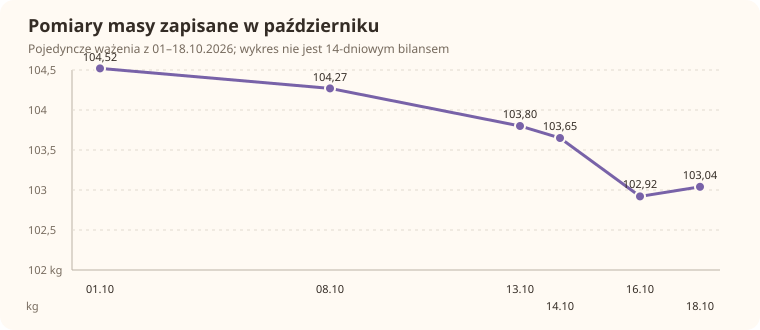
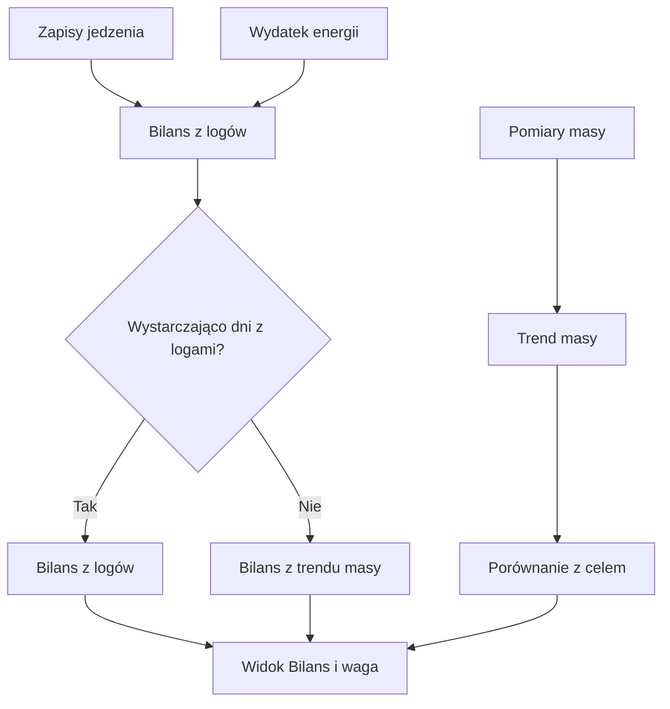

# Bilans i masa ciała

Widok bilansu zestawia szacowane jedzenie z wydatkiem energii i pokazuje trend masy ciała. Gdy aktywny cel wagi ma etapy, tempo docelowe jest wyliczane dla aktualnego, jeszcze nieosiągniętego etapu. Dane z niepełnych dni nie są używane jako pełny wydatek energii.

## Jak liczone

Domyślnie widok używa 14-dniowego okna. Wybór źródła domyślnie preferuje logi jedzenia, gdy wpisy obejmują co najmniej 70% dni; przy mniejszej liczbie wpisów może użyć trendu masy. Ten wariant szacuje bilans jako nachylenie masy pomnożone przez 7700 kcal/kg. Trend 30-dniowy jest pokazywany oddzielnie.

1. Sprawdź liczbę dni w oknie i ile z nich ma wpisy jedzenia.
2. Jeśli udział wpisów osiąga 70%, domyślnie wybierane jest źródło dziennika; w przeciwnym razie może zostać wybrany trend masy.
3. Odczyt z bazy pokazuje masę 104,27 kg 08.10.2026, 102,92 kg 16.10 i 103,04 kg 18.10. To pojedyncze pomiary; nie wystarczą do wyliczenia pełnego 14-dniowego bilansu z trendu.
4. Na ekranie 18.10.2026 kafelek kalendarza pokazuje przy poszczególnych dniach wartości bilansu, np. −583 kcal. To dzienna wartość z widoku, a nie średnia całego okna z zakładki Bilans i waga.

Cel tempa pochodzi z aktywnego celu wagi, jeśli dla niego dostępny jest termin etapu. W przeciwnym razie używane jest ustawione tempo redukcji. W aktualnym kodzie masa do obliczenia trendu pochodzi z `body_measurements`; przeniesiona waga z `fitmodel_daily` jest wykorzystywana jako ostatnia znana masa do wyboru etapu celu, nie do szeregu pomiarów trendu.

## Gdzie to widać

Bilans i waga są dostępne z Formy przez osadzony widok Trenera. Kalendarz może również pokazać zjedzone kalorie i bilans dnia jako link do Zdrowia.

Dla 14-dniowego okna warunek 70% oznacza co najmniej 10 dni z wpisem (14 × 0,70 = 9,8, więc liczba całych dni musi wynieść 10). Próg kompletności dotyczy dziennika, a nie jakości pojedynczego pomiaru. Jeśli wpisy obejmują mniej dni, wynik może przejść na szacunek z trendu masy. Gdy ważenia są zbyt rzadkie, bilans z trendu może nie być dostępny.

W kafelku dnia liczba kalorii ma znak: wartość ujemna oznacza deficyt w prezentowanym zestawieniu, dodatnia nadwyżkę. Jest to opis tego bilansu, nie ocena czy plan żywienia jest właściwy.

## Ograniczenia i pułapki

Wartość jest szacunkiem zależnym od kompletności dziennika i jakości wydatku energii. Nie jest bezpośrednim pomiarem metabolizmu. Dzień bieżący nie jest włączany do zakresu zamkniętych dni w obliczeniu bilansu.

Waga waha się z dnia na dzień. Odczyt 103,04 kg z 18.10 nie jest samodzielnym dowodem przyrostu względem 102,92 kg z 16.10. Porównuj trend obejmujący wiele pomiarów. Kafelek w Kalendarzu i wykres bilansu mogą dotyczyć innych zakresów czasu.

## Wpływa na

- Tempo celu wagi i prezentację trendu; nie zmienia samodzielnie zapisów jedzenia.

## Zależy od

- `intake_logs`, `intake_items`, `energy_daily`, `body_measurements` oraz aktywnego celu wagi.

## Powiązane hasła

- [Masa ciała](../zdrowie/masa-ciala.md)
- [Dziennik jedzenia](../zdrowie/dziennik.md)
- [Kalendarz](kalendarz.md)

## Zrodla

- `qbot_trener_stats.py` — `balance`, `load_days`, `compute_balance`, `weight_stage`.
- `/opt/qbot/web/public/trener.js` — `rBal`.
- `/opt/qbot/web/public/kalendarz3.js` — `foodLn`.
- `qbot_v2.energy_daily`, `qbot_v2.intake_logs`, `qbot_v2.intake_items`, `qbot_v2.body_measurements`, `qbot_v2.fitmodel_daily`.
