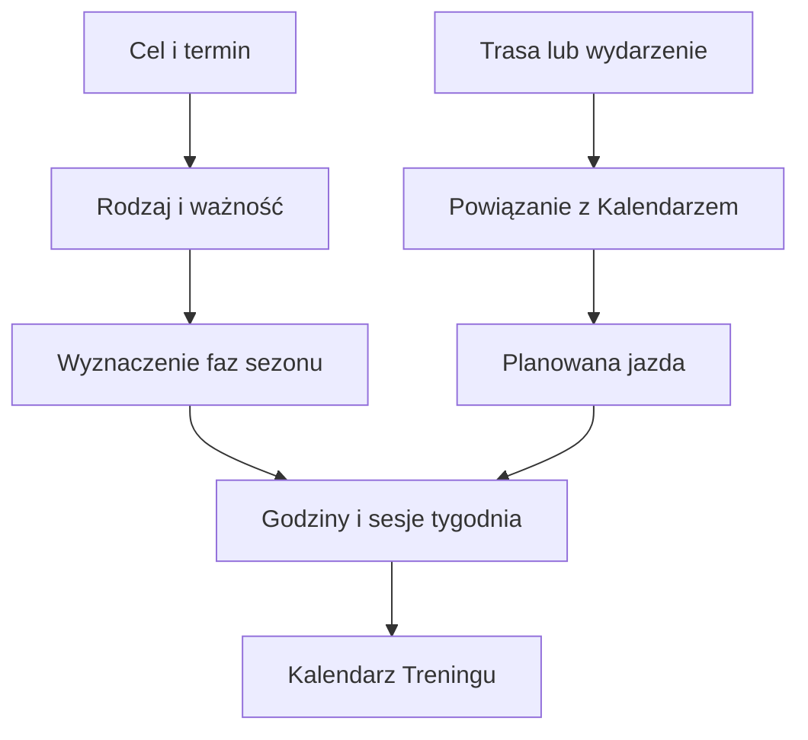

# Cele treningowe

Cele mówią Trenerowi, na co przygotowujesz się w danym terminie. Mogą dotyczyć wyprawy, długiej jazdy lub innego celu. Priorytet A może przesunąć etapy sezonu, aby zostało miejsce na przygotowanie, lżejszy okres przed celem i odpoczynek po nim.

## Po co

Wpisz cel z datą oraz realnym zakresem. Jeśli to wyjazd rowerowy, przypnij trasę albo wydarzenie kalendarza, jeżeli jest dostępne. Dzięki temu plan może uwzględnić konkretną jazdę. Nie traktuj samego wpisania nazwy celu jako rezerwacji całego czasu w kalendarzu.

## Jak działa

1. W zakładce Cele wybierasz rok i dodajesz pozycję. Na ekranie możesz określić rodzaj, nazwę, daty i ważność.
2. Dla przykładu widocznego 18.10.2026 Kalendarz pokazywał tydzień 12.10–18.10, cel sezonu wynosił 5 godzin. To wynik tego tygodnia, nie liczba godzin pojedynczego celu.
3. Silnik bierze pod uwagę cele wyprawowe o priorytecie A przy wyznaczaniu końca bazy oraz tygodni przygotowania i regeneracji.
4. Cel z trasą może być widoczny jako trening rowerowy w Kalendarzu. Szczegóły opisuje [Trasa jako trening](trasy.md).

Na pokazanym tygodniu wartość „Cel z Sezonu” to 5 h. To przykład celu objętości tygodnia, nie cel sportowy z zakładki Cele. Zakładka Cele przechowuje wydarzenia i priorytety, a kafel Kalendarza pokazuje tygodniową liczbę godzin wynikającą z fazy.

## Jak czytać

Cel A jest istotnym punktem sezonu, ale nie gwarantuje konkretnej liczby godzin ani wyniku sportowego. Cel sezonu w kafelku tygodnia to planowana objętość tygodnia. Jeśli termin się zmienił, zaktualizuj go; nie zakładaj, że sam trening zostanie przesunięty razem z wydarzeniem.

Na ekranie Cele możesz przełączyć rok, aby oddzielić stare wydarzenia od przyszłych. Po zmianie priorytetu sprawdź ponownie zakładkę Plan, ponieważ cel A jest wejściem do układania faz. Przy celu z trasą zweryfikuj również datę i liczbę dni w Kalendarzu. Zrzut października pokazuje cel tygodniowy 5 h, ale nie pokazuje listy celów ani konkretnej wyprawy; te informacje są na osobnym ekranie.

## Ograniczenia

Cel może nie zawierać kompletnej trasy lub informacji o dostępności. W takiej sytuacji plan korzysta tylko z danych, które ma. > DO SPRAWDZENIA: aktualna lista aktywnych celów i ich terminów w bazie. W tym etapie nie odczytywałem tych rekordów.

Jeśli widzisz w Kalendarzu nazwę wyprawy, ale nie widzisz oczekiwanej jazdy, otwórz wpis i sprawdź, czy powiązano go z trasą oraz wskazano odpowiednie dni. Zmiana terminu celu może zmienić fazy i plan kolejnych tygodni; sprawdź plan po zapisaniu.

## Wpływa na / Zależy od

Cele priorytetu A wpływają na fazy sezonu; cele z przypisaną trasą mogą wpływać na plan dnia. Szczegóły sezonu, tras i terminów są opisane osobno.

## Powiązane hasła

- [Sezon](sezon.md)
- [Plan tygodnia](plan-tygodnia.md)
- [Trasy w treningu](trasy.md)
- [Kalendarz](kalendarz.md)

## Zrodla

- `/opt/qbot/web/public/trener.js` — `rGoals`, formularz celów i pobieranie podsumowania trasy.
- `qbot_trener_engine.py` — `season_bounds`, `season_weeks`, `build_context`.
- `qbot_v2.trainer_goal` — zapis celów i ich priorytetu.
- `docs/TRENER.md` — reguły celów, sezonu i edytora.
