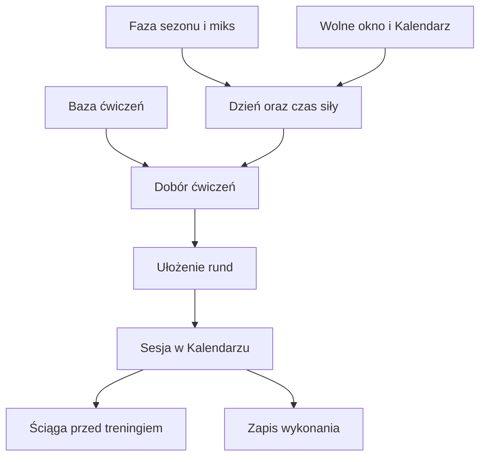

# Ćwiczenia siłowe i ściąga

Trening siłowy może zawierać zestaw ćwiczeń ułożony z zapisanej bazy. Ściąga pokazuje kolejność, liczbę rund i podpowiedzi do wykonania. To opis konkretnego planu, nie diagnoza ani indywidualna konsultacja medyczna.

## Po co

Otwórz szczegóły sesji siłowej, aby sprawdzić, jakie ćwiczenia zaplanowano. Przed treningiem zajrzyj do ściągi i upewnij się, że rozumiesz ruch oraz masz potrzebny sprzęt. Jeśli ćwiczenie jest nieodpowiednie lub sprzęt niedostępny, zmień zestaw w interfejsie, zamiast zakładać, że system wykryje problem.

## Jak powstaje zestaw

1. Plan tygodnia rezerwuje dzień i czas na siłę według fazy sezonu, dostępności i przerw regeneracyjnych.
2. Generator dobiera bazowy zestaw oraz rotujący akcent. Obecny układ obwodu obejmuje trzy rundy; dokładny zestaw zależy od dostępnych ćwiczeń i ustawień.
3. Przykład z bazy: 13.10.2026 zapisana sesja siłowa trwała 39 minut wykonania przy 40 minutach planu. Planowane obciążenie wynosiło 12 [XSS](../slowniczek.md#xss) (punkty opisujące obciążenie treningu). To przykład czasu i planu; sam zapis nie potwierdza listy ćwiczeń z danego treningu.
4. Jeżeli zestaw wyświetla ściągę lub grafiki, otwórz ją przed rozpoczęciem. Widoczność grafiki zależy od konkretnego ćwiczenia.

## Jak czytać

W Kalendarzu sprawdź nazwę, czas oraz planowane XSS. Dla 13.10.2026 odczyt planu miał 40 minut, a wykonanie 39 minut. Nie wyciągaj z samego XSS wniosku o poprawności techniki ćwiczeń. Jeśli brakuje grafiki, opis ćwiczenia może nadal być dostępny; szczegóły konkretnego zestawu sprawdź na stronie.

Plan siły i opis ćwiczeń to dwa poziomy informacji. Kafelek tygodnia pokazuje czas oraz rodzaj sesji; dopiero szczegóły treningu pokazują jej zawartość. W przykładzie z 13.10.2026 znamy czas planu 40 min, wykonanie 39 min oraz plan 12 XSS. Nie znamy z tego odczytu nazw ćwiczeń ani liczby powtórzeń, dlatego nie rekonstruuję zestawu.

Jeśli trening został zmieniony ręcznie, sprawdź wyświetlany zestaw przed wejściem w obwód. Nie zakładaj, że wcześniej otwarta ściąga zmieniła się razem z sesją.

## Ograniczenia i pułapki

> DO SPRAWDZENIA: widok konkretnej ściągi i zestawu ćwiczeń. Dostępny zrzut pokazuje kalendarz, nie otwarte szczegóły treningu.

Na zrzucie wtorek 13.10 pokazuje siłę i 39 minut wykonania. Otwórz szczegóły treningu, aby przejść do ściągi. Jeżeli nie ma odnośnika albo ilustracji, kalendarz nie pozwala ustalić przyczyny; nie dopisuj ćwiczenia na podstawie samej nazwy sesji.

## Wpływa na / Zależy od

Zestaw wpływa na treść zaplanowanej sesji siłowej. Jego obecność zależy od decyzji planera, dostępności ćwiczeń i przypisanych ustawień.

## Powiązane hasła

- [Siła i wioślarz](sila-wioslarz.md)
- [Plan tygodnia](plan-tygodnia.md)
- [Kalendarz](kalendarz.md)
- [XSS](xss.md)

## Zrodla

- `qbot_trener_sila.py` — wybór ćwiczeń, zestaw i rotacja akcentu.
- `qbot_trener_workouts.py` — tworzenie sesji i ściągi.
- `/opt/qbot/web/public/trener.js` — szczegóły sesji i odnośnik do ściągi.
- `docs/TRENER.md` — decyzje o bazie ćwiczeń, obwodzie i ściądze.
- `qbot_v2.trainer_session` — plan i wykonanie 13.10.2026.
