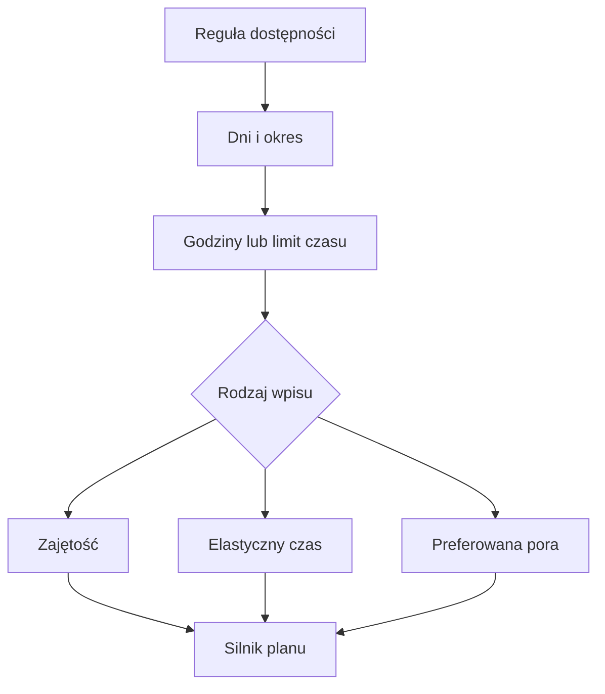

# Dostępność i okna

W Dostępności zapisujesz powtarzające się lub jednorazowe ograniczenia oraz preferowane pory treningu. Wpis może oznaczać zajętość, elastyczny czas albo preferowane okno. Silnik bierze te reguły pod uwagę przy wyborze dnia i godziny.

## Jak czytać

Reguły mają zakres obowiązywania: cały rok, coroczny przedział dat albo pojedynczy okres. Okno może dotyczyć wybranych aktywności. Wpis „elastyczny” może zawierać maksymalny czas. Gdy nie ma osobnej preferowanej pory, kod przyjmuje domyślnie 09:00–20:00 w dzień roboczy oraz 07:00–20:00 w weekend lub urlop.

Przykład z ekranu 12.10–18.10.2026: sobota 17.10 oznaczona jest jako „wolne”; niedziela 18.10 zawiera jazdę. To widok wyniku planu, nie zapis szczegółowej reguły dostępności. Jeśli widzisz trening w godzinie, która Ci nie pasuje, otwórz Dostępność w Setup → Trening i sprawdź zarówno dni, jak i zakres godzin.

Reguły mogą być jednorazowe albo cykliczne. W cyklicznym przedziale sprawdź początek i koniec okresu oraz dni tygodnia; jedna preferencja nie oznacza, że wszystkie inne okna są zablokowane. Regułę można ograniczyć do aktywności, więc sprawdź jej zakres, jeśli widzisz trening innego rodzaju w tym samym czasie.

Dostępność w kalendarzu nie rezerwuje miejsca na wydarzenie społeczne. Jeśli znasz konkretną datę wyjazdu lub delegacji, wpisz ją w Kalendarzu. Wtedy masz czytelny zapis jednorazowy niezależny od domyślnego zakresu godzin.

## Ograniczenia i pułapki

Sama preferencja nie jest tym samym co zajętość. Wpisy z Kalendarza, takie jak choroba, odpoczynek lub delegacja, są osobnymi ograniczeniami. Nie znalazłem w bieżącym widoku Kalendarza pełnego wyświetlenia wszystkich reguł Dostępności; są one ustawiane w dziale Trenera.

Domyślne okna nie oznaczają, że sesja zostanie zaplanowana w dowolnej minucie tego przedziału. Długość sesji i inne wpisy dnia także muszą się zmieścić. Zmiany dla jednej daty zapisuj jako wpis Kalendarza, a powtarzalne zasady jako dostępność.

## Skąd dane

Reguły godzin i dni są ustawiane przez właściciela. Plan odczytuje je razem z wydarzeniami w Kalendarzu. Domyślne okna, gdy nie ustawiono preferencji, wynoszą 09:00–20:00 w dni robocze oraz 07:00–20:00 w weekend lub urlop. Są to godziny dostępności, nie zalecana pora treningu.

## Praktyczny odczyt

1. Wybierz rodzaj reguły: zajętość blokuje czas, preferencja wskazuje lepszą porę, a elastyczne okno może określać limit minut.
2. Sprawdź zakres dat. Reguła jednorazowa nie powinna być traktowana jako powtarzana przez cały rok.
3. Porównaj wynik z Kalendarzem. W tygodniu 12.10–18.10.2026 sobota jest wolna, a niedziela ma jazdę 163-minutową. > DO SPRAWDZENIA: indywidualne reguły dostępności, które doprowadziły do tego rozkładu; nie pobrano ich w tym etapie.
4. Jeśli trening nie mieści się w godzinach, sprawdź dostępność i wpisy dnia przed ręcznym przesuwaniem sesji.

## Wpływa na

- Możliwy dzień i godzinę sesji oraz dostępny czas na trening.

## Zależy od

- Rodzaju reguły, dni tygodnia, godzin, aktywności i okresu.

## Powiązane hasła

- [Plan tygodnia](plan-tygodnia.md)
- [Kalendarz](kalendarz.md)
- [Sezon](sezon.md)

## Zrodla

- `/opt/qbot/web/public/trener.js` — `rAvail`, `ruleApplies`, edytor reguł.
- `qbot_trener_engine.py` — `DEFAULT_WIN`, `DEFAULT_WIN_WD`, budowanie kontekstu planu.
- `docs/TRENER.md` — tabele `trainer_rule`, nadpisania i API.
