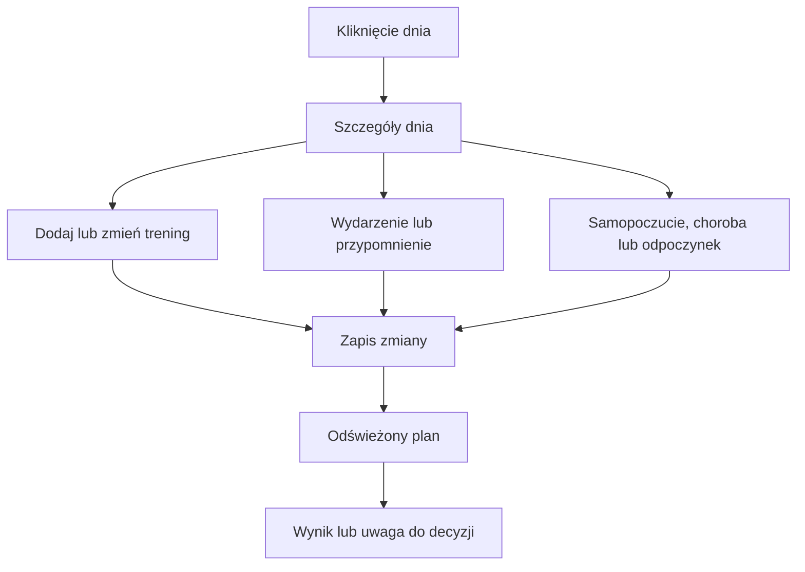

# Wpisy i zmiany dnia w Kalendarzu

Kliknięcie dnia w Kalendarzu otwiera szczegóły. Możesz dodać trening, wydarzenie, przypomnienie, ocenę samopoczucia albo oznaczyć dzień jako odpoczynek, brak czasu lub chorobę. Te wpisy przekazują Trenerowi informacje o tym, czego nie widać w samych aktywnościach.

## Po co

Dodaj wydarzenie, gdy wiesz, że danego dnia masz zajęty czas. Zgłoś chorobę lub samopoczucie, jeśli ma wpływać na plan. Używaj odpoczynku do oznaczenia decyzji o dniu wolnym. Nie wpisuj tych stanów jako zwykłej notatki, jeśli ekran ma do nich osobną akcję.

## Jak działa

1. Wybierz datę w Kalendarzu. Tydzień wybranego dnia zostaje rozwinięty, a panel dnia pokazuje zaplanowane sesje i wpisy.
2. Wybierz odpowiednią akcję. Możesz dodać rodzaj treningu lub zapisać zdarzenie, samopoczucie, chorobę albo odpoczynek.
3. Przykład z 12.10–18.10.2026: ekran pokazuje „delegację” 30.09 i „Rest day” 03.10, a przy 17.10 etykietę „wolne”. To różne dni i nie są dowodem na jedną wspólną regułę planowania.
4. Po zapisie kalendarz odświeża dane. Jeżeli na ekranie pojawi się alert lub oczekująca zmiana, przeczytaj opis i dopiero wtedy zatwierdź lub cofnij.
5. Zmiana dnia z przycisku Telegrama również uruchamia akcję kalendarzową; nie jest tylko odpowiedzią tekstową.

18.10.2026 zmieniono obsługę kliknięcia dnia, gdy istnieje oczekująca zmiana. Wpis z trasą w Kalendarzu zastępuje ręczną jazdę, aby uniknąć dwóch wpisów tej samej jazdy. W oknie treningu dostępne jest pole Trasa. Szczegółowy przykład liczbowy nowego zachowania nie został odczytany z bazy.

## Jak czytać

Zwróć uwagę, czy element oznacza plan, wykonanie czy wydarzenie. W legendzie pod kalendarzem zielony znacznik jest użyty dla wykonanego planu, kreskowany obrys dla zaplanowanej sesji, a niebieski dla wydarzenia. Dzień wolny nie jest treningiem o zerowym czasie, a choroba jest ograniczeniem wpływającym na plan.

Ocena samopoczucia ma kilka stopni od gorszego do lepszego. Zapis jest przypisany do konkretnego dnia; jeśli chcesz usunąć ocenę, wybierz opcję usunięcia w panelu, zamiast dopisywać przeciwną notatkę. Choroba jest osobnym wpisem, więc warto podać jej właściwy okres. Nie zakładaj, że jedna ocena dnia zastępuje dłuższy wpis choroby.

Po zapisaniu zmian sprawdź, czy odświeżony plan odpowiada nowemu wpisowi. Przykład z ekranu: sobota 17.10.2026 jest oznaczona jako „wolne”, a niedziela 18.10 zawiera jazdę. To dwa różne typy informacji.

## Ograniczenia i pułapki

Nie wszystkie edytory są widoczne bez otwarcia panelu dnia. Zrzut przedstawia kalendarz w stanie zamkniętym, więc nie potwierdza każdego pola formularza. Zmiana wpisu może spowodować przeliczenie planu tygodnia.

W widoku 12.10–18.10 niedziela zawiera jazdę z trasą, a sobota jest oznaczona jako wolna. Gdy plan pojawia się w dniu zajętym, sprawdź najpierw wydarzenia, a potem powtarzalne reguły dostępności. Jednorazowy wpis i stała reguła godzinowa pełnią różne role.

## Wpływa na / Zależy od

Wpisy mogą ograniczać dostępne dni, zmieniać gotowość używaną przez plan lub dodawać wydarzenie. Kalendarz zależy od zapisanych wpisów oraz planu i wykonanych aktywności.

## Powiązane hasła

- [Kalendarz](kalendarz.md)
- [Dostępność](dostepnosc.md)
- [Gotowość](gotowosc.md)
- [Plan tygodnia](plan-tygodnia.md)
- [Powiadomienia](powiadomienia.md)

## Zrodla

- `/opt/qbot/web/public/kalendarz3.js` — panel dnia i akcje wpisów.
- `/opt/qbot/web/public/trener.js` — zmiany sesji, samopoczucie i odświeżanie tygodnia.
- `qbot_trener_engine.py` — `day_info`, ograniczenia kalendarza i `build_context`.
- `qbot_v2.calendar_entry` — wpisy dnia.
- `docs/TRENER.md` — edycja dnia i samopoczucie.
- `/opt/qbot/web/public/kalendarz3.js` — klik dnia, oczekująca zmiana i pole trasy.
