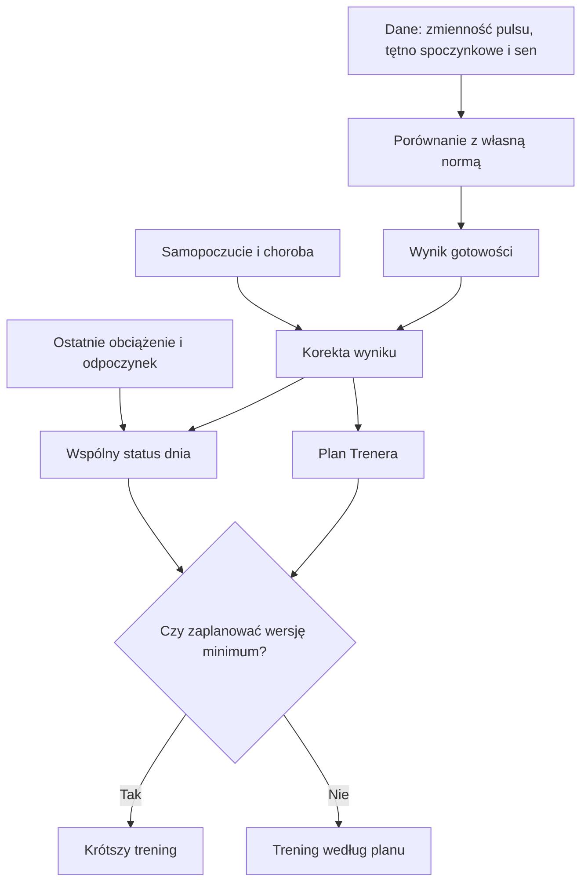

# Gotowość

Gotowość to jeden z sygnałów wykorzystywanych przy planowaniu treningu. [HRV](../slowniczek.md#hrv) (zmienność odstępów między uderzeniami serca) jest jednym z pomiarów wejściowych. Trener porównuje dzisiejszy wynik z Twoją własną historią i może skrócić trening do wersji minimum.

## Skąd dane

Sygnały pochodzą z pomiarów snu, zmienności rytmu serca ([HRV](../slowniczek.md#hrv), czyli zmian odstępów między uderzeniami) i tętna spoczynkowego. Dochodzi do nich zgłoszone samopoczucie lub choroba oraz ostatnie obciążenie treningowe. Progi i normy są osobiste.

## Jak liczone

1. QBot porównuje medianę z ostatnich trzech dni dla HRV, tętna spoczynkowego i snu z własną normą z poprzednich 60 dni. Każdy sygnał zamienia na odchylenie od tej normy.
2. Łączy dostępne sygnały: HRV ma wagę 40%, tętno 35%, sen 25%. Gdy brakuje jednego pomiaru, pozostałe są przeliczane do pełnej wagi.
3. Samopoczucie i zgłoszona choroba mogą zmienić wynik. Trener patrzy też na średnią gotowość z trzech dni, tętno z siedmiu dni, niedawną infekcję i skok obciążenia.
4. Osobny próg Trenera jest domyślnie 15. percentylem dostępnych wyników z ostatnich 365 dni. Wspólny status dnia ma pierwszeństwo. Bez tego statusu wynik poniżej progu może uruchomić krótszą wersję treningu.
5. Przykład z bazy z 18.10.2026: wynik obiektywny wynosił −0,962, po korekcie −1,112, a próg wynosił −0,719. Wspólny status dnia miał jednak wartość „w normie”, więc sam odczyt progu nie przesądzał o skróceniu treningu.

Krok 1 na tym przykładzie: −1,112 jest niższe niż −0,719. Krok 2: tego dnia wspólny status był „w normie”. Krok 3: status ma pierwszeństwo, więc sama nierówność nie wystarcza, by stwierdzić, że plan powinien zostać skrócony. To rozróżnienie widać w bieżącej regule silnika.

Wzór

Wynik podstawowy to średnia ważona dostępnych odchyleń: HRV × 0,40, tętno spoczynkowe × 0,35 i sen × 0,25. Wyższe tętno spoczynkowe działa w przeciwnym kierunku. Wartość skorygowana uwzględnia zgłoszone samopoczucie i chorobę. Próg Trenera to element o indeksie 15% po uporządkowaniu wyników z poprzedniego roku.

## Gdzie to widać

W tygodniowym planie Trenera komunikat o wersji minimum pojawia się przy dniu, którego dotyczy. Można też ręcznie oznaczyć dzień jako lżejszy.

## Jak czytać

Wartość niższa od progu jest ostrzeżeniem dla planu, nie diagnozą medyczną. Jeśli wspólny status dnia jest już dostępny, to on ma pierwszeństwo przed samym progiem. Gorsza jedna noc nie musi więc samodzielnie zmienić treningu.

## Ograniczenia i pułapki

Brak wystarczającej historii pomiarów może uniemożliwić obliczenie wyniku lub progu. Ręczna korekta dnia także zmienia plan.

Na zrzucie Kalendarza stan „zmęczony” jest etykietą dnia, a nie rozpoznaniem choroby. Gdy rano widzisz taką etykietę, sprawdź uwagę oraz dzisiejszy trening. Jeśli czujesz się źle, zapisz chorobę w Kalendarzu; opisuje to [edycja dnia](edycja-dnia.md).

## Wpływa na

- Długość lub wersję treningu w danym dniu.

## Zależy od

- Danych gotowości oraz progu z ustawień Trenera.

## Powiązane hasła

- [Plan tygodnia](plan-tygodnia.md)
- [Kalendarz](kalendarz.md)
- [Gotowość w Formie](../forma/gotowosc.md)

## Zrodla

- `qbot_trener_engine.py` — `build_context`, `readiness_today`, `readiness_threshold`.
- `/opt/qbot/web/public/trener.js` — `drawWeek`, ostrzeżenie o wersji minimum.
- `/opt/qbot/app/fitmodel/readiness.py` — `compute_readiness`, korekta wyniku o samopoczucie i chorobę.
- `/opt/qbot/app/fitmodel/day_status.py` — składowe i reguły wspólnego statusu dnia.
