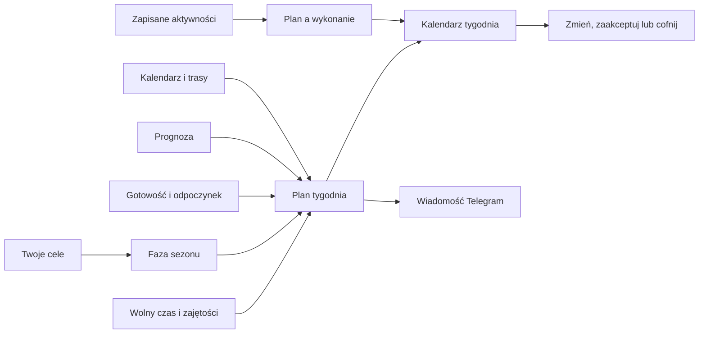

# Trening i Trener

To jest przewodnik po stronie Trening. Widzisz na niej plan tygodnia, cele, pory treningu i podsumowanie obciążenia. Kalendarz zbiera plan oraz wykonane jazdy, a zakładka Plan pokazuje fazy roku. Plan jest propozycją: możesz go zmienić, zatwierdzić zmianę albo ją cofnąć.

## Po co

Rano sprawdź plan dnia, wolny czas i uwagę o pogodzie. Jeżeli obciążenie wygląda inaczej niż oczekujesz, otwórz szczegóły tygodnia. Trening zaplanowany i wykonany mogą mieć różne czasy oraz punkty obciążenia. Przeczytaj o tym w [planie tygodnia](plan-tygodnia.md) i [XSS](xss.md).

## Droga przez dział

## Jak przejść od ekranu do hasła

Na zrzucie zaznaczony jest październik 2026. Rozwinięty tydzień obejmuje poniedziałek 12.10–niedzielę 18.10.2026. Kafelki dni pokazują rodzaj i czas sesji, planowane lub rzeczywiste XSS (punkty obciążenia), samopoczucie, pogodę i masę. U góry znajdziesz podsumowanie miesiąca, tygodniowe godziny, XSS, cel sezonu i przycisk przeliczenia tygodnia.

| Co widzisz na ekranie | Gdzie szukać wyjaśnienia |
|---|---|
| Miesiąc, strzałki, przycisk „dziś” i kafelki dni | [Kalendarz](kalendarz.md) |
| Liczba treningów, kilometry i XSS przy nazwie miesiąca | [Kalendarz](kalendarz.md), [XSS](xss.md) |
| Pogoda w kafelku dnia | [Korekta pogodowa](korekta-pogodowa.md) |
| Ocena „zmęczony”, „neutralny”, „świeży” | [Gotowość](gotowosc.md), [edycja dnia](edycja-dnia.md) |
| Sen i masa u dołu komórki dnia | [Gotowość](gotowosc.md), [Bilans i masa ciała](bilans-waga.md) |
| Przycisk „przelicz tydzień” | [Plan tygodnia](plan-tygodnia.md) |
| „Plan / zrobione”, obciążenie i cel z sezonu | [Plan tygodnia](plan-tygodnia.md), [XSS](xss.md), [Sezon](sezon.md) |
| Ostrzeżenie po prawej od kafelków | [Edycja dnia i uwagi](edycja-dnia.md) |
| „Szczegóły tygodnia”, „Poproś Trenera”, „Weryfikacja [AI](../slowniczek.md#ai-sztuczna-inteligencja) (sztucznej inteligencji)” | [Plan tygodnia](plan-tygodnia.md) |
| Zielony trening i kreskowany plan | [XSS](xss.md), [Plan tygodnia](plan-tygodnia.md) |
| Obciążenie po treningu siłowym lub na wioślarzu | [Siła i wioślarz](sila-wioslarz.md), [Ćwiczenia i ściąga](cwiczenia-sciaga.md) |
| „Sezon — Roztrenowanie” | [Sezon](sezon.md) |
| „Bil. −583” i wartości kalorii | [Bilans i masa ciała](bilans-waga.md) |
| Pogoda i poranna propozycja zmiany | [Korekta pogodowa](korekta-pogodowa.md) |
| Trening „Rembertów” z kilometrami | [Trasy w treningu](trasy.md) |

## Przykład z ekranu i bazy

W tygodniu 12.10–18.10.2026 zrzut pokazuje 6,7 godziny planu i 6,6 godziny wykonania oraz cel sezonu 5 godzin. To podsumowanie zrzutu, a nie stałe normy. Odczyt bazy potwierdził między innymi jazdę 14.10: plan 60 minut i 57 XSS, wykonanie 60 minut i 64,5 XSS. 16.10 plan wynosił 60 minut i 57 XSS; zapisane wykonanie to 67 minut i około 69,7 XSS. Różnicę widać też w podsumowaniu tygodnia.

## Zakładki i ustawienia

Strona ma Kalendarz, Cele i Plan. Dostępność oraz część ustawień znajdują się w Setup → Trening. Na telefonie Kalendarz ma ciaśniejszy układ; znaczenie kolorów i oznaczeń pozostaje podobne. Dawna osobna strona Kalendarza i Trenera przekierowuje do strony Trening.

## Jak czytać

- Zielony znacznik oznacza wykonanie, kreskowany obrys oznacza plan, a niebieski element oznacza wydarzenie. Pomarańczowy wynik poza planem ma podane kilometry, czas i obciążenie. Objaśnienie legendy jest pod kalendarzem.
- Porównuj wartości z tego samego tygodnia i rozróżniaj plan od wykonania. Rzeczywisty zapis może zastąpić plan w części podsumowań.
- Gdy pogoda lub gotowość zgłasza uwagę, potraktuj ją jako informację do decyzji. Sprawdź szczegóły, zanim zmienisz sesję.

## Wpływa na / Zależy od

Plan zależy od celów, fazy sezonu, dostępnych godzin, wydarzeń w Kalendarzu, wcześniejszych treningów, gotowości i prognozy. Zapis wykonanej aktywności może zmienić porównanie z planem. Szczegóły łańcucha opisuje [mapa zależności](../zaleznosci.md).

## Powiązane hasła

- [Kalendarz](kalendarz.md)
- [Plan tygodnia](plan-tygodnia.md)
- [Gotowość](gotowosc.md)
- [Sezon](sezon.md)
- [Dostępność](dostepnosc.md)
- [Cele](cele.md)
- [Korekta pogodowa](korekta-pogodowa.md)
- [Adaptacja wykonania](adaptacja.md)
- [Ćwiczenia i ściąga](cwiczenia-sciaga.md)
- [Powiadomienia](powiadomienia.md)
- [Trasy w treningu](trasy.md)

## Zrodla

- `/opt/qbot/web/public/trening.html` — bieżące zakładki i układ strony.
- `/opt/qbot/web/public/trener.js` — widoki Plan, Cele, podsumowania tygodnia i formularze.
- `/opt/qbot/web/public/kalendarz3.js` — kalendarz miesiąca, rozwijany tydzień i panel dnia.
- `qbot_trener_engine.py` — `build_context`, `plan_week`, fazy sezonu i reguły planowania.
- `qbot_v2.trainer_session` — odczyt planu i wykonania z 12.10–18.10.2026.
- `img/ekrany/trening.png` — zrzut ekranu, indeks w `img/ekrany/indeks.md`.
