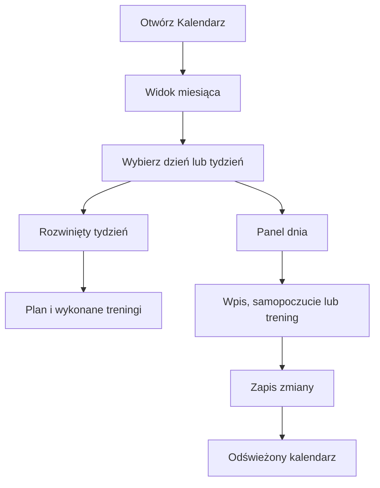

# Kalendarz treningowy

Kalendarz jest zakładką na stronie Trening. Pokazuje miesiąc, a tydzień wybranego dnia rozwija, aby łatwiej zobaczyć plan i wykonane sesje. Kliknięcie dnia otwiera panel z wydarzeniami i treningami. Możesz tam zmienić status sesji lub jej szczegóły.

## Co widać

Karta tygodnia zbiera plan i wykonanie, obciążenie planu, liczbę sesji oraz cel sezonu. Osobny kafel pokazuje ostrzeżenia i zmiany oczekujące na decyzję. W panelu dnia można dopisać wydarzenie, samopoczucie, chorobę lub przypomnienie, dodać trening albo ustawić dzień jako odpoczynek, krótszy lub chorobowy.

Trening wykonany pokazuje dane rzeczywiste, jeśli są dostępne. Przykład z bazy: 11.10.2026 jazda „Neverending Bug” miała 220 minut wykonania i 244,9 XSS; sesja planowana miała 246 minut i 236 XSS. To przykład rozbieżności planu z wykonaniem, nie reguła oceny.

Na zrzucie tygodnia 12.10–18.10.2026 górny kafel pokazuje 6,7 h planu i 6,6 h wykonania, obciążenie planu około 282 XSS, a cel sezonu 5 h. W komórce środy 14.10 widnieje sesja rowerowa. Odczyt bazy potwierdza dla niej plan 60 minut/57 XSS oraz wykonanie 60 minut/64,5 XSS. Liczby górne są sumą tygodnia; nie porównuj ich bezpośrednio z pojedynczą sesją.

Wpis z przypisaną trasą jest prezentowany jako trening rowerowy, a nie jako drugie, osobne wydarzenie tego samego dnia.

## Jak czytać tydzień krok po kroku

1. Spójrz na daty w lewym kaflu tygodnia. Tutaj to poniedziałek 12.10–niedziela 18.10.2026. Tydzień zawsze zaczyna się w poniedziałek.
2. Porównaj „Plan / zrobione”: 6,7 / 6,6 h. Pierwsza liczba opisuje plan, druga wykonanie.
3. „Obciążenie (plan)” pokazuje około 282 XSS, czyli punkty obciążenia. Nie jest to czas w godzinach.
4. Wybierz dzień, aby otworzyć szczegóły i rozróżnić plan, wykonanie i wydarzenia. Przykładowo środa 14.10 ma plan 60 min/57 XSS i zapis 60 min/64,5 XSS.
5. Jeśli podsumowanie pokazuje uwagę, rozwiń szczegóły tygodnia i przeczytaj jej treść. Kafelek dnia może pozostać planem mimo widocznej zmiany do rozpatrzenia.

Wiersze kalendarza biegną od poniedziałku do niedzieli. Poza wybranym tygodniem widok może pokazać przygaszone dni poprzedniego lub następnego miesiąca. Nie traktuj ich jako dnia z bieżącego tygodnia tylko dlatego, że widać je obok. Kliknięcie daty zmienia wybrany tydzień i panel szczegółów.

Przy odczycie liczby na dole komórki zachowaj rozróżnienie: podpis snu i masa odnoszą się do dnia, a nie do długości sesji. Podsumowanie miesięczne u góry obejmuje szerszy zakres niż rozwinięty tydzień.

## Ograniczenia i pułapki

Widok Kalendarz zastąpił wcześniejsze osobne widoki „Miesiąc” i „Tydzień”. Starszy opis projektu o osobnej zakładce Tydzień jest w tym punkcie nieaktualny.

## Wpływa na

- Zapis dnia, zmiana sesji i dodanie trasy mogą spowodować przeliczenie planu.

## Zależy od

- API Kalendarza i API Trenera; wykonane aktywności pochodzą z danych treningowych.
- Wpisy ręczne i trasy opisuje [edycja dnia](edycja-dnia.md) oraz [trasy w treningu](trasy.md).

## Powiązane hasła

- [Plan tygodnia](plan-tygodnia.md)
- [Trasy w treningu](trasy.md)
- [Powiadomienia](powiadomienia.md)

## Zrodla

- `/opt/qbot/web/public/kalendarz3.js` — montaż Kalendarza, panel dnia, połączenie wydarzenia z planem.
- `/opt/qbot/web/public/trener.js` — podsumowania i edycja sesji.
- `qbot_trener_engine.py` — `build_context`, sesje i wpisy tras.
- `qbot_v2.trainer_session` — przykład wykonania z 11.10.2026.
