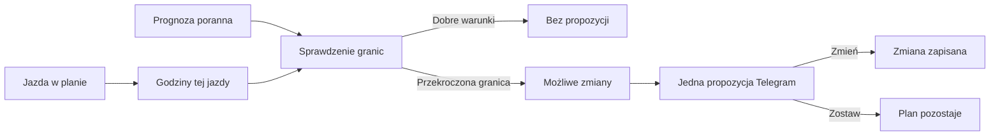

# Poranna korekta treningu przez pogodę

[XSS](../slowniczek.md#xss) (punkty opisujące obciążenie treningu) to jedna z liczb pokazywanych przy sesji. Poranna wiadomość może zaproponować zmianę jazdy, gdy prognoza na zaplanowaną godzinę wskazuje trudne warunki. To propozycja, którą możesz przyjąć lub odrzucić. Wiadomość może też zawierać samo ostrzeżenie dla jazdy dodanej ręcznie.

## Po co

Użyj tej funkcji, gdy plan jest już zapisany, a poranna prognoza zmieniła się na niekorzystną. Sprawdź godzinę, deszcz, wiatr i temperaturę odczuwalną. Przyciski zmiany i pozostawienia planu są decyzją użytkownika.

## Jak działa

1. Rano system pobiera prognozę dla ustawionego miejsca i sprawdza godziny konkretnej sesji. To węższe okno niż przegląd pogody używany przy układaniu tygodnia.
2. Przykładowe domyślne granice kodu: wiatr 8 m/s, porywy 13 m/s, deszcz powyżej 0,5 mm/h przy prawdopodobieństwie co najmniej 40%. Dla krótszej jazdy próg wiatru ma dodatkowy zapas 2 m/s, a próg porywów 3 m/s. Lasy mają osobny dodatek do limitu wiatru.
3. Jeżeli warunki przekroczą granicę, system szuka propozycji: przesunięcia godziny, przeniesienia jazdy, skrócenia albo zamiany na trening w domu. Wybór zależy od wolnego czasu i ustawień.
4. Przykład z Kalendarza 18.10.2026: zaplanowana jazda „Rembertów” miała 163 minuty i 156 XSS w planie. Sam zrzut nie dowodzi, że dla tej jazdy wystąpiła propozycja pogodowa.
5. Przyciskiem „Zmień” przyjmujesz propozycję. „Zostaw” usuwa tę propozycję bez zmiany planu.

## Jak czytać

Próg to ustawienie, a nie gwarancja bezpieczeństwa. Prognoza może się mylić i lokalne warunki mogą być inne. Sprawdź ją przed wyjazdem. Jeżeli widzisz tylko ostrzeżenie, nie zakładaj, że plan został automatycznie zmieniony.

Granice temperatury odczuwalnej również są ustawieniami: domyślnie krótka jazda ma próg −10°C, a długa 0°C. Opad jest sprawdzany wraz z prawdopodobieństwem, więc sama wartość deszczu nie wystarcza. Śnieg ma domyślną granicę 10 cm. Te wartości opisują regułę programu, nie indywidualną ocenę warunków dla każdego rowerzysty.

## Ograniczenia i pułapki

Wartości graniczne mogą być zmienione w ustawieniach Treningu. Plan tygodnia ma odrębną reakcję na pogodę; zapasowe opcje konfigurowane do porannej korekty nie są automatycznie tym samym co zachowanie planera.

Jeśli nie pojawi się wiadomość, nie wyciągaj wniosku, że pogoda została sprawdzona i uznana za dobrą. Mogło brakować prognozy, miejsca lub należnej sesji. Sesje w pomieszczeniu są pomijane przez kontrolę porannej propozycji. > DO SPRAWDZENIA: czy wiadomość pogodowa dla tej lub innej sesji została doręczona i jaką odpowiedź wybrał właściciel. Zrzut potwierdza plan jazdy „Rembertów” 18.10, ale nie wiadomość.

## Wpływa na / Zależy od

Korekta wpływa na konkretną sesję i jej dzień/godzinę, jeżeli zaakceptujesz propozycję. Zależy od zapisanej sesji, miejsca, prognozy, dostępności i ustawień progów.

## Powiązane hasła

- [Plan tygodnia](plan-tygodnia.md)
- [Dostępność](dostepnosc.md)
- [Powiadomienia](powiadomienia.md)
- [Prognoza pogody](../pogoda/prognoza.md)

## Zrodla

- `qbot_trener_weather.py` — poranna propozycja pogody i dostępne warianty.
- `qbot_trener_engine.py` — `wx_bad`, granice pogodowe i planowanie sesji.
- `qbot_trener_notify.py` — przyciski korekty i obsługa odpowiedzi.
- `docs/TRENER.md` — „Pogoda rano: propozycja korekty”, stan z 12.10.2026.
