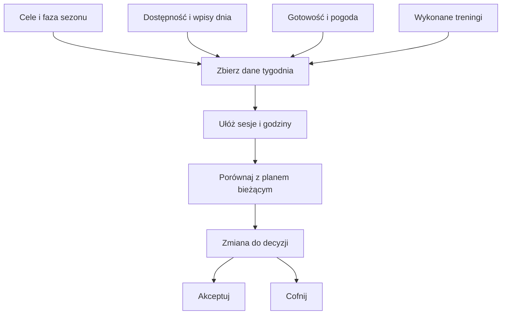

# Plan tygodnia

Silnik układa sesje na podstawie celów, fazy sezonu, dostępnych godzin, wydarzeń w Kalendarzu, wcześniejszych treningów, gotowości i pogody. [XSS](../slowniczek.md#xss) (punkty opisujące obciążenie treningu) pomaga porównać plan z wykonaniem. Przeliczenie dotyczy automatycznych treningów, które nadal są zaplanowane; treningi ręcznie zmienione, wykonane lub pominięte są zachowywane. Po zmianie możesz ją zaakceptować albo cofnąć.

## Jak liczone

1. Silnik zbiera kontekst tygodnia, w tym reguły dostępności, wydarzenia oraz aktywności.
2. Rozdziela sporty i czas według fazy sezonu oraz ustawionego miksu miesiąca.
3. Uwzględnia ograniczenia dnia, pogodę i przerwy po ciężkim wysiłku.
4. Wylicza obciążenie planu w XSS. Jeśli jazda została dopasowana do wykonanej aktywności, do dalszych obliczeń bierze rzeczywisty czas i XSS.
5. Zmiany widać przed zatwierdzeniem; przyciski „Akceptuj” i „Cofnij” rozstrzygają zmianę.

W przykładzie z 14.10.2026 plan wynosił 60 min i 57 XSS, a wykonanie 60 min i 64,5 XSS. Krok porównania to 64,5 − 57 = 7,5 XSS. To nie przekroczyło domyślnej adaptacyjnej granicy 15 XSS. Dla 16.10: 69,7 − 57 = około 12,7 XSS; również poniżej 15. Oba przykłady pochodzą z bazy.

Przykład z bazy: 16.10.2026 plan zakładał 60 minut jazdy i 57 XSS. Wykonanie trwało 67 minut i miało 69,7 XSS. Różnica obciążenia to 12,7 XSS. Kod używa progu skonfigurowanego jako `adapt.xss_delta` (domyślnie 15 punktów) do reakcji adaptacyjnej; samo oznaczenie „więcej/mniej niż plan” ma osobną granicę 10% czasu albo obciążenia.

## Co zrobić przy zmianie planu

Najpierw sprawdź, którego dnia i sesji dotyczy zmiana. W tygodniu 12.10–18.10.2026 widoczne są plan 6,7 h, wykonanie 6,6 h oraz około 282 planowane XSS. Te trzy liczby opisują różne podsumowania. Dla środy 14.10 baza potwierdza plan 60 min i 57 XSS oraz wykonanie 60 min i 64,5 XSS.

Jeśli proponowana sesja nie pasuje do Twojego dnia, edytuj ją albo wpisz ograniczenie w Kalendarzu. Jeśli po przeliczeniu pojawi się oczekująca zmiana, zaakceptuj ją tylko po przeczytaniu szczegółów. W razie pomyłki użyj cofnięcia, o ile dana zmiana nadal ma taką możliwość. Przy zmianie celu najpierw sprawdź [cele](cele.md) i [sezon](sezon.md), bo mogą wpływać na kilka następnych tygodni.

## Ograniczenia i pułapki

Pogoda używana przy układaniu planu nie jest tym samym co poranna propozycja korekty. Wpis z trasą w Kalendarzu jest osobnym źródłem planowanej jazdy. Bieżąca reguła ogranicza adaptacyjne przeliczenie do nierozpatrzonych sesji z ostatnich trzech dni; starszy opis projektu może sugerować szerszy zakres.

Na ekranie kliknij „przelicz tydzień” tylko wtedy, gdy chcesz odświeżyć plan na podstawie aktualnych danych. Przy oczekującej zmianie otwórz szczegóły tygodnia, przeczytaj powód i wybierz akceptację lub cofnięcie. Szczegóły reakcji na wykonaną jazdę opisuje [adaptacja](adaptacja.md), a porannej pogody [korekta pogodowa](korekta-pogodowa.md).

## Wpływa na

- Treningi, sumę czasu i XSS tygodnia, odpoczynek oraz propozycje zmian.

## Zależy od

- [Sezonu](sezon.md), [dostępności](dostepnosc.md), [gotowości](gotowosc.md), [XSS](xss.md), Kalendarza i pogody.

## Powiązane hasła

- [Kalendarz](kalendarz.md)
- [Trasy w treningu](trasy.md)
- [Powiadomienia](powiadomienia.md)

## Zrodla

- `qbot_trener_engine.py` — `build_context`, `plan_week`, `deviation`.
- `qbot_trener_ops.py` — dopasowanie wykonania i `refresh_real`.
- `qbot_trener_notify.py` — `adapt_check`.
- `/opt/qbot/web/public/trener.js` — `rWeek`, `drawWeek`.
- `qbot_v2.trainer_session` — przykład z 16.10.2026.
