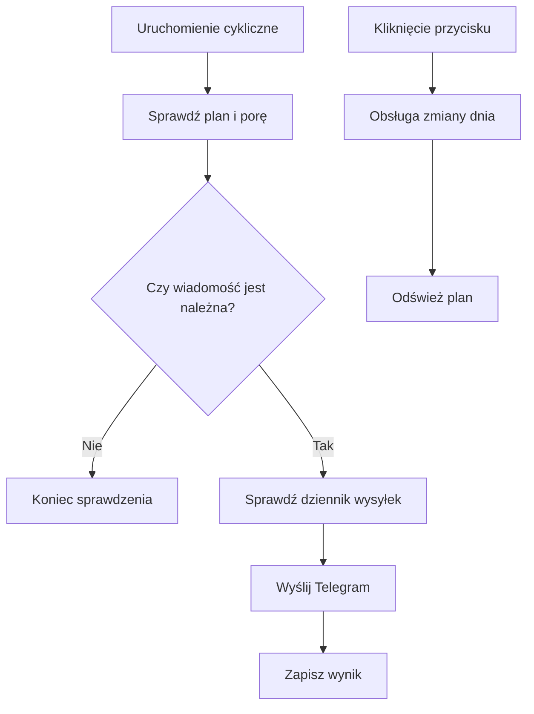

# Powiadomienia Trenera

Trener może wysyłać wiadomości na Telegram o planie tygodnia i treningu dnia. Automat sprawdza zadania cyklicznie, zapisuje wysyłki w dzienniku, aby ograniczać duplikaty, i udostępnia przyciski do szybkiej zmiany dnia.

## Kiedy

Powiadomienia obejmują między innymi podsumowanie tygodnia w niedzielę wieczorem oraz wiadomość dnia rano lub przed treningiem. Ustawienia sterują rodzajem i porą. Sprawdzenie uruchamia się co 15 minut; pojedynczy przebieg ustala, czy wiadomość jest należna właśnie teraz.

Wiadomość dnia ma przyciski REST DAY, „Brak czasu” i „Choroba”. Kliknięcie nie jest tylko odpowiedzią tekstową: uruchamia akcję Kalendarza/Trenera.

## Jak odczytać wiadomość

Wiadomość o tygodniu opisuje plan na kilka dni, a wiadomość dnia dotyczy konkretnej daty. Przyciski „REST DAY”, „Brak czasu” i „Choroba” zmieniają stan dnia przez akcję Trenera. Nie klikaj ich jako zwykłego potwierdzenia odbioru, jeśli nie chcesz zmieniać planu.

Harmonogram sprawdza, czy pora wysyłki nadeszła; nie wysyła każdego rodzaju wiadomości w każdym przebiegu. W poprzednim odczycie pięć ostatnich zapisów wysyłki z 16–18.10.2026 miało wynik powodzenia. Taki zapis nie dowodzi, że Telegram wyświetlił wiadomość na telefonie.

Jeżeli nie widzisz wiadomości, sprawdź plan w Kalendarzu. Brak wiadomości nie jest potwierdzeniem, że dzień jest wolny ani że wiadomość dotarła. Zmiany dnia opisuje [edycja dnia](edycja-dnia.md).

Jeżeli dostaniesz propozycję korekty pogody, sprawdź nazwę sesji i proponowany dzień. Odpowiedź „Zostaw” usuwa propozycję; nie zapisuje drugiej sesji. Przyciski dnia mogą wywołać inny rodzaj zmiany, dlatego przed kliknięciem przeczytaj ich etykiety. Zobacz osobne hasła o [korekcie pogodowej](korekta-pogodowa.md) i [edycji dnia](edycja-dnia.md).

Wiadomość tygodniowa może przyjść w niedzielę wieczorem, a wiadomość dzienna w godzinach skonfigurowanych dla tego rodzaju przypomnienia. Nie podaję godziny każdego powiadomienia, bo zależy ona od ustawień właściciela. Harmonogram sprawdza je co 15 minut, ale nie oznacza to wysyłki co 15 minut.

## Ograniczenia i pułapki

Crontab odczytany 18.10.2026 uruchamia sprawdzanie co 15 minut. Pięć ostatnich wpisów według czasu wysyłki z 16–18.10.2026 ma `ok=true`; oznacza to, że kod zapisał powodzenie, nie potwierdzenie dostarczenia na ekranie telefonu.

Praktycznie: wiadomość z planem tygodnia jest podsumowaniem, a wiadomość dnia daje przyciski do szybkiej zmiany. Jeśli klikniesz „Brak czasu” lub „Choroba”, zmienia się zapis dnia i plan może zostać odświeżony. Przy korekcie pogody wybory „Zmień” i „Zostaw” opisano osobno w [porannej korekcie](korekta-pogodowa.md).

## Wpływa na

- Powiadomienia właściciela oraz akcje dnia wywołane z Telegrama.

## Zależy od

- Planu, ustawień `notify.*`, konfiguracji Telegrama i dziennika wysyłek.

## Powiązane hasła

- [Plan tygodnia](plan-tygodnia.md)
- [Kalendarz](kalendarz.md)

## Zrodla

- `qbot_trener_notify.py` — `tick`, `day_buttons`, `send`, `handle_callback`.
- `qbot_v2.trainer_notify_log` — dziennik deduplikacji.
- `docs/TRENER.md` — opis harmonogramu oraz API podglądu.
