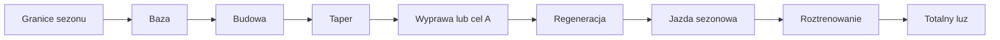

# Sezon treningowy

Sezon Trenera porządkuje rok w fazy o różnej docelowej objętości. Początek sezonu jest wyznaczany automatycznie jako pierwszy dzień roboczy po okresie świątecznym, ale granice faz można zmienić. Cele wypraw o priorytecie A wpływają na plan bazy, taperu i regeneracji.

## Jak liczone

Silnik wylicza tygodnie sezonu. Domyślny początek sezonu Y to pierwszy dzień roboczy po 27 grudnia roku Y−1, z pominięciem weekendu, 1 stycznia i 6 stycznia. Bez celu A koniec bazy przypada domyślnie 28 lutego, ale nie wcześniej niż po sześciu tygodniach od startu. Przy celu A baza kończy się w okolicy dziesięciu tygodni przed nim. Roztrenowanie zaczyna się domyślnie 1 października albo po regeneracji po ostatnim celu A. Totalny luz zaczyna się 12 grudnia.

Są to wartości automatyczne. Zakładka Sezon pozwala zmienić początek, koniec bazy, początek roztrenowania i luz dla danego roku. Pozostałe suwaki ustawiają między innymi długość taperu, regeneracji i częstotliwość lżejszych tygodni.

Przykład odczytu z ekranu 18.10.2026: oznaczenie sezonu to „Roztrenowanie”, a cel tygodnia wynosi 5 h. Są to wartości pokazane dla tego widoku. Nie należy wyliczać ich z samej daty: granice mogą być ręcznie zmienione, a cele A mogą przesunąć fazy. Krok po kroku: odczytaj nazwę fazy; odczytaj cel godzinowy; porównaj go z planem/zrobione w kafelku tygodnia; dopiero potem oceniaj, czy liczby odnoszą się do tego samego okresu.

## Gdzie to widać

Zakładka Sezon pokazuje tygodnie jako fazy i szacowaną objętość. W Kalendarzu tygodniowy kafel „Cel z Sezonu” pokazuje docelową liczbę godzin.

## Jak sprawdzić fazę na ekranie

1. Odczytaj nazwę fazy w pomarańczowym znaczniku nad kalendarzem. Na zrzucie z 18.10.2026 widnieje „Roztrenowanie”.
2. Odczytaj „Cel z Sezonu”. W tym tygodniu wynosi 5 h.
3. Porównaj z planowanym czasem tygodnia: ekran pokazuje 6,7 h planu. To różne wartości, więc nie zakładaj, że cel 5 h jest sumą wykonania albo liczbą jazd.
4. Jeśli faza nie pasuje do Twojego kalendarza startów, sprawdź wpisy celów i ustawione granice sezonu. Nie koryguj jej na podstawie samej nazwy miesiąca.

Sezon może obejmować kilka faz: bazę, budowę, taper, wyprawę, regenerację, jazdę sezonową, roztrenowanie i czas luzu. Taper i regeneracja mają domyślnie po 2 tygodnie, lżejszy tydzień wraca co 4 tygodnie, a domyślna objętość celu wynosi 5 h. To wartości bazowe, które mogą być nadpisane. Wartość celu sezonu 5 h na zrzucie 18.10.2026 nie dowodzi, że wszystkie ustawienia pozostały domyślne.

## Ograniczenia i pułapki

Starszy opis projektu nie obejmuje części bieżących reguł. Występują także fazy „totalny luz” oraz „sezon — jazda”.

Gdy ekran pokazuje „Roztrenowanie”, nie oznacza to wyłączenia planu: zrzut 18.10.2026 nadal zawiera zaplanowane sesje w tym tygodniu. Faza zmienia docelową objętość i miks, nie usuwa automatycznie aktywności.

## Wpływa na

- Docelowe godziny i miks treningów w kolejnych tygodniach.

## Zależy od

- Daty i nadpisań sezonu oraz aktywnych celów wypraw.

## Powiązane hasła

- [Plan tygodnia](plan-tygodnia.md)
- [Dostępność](dostepnosc.md)
- [Trasy w treningu](trasy.md)

## Zrodla

- `qbot_trener_engine.py` — `first_workday_after_xmas`, `season_bounds`, `season_of`, `season_weeks`.
- `/opt/qbot/web/public/trener.js` — `rSeason`, `drawSeason`.
- `/opt/qbot/web/public/kalendarz3.js` — kafel podsumowania tygodnia.
- `docs/TRENER.md` — opis API `/season`.
